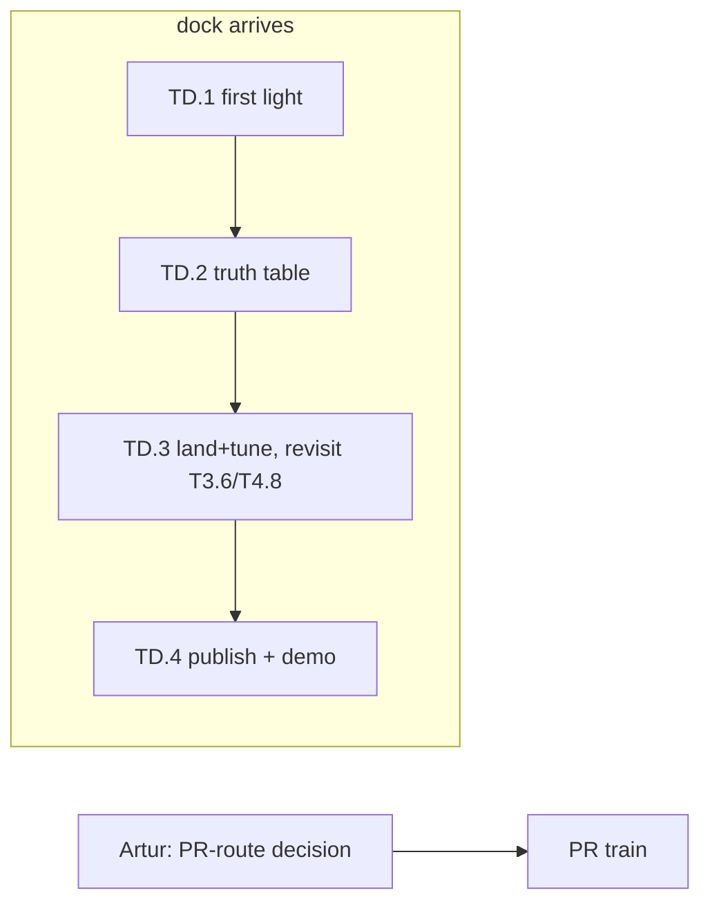

# TASKS.md — agent handoff for the Ampere-over-Thunderbolt effort

> **RESUME HERE (2026-09-17 01:40):** read `HANDOFF_2026-09-17.md` (entry point), then `HANDOFF_2026-09-13.md` §5d/§5e. Standing = Q4_0 @262144, `NV_ATTN_WMMA=1` (T4.113), `STATE_CACHE_TOOL_SNAPSHOTS=0`, Hermes compaction at 131072; Ornith-1.5-9B Q5_K_M on :8082 (LaunchAgent), Ling on demand. master == integration/t6 (PR #46, 018532163). Ops: `~/Documents/tinygrad-bench-data/RUNBOOK.md`, `healthcheck.sh`. Open: T4.93b (needs Artur's prompts), T4.94b (parked), BEAM refresh, WMMA levers (`NV_ATTN_WMMA_DSPLIT=2`, per-kv-head variant), the held macOS 15.8 update.
>
> **Next arc (drafted 2026-09-09, done by 09-13):** T4.91 `reasoning_effort` passthrough (every think:on request has run at the template default xhigh) → T4.92 model-card sampler defaults + presence penalty → T4.93 the 27B on the 3090 ALONE at 4-bit (measure first) → T4.94 MTP on that build. Entries at the end of the T4 section. **2026-09-10: all of the above is on master (43ac66739 == integration/t6). T4.93 measured and parked (K-quant 5.4 / Q4_0 6.9 tok/s: the generated gemv kernels cap every quant). NOW: T4.98 (hand-written NV quantized gemv, 6 subtasks, agents running), T4.99 host snapshots, T4.93b quality gate. Hermes/server deliberately DOWN for the experiments (Artur 09-10: \"Don't hesitate to stop it\").**

Task breakdown of `NV_LLM_DESIGN.md` (WS refs point there; context in `memory.md` — read both first).
Baseline `af2a43c85`; rebase on upstream master weekly. Written 2026-08-18, while the eGPU dock
(AOOSTAR AG02) was in the mail — **Phase 0 tasks need no NVIDIA hardware at all.**
**Dock + RTX 3090 LIVE 2026-08-24 — TD.1 ✅ + TD.2 ✅ COMPLETE in the first 24 h.**
Best decode config = `DEV=NV` (nvcc) + JITBEAM=2 on every model: llama3.2:1b **149.1 tok/s**
(exceeds the llama.cpp-CUDA 110-130 reference band), qwen3:8b **46.9** (1.73x llama.cpp-Metal),
gpt-oss:20b **60.9** (~4x Metal BEAM). Transport exonerated for decode (TD.2a); T4.14
compile-server bug found+fixed en route (prime PR candidate). **TD.3 CORRECTNESS PROGRAM
COMPLETE (2026-08-25): the FLAGSHIP works — real olmoe graphed METAL+NV MoE pooling, experts
on the 3090, byte-identical, decode 41.1 tok/s split vs 12.9 all-NV (3.2x).** Dense pooling
~80-90 µs/hop; T2.1 (+12% D2H) and T2.2 (2.51x map) validated; three PR-shaped fixes stacked
(T4.14, T4.17, T4.18) + protocol no-free-verb finding for tinygpu_releases. Remaining: BEAM'd
pooling perf rows (bench window), T4.15/T4.16 filler, kernargs pooling (T4.18 headroom),
PR-train route decision.

> **STATUS 2026-08-21 (Phase 0 COMPLETE):** 8 agent waves + 4 bench windows, ~55 tasks closed
> (✅/❌/📋 markers below; the **Status log** is the authoritative record). **All pre-dock code
> work is DONE and measured.** Bench window 4 confirmed T4.13 at real scale: gpt-oss-20b decode
> 1.69 → **10.97 tok/s no-BEAM / 15.52 BEAM** (bytes 59.3 → 3.46 GB/token); long-context gpt-oss
> is now attention-COMPUTE-bound on Metal → sm_86 case. Headline: qwen3:8b METAL decode 7.38
> no-BEAM / 14.40 BEAM vs llama.cpp 27.1. **PR #1 (integration/wave1 → fork master) MERGED** —
> fork `master` (`457e1a915`) now carries all Phase 0 work on top of upstream `b8cc74ecf`.
> Remaining: the on-hold **PR train** (T4.9 → T4.13 → T4.7+T1.8c-fix → T4.2 → T4.1 →
> T1.5/T1.6/T2.1/T2.2; submission gated on Artur's route decision — see memory.md §6 2026-08-20,
> AI disclosure mandatory), optional T2.4 (rented 3090), and the dock (TD.x). Closed pre-dock:
> fused attention (T4.8 final no-go — machinery built, waits for sm_86), Stage B bridge (parked
> for TD.3).

## Conventions for agents

- Branch per task: `task/T<id>-<slug>` **off fork `master`** — now **`0a2fb4cce`** (the PR #5 merge,
  2026-08-26: upstream sync #4 + the complete client-side panic remediation — T4.37 + 40-1/40-2 (T4.40b) +
  40-4 (T4.40a); fork line-cap 27000; `integration/phase1b` retired). No local `master` branch
  exists. **`origin` is the SSH remote and is interactive-only: fetch AND push via the explicit
  HTTPS URL** (`git fetch https://github.com/arttarawork/tinygrad.git master`) or `origin/master`
  will silently sit stale. Retired as bases (content fully in `master`): `integration/wave1`, `integration/phase1b`,
  `task/TD.3-pooling`, `task/T4.27-beam-silent-fallback`, `task/T4.28-integration`. The old
  baselines `af2a43c85` / `457e1a915` / `b37d80fc9` apply only to their era's branches.
  Remotes: `origin` = arttarawork/tinygrad fork, `upstream` = tinygrad/tinygrad.
- Python env (Mac, verified 2026-08-18): no bare `python`; Homebrew python3.14 has no test deps.
  Use `/Users/artur/Documents/tinygrad/.venv` (numpy, torch, pytest+xdist, hypothesis, z3, gguf,
  mypy 1.19.1, ruff 0.14.10). From any checkout/worktree: `PYTHONPATH=. <venv>/bin/python -m ...`.
- Before pushing: `PYTHONPATH=. .venv/bin/python -m pytest <touched area> -x -q -n12`,
  `.venv/bin/python -m mypy tinygrad/`, `.venv/bin/python -m ruff check .`
- **llm-touching work also gets a `DEV=CPU` pass** (CI's Linux default; our METAL-default gates
  missed 3 real failures on PR #1 this way — see the 2026-08-19 fork-CI row).
- **Stagger pushes to `master` and feature branches** — concurrent pushes run two full CI
  matrices at once and starve the fork runners into setup timeouts (post-sync CI lesson).
- **Push the `memory` docs branch (and any unmerged evidence branch) after each session** —
  `git push https://github.com/arttarawork/tinygrad.git memory` — the docs and bench CSVs are
  the un-regenerable part of this project; local-only means one dead laptop loses the record.
- Fork pushes (2026-08-19): use `gh` — `gh auth setup-git` once, then push via explicit HTTPS URL
  (`git push https://github.com/arttarawork/tinygrad.git <branch>`); SSH works only from Artur's
  interactive shell. The gh token LACKS `workflow` scope: pushes touching `.github/workflows/`
  need Artur (or `gh auth refresh -s workflow`). CI logs/reruns: `gh run view --log-failed`,
  `gh run rerun <id> --failed -R arttarawork/tinygrad`. `gh run list --commit` needs the FULL
  40-char SHA — a short SHA silently matches nothing.
- **Worktree agents: use RELATIVE paths for repo files.** Absolute `/Users/artur/Documents/tinygrad/...`
  paths silently resolve to the shared checkout (different branch!) — a T2.5 agent lost time to a
  phantom "stale file" bug this way. Absolute paths are correct only for the venv and model caches.
- Mac resource limits (updated 2026-08-18, after Artur freed ~157 GB): **~179 GB disk free** —
  model downloads are now fine (bench GGUFs go through `tinygrad.llm`'s fetch cache; gpt-oss-20b
  MXFP4 for T1.3 validation OK). **llama-server still keeps ~23 GB wired** (LaunchAgent KeepAlive)
  — before real-model METAL runs / T0.1 benchmarks, stop it: `launchctl bootout gui/501/com.artur.llama-server`
  (restart: `launchctl bootstrap gui/501 ~/Library/LaunchAgents/com.artur.llama-server.plist`).
  **Bench window RETIRED 2026-08-27: llama-server is gone; the pooled server (`~/bin/pooled-serve.sh stop` before, `start` after)
  is what a `DEV=NV` bench run now displaces.**
  **Before stopping, check Hermes isn't mid-scheduled-task**: its 9 auxiliary text tasks
  (compression, triage, …) AND its last-resort fallback provider run on this llama-server —
  both degrade for the whole bench window (~/CLAUDE.md "Hermes wiring" has the details).
  Tiny random-weight configs are fine anytime.
- Perf claims need before/after numbers from the T0.3 harness on named hardware. Upstream-bound
  changes must be small and hand-verified — maintainers have reverted "ai slop" before (see memory.md §4).
- Don't remove the deliberate `.contiguous()` calls in the MoE expert path (`llm/model.py:27,129`).
- `PYTHONPATH=.` when running from the clone.

## Execution environments

| Tag | Meaning |
|---|---|
| `ANY` | pure code; NULL/CPU device is enough (kernel-count and scheduling tests run on `DEV=NULL`) |
| `MAC` | the MacBook M3 Pro — Metal backend, real perf numbers today |
| `AMD` | (descoped 2026-08-18 — see T0.2; kept for the footgun note) the Bazzite box w/ RX 9070 XT. **Never** use the AM/PCI driver path there: it unbinds `amdgpu` and kills the display. |
| `MOCKNV` | NV backend under gpuocelot PTX emulation — functional correctness only, no perf. Recipe (T0.4, verified 2026-08-18): `OCELOT_PATH=.venv/lib/libgpuocelot.dylib DEV=MOCK+NV:PTX PYTHONPATH=. .venv/bin/python -m pytest ...` — the `DEV` string must start with `MOCK` (`device.py:376` never falls back to `MOCKIface` otherwise) and the dylib is CI's prebuilt (`github.com/tinygrad/gpuocelot` release v0.1.0, already at `.venv/lib/`). Do NOT use `extra/setup_mock_nv_osx.sh` (heavy source build + sudo to /usr/local/lib; CI doesn't use it either). Details: `MOCKNV_SETUP.md` on `task/T0.4-mocknv`. |
| `CLOUD3090` | optional: a rented Linux 3090 (vast.ai etc.) runs the same NV backend/kernels via `NVKIface` — real sm_86 perf for kernel work before the dock arrives |
| `DOCK` | AG02 + 3090 arrived 2026-08-23; live once TD.1 first light passes |

## Phase 0 — no dock required

### T0 · Bring-up & baselines

- **T0.1 ✅ — Metal baseline table** `[MAC]` deps: —
  Clone on the Mac; run `python -m tinygrad.llm -m qwen3:8b --benchmark --warmup` (and qwen3.6:27b,
  qwen3-30b-a3b) on `DEV=METAL`, with and without `JITBEAM=2`; same GGUFs through `llama-bench` (Metal).
  *Done when:* a committed CSV/table of load / prefill / decode tok/s for ≥3 models × both stacks.
- **T0.2 — ~~Verify the 9070 XT as an HCQ testbed~~ DESCOPED (2026-08-18)** `[AMD]`
  AMD is not a target; the box was only a real-HCQ stand-in for validating shared `hcq.py` changes
  pre-dock. That role is covered better by `CLOUD3090` (same backend as target, NVKIface) and by
  upstream CI's AMD runners. Revive only if a cheap local HCQ sanity-check ever beats renting.
- **T0.3 ✅ — Bench harness** `[MAC]` deps: T0.1 (WS5.1)
  One script: same GGUF → `tinygrad.llm` + `llama-bench`, emits CSV (model, dev, flags, load s,
  prefill t/s, decode t/s, GB/s from `GlobalCounters`). Validated on Metal now; reused on NV later.
  *Done when:* T0.1's table is reproducible with one command.
- **T0.4 ✅ — Mock-NV bring-up** `[MOCKNV]` deps: —
  Get `DEV=NV` under gpuocelot green for `test/test_tiny.py` locally (Mac or Linux). Document setup
  quirks. This unblocks all NV-touching code tasks pre-dock.
  *Done when:* documented one-shot setup + passing test_tiny.

### T1 · Decode-path kernels & dtypes (WS1) — all measurable on Metal today

- **T1.1a ✅ — fp16 KV cache: implement + accuracy** `[ANY, runnable anytime]` deps: — (WS1.1)
  Explicit KV dtype at `llm/model.py` `_init_state` (default fp16, `KV_F32=1` escape flag); check
  every `_init_state` variant (attention, MLA, SSM conv/state — SSM state may need fp32, decide
  per-block with evidence). Accuracy: greedy-token parity + max logit delta vs fp32 over ≥5 prompts
  on llama3.2:1b (1 GB, fits anytime) AND a recurrent tiny-config. STOP if any family needs
  >1-line special-casing — report instead.
  *Done when:* diff + accuracy table committed; upstream-PR-shaped. Perf is T1.1b, not this task.
- **T1.1b ✅ — fp16 KV: measure decode delta** `[MAC, bench window]` deps: T1.1a, llama-server stopped
  T0.3 harness, qwen3:8b, fp32-KV vs fp16-KV on integration, no-BEAM + JITBEAM=2, long-context
  variant (`-p 4096`) where the KV read dominates. *Done when:* CSV rows + delta in BENCH_NOTES.md.
- **T1.2 ✅ — MATVEC heuristic: see through CAST** `[ANY→MAC]` deps: T0.1 (WS1.2)
  Reproduce the miss: `DEBUG=3` on a fp16/Q4 gemv, confirm no `MATVEC:` line (guard at
  `codegen/opt/heuristic.py:60-78` requires `MUL(INDEX,INDEX)`, real ASTs wrap it in CAST).
  Patch guard, add a kernel-selection unit test (NULL device), measure decode on Metal.
  *Done when:* heuristic fires on fp16+quantized gemvs; no regressions in `test/opt/`.
- **T1.3 ✅ — gpt-oss arch in `tinygrad/llm`** `[MAC]` deps: T0.1 (WS1.6)
  Wire the `gptoss` GGUF arch into `llm/model.py:340-451` + registry (`cli.py:76-94`); MXFP4 dequant
  already exists (`gguf.py:105-114`); training-side reference in `examples/mlperf/`. Validate
  gpt-oss-20b MXFP4 (~12 GB, fits the Mac's wired budget) output vs llama.cpp same-seed greedy.
  *Done when:* `-m gpt-oss:20b` generates correct text on Metal; benchmark row added.
- **T1.4 — Single-kernel MoE top-k — RESOLVED-AS-MEASURED (2026-08-18): premise was wrong.**
  `pairwise_topk` already costs exactly **1** kernel/layer in-model (control experiment on NULL:
  real topk vs free `arange` sel, all gating paths, T=1 and T=8). The scatter+slice+cast lower to
  an inlined select chain; only the rank reduce realizes, and rangeify's `remove_bufferize`
  (rangeify.py:258-282) makes 1 the floor (buffer-reading REDUCE can't inline into a consumer
  reduce). Alternatives (one-hot select, int32 scatter, `Tensor.topk` bitonic) all equal or worse.
  Landed tests-only (+19): exact tie-break equivalence vs numpy stable argsort + kernel-count pin.
  The other ~3 routing kernels/layer are the caller's probs path (gather + softmax stats,
  model.py:124-127) — a different, larger task if ever worth it.
- **T1.5 ✅ — Skip RNG at temperature 0** `[ANY]` deps: — (WS1.5)
  `llm/model.py:358-364`: bypass Gumbel noise when temp==0 without retriggering JIT capture.
  *Done when:* argmax path drops the threefry work; greedy outputs identical.
- **T1.6 ✅ — Cache `_prepare_jit_inputs`** `[ANY]` deps: — (WS2.4-adjacent)
  `engine/jit.py:200-218` re-derives state dicts every call (~0.5 ms/token host). Memoize safely.
  *Done when:* host time/token measurably down on Metal; JIT tests green.
- **T1.7 ❌ — Fused-attention track A: PCONTIG — DEAD END (2026-08-18).** PCONTIG fusion is
  numerically WRONG on multi-pass reduces (masked by the SCACHE bug T4.9 fixed), crashes Metal
  threadgroup limits at real GQA shapes, and sizes on-chip buffers by a symbolic Variable's static
  upper bound (compile crash at real max_context). Evidence: `PCONTIG_ATTN_NOTES.md` (merged).
  Do not wire PCONTIG into tinygrad/llm. Fused attention now routes through T4.7 ✅ → T1.8c → T4.8.
- **T1.8 ✅ — Fused-attention track B: pluggable custom kernel** `[MAC]` deps: T0.1 (WS1.4b)
  Add a clean attention-override hook in `llm/model.py:196` (pattern: `STUB_ATTENTION`,
  `extra/models/llama.py:104-119`; `Tensor.custom_kernel` is tested). Prove it with a naive Metal
  custom kernel; the tuned sm_86 kernel is T2.4/TD-side.
  *Done when:* hook merged behind a flag; parity test vs SDPA passes.
- **T1.10 ✅ — MATVEC for quantized (GGUF-fused) gemvs** `[MAC]` deps: T1.2 (WS1.2 follow-up, found 2026-08-18)
  T1.2 fixed fp16 but confirmed quantized gemvs miss MATVEC for two deeper reasons: the weight
  operand is a whole dequant expression (e.g. Q4_0: `MUL(INDEX, MUL(CAST(ADD(BITCAST(AND(...)))), ...))`
  with 3 INDEXes into one uchar buffer), and GGUF block substructure splits the row axis into
  multiple global axes (`full_shape=[32,2,16,1024]`). These are the dominant decode kernels for
  Q4_K models. Needs its own pattern match (or BEAM-informed hand-coded opts), not a CAST strip.
  *Done when:* MATVEC-class opts fire on Q4_0/Q4_K gemvs; measured GB/s uplift on Metal; no test/opt regressions.
- **T1.8c ✅ — Symbolic-Tk tuned attention kernel** `[MAC]` deps: T4.7 ✅ — done 2026-08-19: fires every token, byte-identical, ~2-3% slower than SDPA chain on 1B (T4.8 parked; qwen3:8b datum pending). Original scope:
  T4.7 made `custom_kernel` accept symbolic dims, but T1.8b's tuned kernel still can't fire past
  token 1: its CHUNK staging is a Python-level loop (`n_full = Tk // chunk; for j in range(...)`)
  needing a concrete int Tk. Rewrite the chunking kernel-side (a `UOp.range` over chunk index with
  a tail guard — no Python branching on Tk), keep the T1.8b structure (LOCAL threads, shared-mem QK,
  online softmax) otherwise. Then flip the fallback gate in `tinygrad/llm/attn_kernel.py`, verify
  T1.8's parity suite + `test_custom_kernel_symbolic_tk` pattern at symbolic Tk, and measure real
  llama3.2:1b decode with FAST_ATTN=1 (kernel now fires EVERY token) vs FAST_ATTN=0 — byte-identical
  tokens required. Honest expectation: still slower than the SDPA chain until T4.8 lands warp
  reduction — the deliverable is the working symbolic kernel + measurement, win or lose.
  *Done when:* gate flipped, parity green, real-decode delta measured. STOP if kernel-side chunking
  hits a codegen wall — document verbatim.
- **T1.9 ✅ — Streaming GGUF load** `[MAC]` deps: T0.1 (WS2.3-adjacent)
  Replace whole-file blob (`llm/gguf.py:134`) with per-tensor staging to cut the ~2x transient and
  TB-load cost; keep the io_uring fast path. Helps Metal load times immediately.
  *Done when:* peak load memory ≈ model size; load time not worse on Metal.

### T2 · Transport & runtime (WS2) — build now, tune on dock

- **T2.1 ✅ — Parallelize `_copyout`** `[MOCKNV→CLOUD3090]` deps: T0.4 (WS2.2)
  Mirror `_copyin`'s 32×2 MB round-robin (`hcq.py:559-576`) in `_copyout` (`hcq.py:596-609`).
  Shared HCQ code — write + functional-check under mock; real-hardware D2H bandwidth numbers from
  a rented 3090 (or post-dock). Upstream CI's AMD runners cover the AMD side of `hcq.py`.
  *Done when:* D2H bandwidth up on real NV hardware; `test/device/test_hcq.py` green.
- **T2.2 ✅ — Batch PTE writes / defer remote validation reads** `[MOCKNV]` deps: T0.4 (WS2.3)
  `nvdev.py:48-49` writes one 8-byte PTE per socket message; `memory.py:204-213` does blocking
  readback. Add a bulk-write path + skip validation on remote ifaces. Functional under mock; the
  latency win is measured post-dock.
  *Done when:* map_range socket-message count collapses (count messages in a fake iface test).
- **T2.3 ✅ — NV remote-tuning skeleton** `[MOCKNV]` deps: T0.4 ✅ (WS2.1)
  Prep a remote-keyed sizing layer for NV mirroring AMD's `is_usb()` knobs (`ops_amd.py:980-994`
  template): kernargs size, sigalloc, ring sizes, `bind()` bulk writes. Remote detection exists
  since T2.2 (`is_remote` on the MMIO iface). Values tuned post-dock; structure lands now.
  *Done when:* knobs exist with defaults = current behavior (mock-NV suites byte-green), one unit
  test asserting the knob set flips under a remote iface; no behavior change on NVK Linux path.
- **T2.4 — sm_86 kernel work on a rented 3090** `[CLOUD3090]` deps: T1.8 — *optional accelerator*
  Same NV backend, real tensor cores: BEAM sweeps on decode gemvs, tuned FA custom kernel for the
  T1.8 hook, MATVEC perf confirmation. Everything transfers to the eGPU minus transport.
  *Done when:* beam cache + FA kernel with measured tok/s vs Metal baseline.
- **T2.5 ✅ — Amortize the per-token sync** `[MAC]` deps: T0.1 ✅ (WS2.4)
  `generate()`'s per-token `.item()`: keep sampled tokens on device, drain every N for streaming;
  overlap the copyout with the next launch. Branch off `integration/wave1` (generate() moved:
  device-aware `t`/`temp` landed in review-fixes — re-locate the loop before scoping).
  *Done when:* host-visible stall/token down on Metal (T0.3 harness row); streaming UX unchanged (N≤4).

### T3 · Pooling groundwork (WS3 Stage A) — the sleeper: fully rehearsable pre-dock

Metal+CPU on the MacBook hits the *same three cross-backend blockers* as Metal+NV
(one-binary-per-`device[0]`, same-device kernel assert, no mixed graph capture) — so Stage A
can be built and proven before the dock ships.

- **T3.1 ✅ — Device-map plumbing in `tinygrad/llm`** `[ANY]` deps: — (WS3.A)
  `--device-map` (explicit ranges + `auto` by free memory): per-layer weight placement via
  `.to_()` before `load_state_dict` (loader honors pre-placed params, `nn/state.py:211-214`),
  per-layer KV-cache device (`model.py:200-204`), boundary copies at the `@function` block seam
  (`model.py:145-151`). Prototype homogeneous first: `("CPU:0","CPU:1")` / NULL.
  *Done when:* a model runs split across two same-backend devices with correct output.
- **T3.2 ✅ — Heterogeneous pipeline: METAL+CPU rehearsal** `[MAC]` deps: T3.1 ✅
  Swap one side for CPU. T3.1 already proved (homogeneous): mixed-device JIT capture works with no
  fallback, only COPY spans devices, and graph batching forms per-backend islands (METAL graphed,
  CPU sequential) — exactly the Stage A shape. Remaining here: do it cross-BACKEND, measure
  boundary cost/token, and **force realize for split models** (unrealized lazy initializers get
  captured and re-run every step — T3.1 finding).
  *Done when:* qwen3-8b runs layers split METAL/CPU, output correct, boundary cost quantified.
- **T3.3 ✅ — MoE placement policy** `[MAC]` deps: T3.2 ✅ (WS3.A)
  Sub-layer split: attention+norms+KV on device A, routed-expert FFN tensors on device B — extends
  `device_map` with per-tensor (not just per-block) placement for `ffn_*_exps`. Validate on a tiny
  MoE config first (exact-output test, both directions); then olmoe Q4 (~4.2 GB, registry —
  download OK, disk is fine) with experts on CPU and the rest on METAL (fits beside llama-server).
  Budget hops against T3.2's ~750 µs/copy floor — 2 hops/MoE-layer is the design's expected shape.
  *Done when:* MoE model runs with experts on the second device, outputs exact, hop count/token
  measured vs the 2/layer expectation. This is the flagship NV+METAL shape.
- **T3.4 ❌ — Zero-copy bridge spike (Stage B)** `[MAC]` deps: T3.2 ✅ (WS3.B)
  Wrap shared host memory across backends: `BufferSpec.external_ptr` on Metal (`ops_metal.py:157`
  at baseline — re-locate) over a CPU-visible buffer. The number to beat: T3.2 measured a
  **~750 µs FIXED cost per boundary copy** (overhead, not bandwidth) — if aliasing removes the
  copy, the hop cost should collapse toward sync-only. Target: eliminate the block-boundary
  activation copy in T3.2's METAL+CPU test pipeline, re-measure per-token cost. Also sketch (on
  paper, in the report) the HCQ-signal↔`MTLSharedEvent` bridge for the eventual NV side.
  *Done when:* one boundary copy eliminated + before/after per-token cost, OR analysis of why
  aliasing is unsafe (sync semantics, buffer lifetime, JIT capture) with the smallest viable alternative.
- **T3.5 — Boundary-copy microbenchmark — RESOLVED by T3.2 (2026-08-18):** METAL↔CPU table
  delivered (~750 µs fixed floor <1M elems, bandwidth above). Remaining: rerun on METAL↔NV post-dock.
- **T3.6 📋 — Async signal bridge — PRE-DOCK REHEARSAL REFUTED (2026-08-19), parked for the dock.**
  Bridge works (race-tested) but loses 20-35 µs net on METAL+CPU: CPU-producer sync is nearly free
  and Python dispatch (~300 µs) dominates; MetalGraph caps the drain cost in production. Capture-op
  design + sizing (~110-160 lines) in `SIGNAL_BRIDGE_NOTES.md` on the branch — revisit at TD.3
  when the producer is NV over the socket. Original scope kept below for that day:
- **(original T3.6 scope)** `[MAC→DOCK]` deps: T3.4 ❌ analysis
  T3.4 proved the boundary cost is SYNC (CPU-blocking `waitUntilCompleted` full-queue drain), not
  memcpy. Build the bridge: encode `MTLSharedEvent` `waitForEvent:value:` into the consuming Metal
  command buffer ahead of submit; a lightweight watcher signals it when the producer's HCQ signal
  word crosses the value (CPU HCQ2 signal for the pre-dock rehearsal; NV signal post-dock). The
  hard part is a JIT-capturable "wait on foreign signal" op — scope THAT first (where would it live
  in the captured graph? what does replay rebind?) and prototype METAL-consumer/CPU-producer on
  T3.2's split-model harness. Design sketch + primitives inventory: T3.4's report (`memory.md`
  session log pointer). *Done when:* one boundary hop runs without a full-queue drain, per-token
  cost measured vs the ~750 µs baseline, OR a scoped analysis of the capture-op gap. STOP before
  any scheduler surgery >~80 lines — report instead.

### T4 · Post-baseline work (added 2026-08-18, after waves 1-2 + measured baselines)

- **T4.1 ✅ — Upstream PR prep: MATVEC pair first** `[ANY]` deps: — (WS5/G3)
  Rebase `task/T1.2-matvec-cast` + `task/T1.10-matvec-quant` (as ONE combined branch off current
  `upstream/master`), re-run `test/opt/` + mypy + ruff, re-verify the fp16 + Q4_0 gemv wins still
  hold with a quick METAL microbench, and write the PR description: what/why, the measured numbers
  (56→100 GB/s fp16, ~4x membw Q4_0/Q6_K, and the +48% no-BEAM decode contribution from the
  baseline table). **Do NOT push or open the PR — Artur reviews and submits.** *Done when:* a
  rebased branch + PR-description file are ready for hand-off. (T1.5, T1.6, T2.1, T2.2 follow the
  same recipe as separate later tasks once this one lands cleanly.)
- **T4.2 ✅ — Q4_K dequant ALU cost** `[MAC]` deps: — (from T1.10's finding)
  T1.10 measured Q4_K gemvs ALU-bound (4x membw, flat wall-time; Q4_0/Q6_K got ~4x). Profile the
  Q4_K kernel (DEBUG=2 + generated source), identify the 6-bit sub-scale unpack cost, try ≤2
  targeted rewrites (e.g. restructure the scale-unpack expression in `llm/gguf.py` Q4_K dequant, or
  a BEAM comparison to see what search finds). STOP after 2 attempts if wall-time won't move —
  a written analysis is a valid outcome. Q4_K_M is the most common quant in the wild; this gates
  its decode win. *Done when:* Q4_K wall-time improves ≥15%, or the blocking analysis is committed.
- **T4.3 ✅ — gpt-oss-20b real-model validation** `[MAC, bench window — llama-server MUST be stopped
  (12 GB model)]` deps: T1.3 ✅
  `-m gpt-oss:20b` (GGUF cached): generate vs llama.cpp same-model same-prompt greedy (llama-cli
  `--temp 0`); token-level comparison over ≥3 prompts crossing the chunk_size=32 prefill boundary
  (exercises sliding-window × chunked-prefill, T1.3's untested interaction). Add a benchmark row
  via T0.3 harness while the window is open. *Done when:* parity verdict (exact or divergence
  documented with position/cause) + bench row committed.
- **T4.4 ✅ — BEAM prefill anomaly** `[MAC]` deps: — *small filler*
  Baseline table showed integration BEAM prefill 43.47 vs upstream 46.65 tok/s (single runs).
  3 repeats each side (harness exists); if the gap is real (>spread), bisect which wave lever
  costs prefill and why (likely MATVEC guard firing on a prefill kernel it shouldn't). STOP after
  attribution — fix is a follow-up. *Done when:* variance verdict or named culprit in BENCH_NOTES.md.

- **T4.7 ✅ — Upstream enabler: symbolic-shape `custom_kernel`** `[ANY]` deps: — (from T1.8b)
  `Tensor.custom_kernel` asserts `all_int(self.shape)`; the JIT's symbolic Tk therefore locks every
  custom kernel out of real decode. Investigate what breaks if custom kernels accept bound
  Variables (range construction? kernel cache key? memory planning?) and land the smallest
  upstream-shaped fix. Unlocks T1.8b's kernel AND T2.4's sm_86 flash kernel.
- **T4.8 📋 (scoped, deferred) — Upstream enabler: warp-reduce primitives in Metal renderer** `[MAC]` deps: — (from T1.8b)
  Metal codegen has no `simd_sum`/`simd_shuffle`; threadgroup_barrier+LOCAL is the only cross-lane
  reduction (measured dominant cost in T1.8b's kernel; caps custom kernels ~5% of bw). Scope what
  adding a simdgroup reduction primitive to the Metal renderer takes (renderer op, codegen
  pattern, correctness gating by threadgroup size). Benefits all GROUP reductions, not just attention.

- **T4.11 ✅ — gpt-oss decode reads ~25x too many bytes — NOT REPRODUCED at tiny scale (2026-08-19);** shared decode path exonerated (all 4 suspects refuted, regression test pinning <3x analytic); real-model chase moved to the bench-window docket. Original scope:
  Bench row (T4.3): gpt-oss-20b decode **1.69 tok/s at 100.65 GB/s** ⇒ ~60 GB read/token. Expected:
  ~2-3 GB (3.6B active params @ MXFP4 + KV) ⇒ ~30-40 tok/s ceiling. Something reads ~20-30x excess.
  Steps: (1) Reproduce at TINY scale first (synthetic gpt-oss config from `test_llm_gptoss.py`'s
  builder): measure `GlobalCounters.global_mem` per decode token vs the analytic expectation for
  that config — if the blowup reproduces small, iterate there (no 12 GB model, no bench window).
  (2) `DEBUG=2` kernel table for one decode step: which kernels read the excess? Suspects, in
  order: ExpertWeights gather degrading to dense-all-experts reads (check the `weight[sel]` kernel
  reads k experts' bytes, not E); the sinks manual-softmax path re-reading K/V multiple times;
  MXFP4 dequant materializing; masks built at full `max_context`. (3) Name the culprit; fix only
  if ≤2 targeted attempts move it, else commit the analysis. Real-model confirmation next bench
  window. *Done when:* culprit named with per-kernel byte attribution + fix-or-analysis committed.
  STOP if tiny scale does NOT reproduce — that finding (size-dependent, e.g. cache thrash) is the
  report; don't burn the window chasing it here.

- **T4.91 ✅ — Pass `reasoning_effort` through to the chat template (we have been running every thinking request at xhigh)** `[MAC]` deps: — (from the 2026-09-09 model-card check)
  *Landed 2026-09-09 (integration/t6 3fa9741fa):* one `EFFORT_LEVELS` table feeds template_kwargs and thinking_budget (minimal/low→low ÷8/÷4, medium→medium ×1, high→xhigh ×4, xhigh/max/ultra→xhigh unlimited, none/off→thinking off, other→medium); log shows `think:<level>`; 10 tests incl. one against the REAL GGUF template. Finding: the template injects text only for xhigh ('validate key assumptions, consider plausible alternatives…') and low ('keep your thinking brief…'); **medium injects nothing** — so medium simply removes the xhigh instruction we had been sending by default. A/B: see the Status log.
  `template_kwargs` in `tinygrad/llm/serve.py` maps Hermes's top-level `reasoning_effort` only to `enable_thinking`. The Qwen3.8 GGUF template
  (`tokenizer.chat_template`) takes `reasoning_effort` ∈ {low, medium, xhigh} (default **xhigh**; `high` → xhigh; any other value raises
  "Unexpected reasoning effort") and injects an instruction into the system prompt — xhigh: "think carefully through the task, validate key
  assumptions, consider plausible alternatives…", low: "keep your thinking brief and focused, moving directly to the conclusion…". So every
  think:on request served so far ran at xhigh, which is the instruction behind the 09-07/09-08 "consider the alternative" oscillations.
  Steps: (1) map minimal→low, low→low, medium→medium, high/xhigh→xhigh, none→`enable_thinking=false`; pass `reasoning_effort` only when
  thinking is on; (2) unit test with a stub template asserting the kwarg per Hermes value; (3) log the effective level in the request line
  (`think:medium`); (4) re-align the T4.88 THINK_BUDGET ladder to the three template levels; (5) note the prefix-cache implication: the
  instruction sits at the front of the prompt, so changing the level mid-conversation costs a re-prefill (Hermes holds `/reasoning` per
  conversation, fine). Deploy in an idle window (7-min restart). *Done when:* Hermes `/reasoning low|medium|high` produce the three template
  texts (verified in the rendered prompt), the request log shows the level, and on 3 prompts × 2 runs a medium think block is measurably
  shorter than xhigh with the same answer quality. STOP if the template raises on any Hermes value — map to the nearest level, never drop it.
- **T4.92 ✅ — Sampler defaults per mode, from the model card (temp 1.0 thinking / 0.7 + presence 1.5 non-thinking)** `[MAC]` deps: T4.91
  *Landed 2026-09-09 (integration/t6 97df22a1c):* `DEFAULT_TEMPERATURE_THINK` (falls back to DEFAULT_TEMPERATURE), `PRESENCE_PENALTY` (non-thinking only unless the request sends `presence_penalty`) as a (1,vocab) device mask updated eagerly per generated token, JIT key gains a (vision_on, penalty_on) pair only when either is active; not plumbed into speculative_generate. Default path byte-identical (tested). A/B done 2026-09-09 05:38 (Status log): DEFAULT_TEMPERATURE_THINK=1.0 shipped in the plist; PRESENCE_PENALTY left unset.
  Card: thinking → temperature 1.0, top-p 0.95, top-k 20, min-p 0, presence 0; non-thinking → temperature 0.7, top-p 0.8, top-k 20,
  presence 1.5 (presence 0-2 "to reduce endless repetitions", may cause language mixing). We run `DEFAULT_TEMPERATURE=0.6 MIN_P=0.05` for
  both (set 09-07 against greedy loops). Steps: (1) split the defaults by mode (`DEFAULT_TEMPERATURE_THINK`, `DEFAULT_TEMPERATURE`); keep
  min-p as the top-p/top-k surrogate (no sort/topk in the tensor lib) but measure min-p 0.05 vs 0 at temp 1.0; (2) presence penalty:
  `PRESENCE_PENALTY` env (default 0, applied to non-thinking requests) in `sample_logits` via a vocab-size presence-mask tensor updated
  once per token (a JIT input like the temperature tensor; no host round-trip); request `presence_penalty` overrides; (3) A/B on the 09-08
  stream-capture prompts: repeated-sentence share (the T4.89 metric), output length, loop-breaker firings, and a code-identifier sanity
  check (identifiers must still repeat under the penalty). *Done when:* mode-split defaults ship, presence penalty is measured, before/after
  numbers are in the Status log. STOP if temp 1.0 raises the repeated-sentence share or breaks tool-call JSON — keep 0.6 for thinking and
  record why.
- **T4.93 ⏸ — Qwen3.8-27B on the 3090 ALONE at 4-bit (UD-Q4_K_XL / Q4_K_M): measure before deciding** `[MAC+dock]` deps: — (from the
  *Parked 2026-09-09 after measurement:* UD-Q4_K_XL (16.35 GiB; embed Q4_K, head Q6_K, blocks Q3_K/Q5_K mix) fetched to `~/models/qwen3.8-27b-q4/`. On the 3090 alone it does NOT fit under the current loader/JIT: warmup dies on one ~4.9 GiB NV allocation (`0x13d800000`) that is independent of context (2k = 8k) and prefill chunk (8 = 32), shrinks only ~20 MB per block moved to METAL, and stays whether the EMBEDDING (`0:METAL`) or the HEAD (`63:METAL`) is moved off NV — i.e. a planned intermediate holding the dequantized fp32 vocab matrix (248,320 × 5120 × 4 B = 4.74 GiB) for whichever of the two remains, plus per-block scraps; the Q8_0 file does not show this (Q8_0 dequant fuses/fp16, K-quants apparently materialize fp32). With 16 blocks on METAL (`0-15:METAL,16-63:NV`) it fits and runs, but under cache-only BEAM the untuned Q3/Q5/Q6 kernels give **2.2 tok/s prefill / 0.71 tok/s decode** (Q8 pooled, same harness, same night: 18.3 / 4.34) — a kernel-tuning artifact, not the quant's speed. **Measured 2026-09-10 (Status log): tuned decode 5.42 tok/s (UD-Q4_K_XL) / 6.92 (Q4_0) vs 4.34 pooled — parked; the gemv kernels, not the quant, are the ceiling → T4.98.** **Unblocked 2026-09-09 21:50:** `KQUANT_STAGE=0` (task/T4.93-kquant-stage) makes it fit and run on the 3090 with only block 63 + head on METAL; untuned 0.715 tok/s decode; BEAM leg queued. **Root cause 2026-09-09 20:35 (Status log):** not the vocab matrices — on NV every K-quant weight's nibble unpack is materialized as a per-token uint8 intermediate inside the JIT'd step (the 4.9 GiB is the planner arena for those); CPU fuses the same expression. Next: make the K-quant unpack fuse on NV (scheduler rule) or hand-write NV K-quant gemv/gemm kernels; then a verified BEAM leg on `0-62:NV,63:METAL` for the real speed number. Harness rows: scratchpad t4x/bench_q4_*.log.
  2026-09-09 article review — syv-ai/qwen38-27b-rtx3090: 46 tok/s plain / 120-133 with speculation / 1.4-1.9k tok/s prefill on one 3090 at
  250 W, int4 body + int8 heads = 15.7 GiB, int8 KV, 150k ctx, IFBench 78.3 vs 79.5, GSM8K 96.5%; Quesma: Unsloth Q4_K_M ≈ BF16 on GPQA
  Diamond / IFBench / Terminal-Bench 2.1, 2-bit −few points and +25% tokens, 1-bit collapses)
  The pooled Q8 map (38 DeltaNet blocks on METAL over USB4) is map-bound: 4 tok/s decode, 19 tok/s prefill. A ~17 GB 4-bit GGUF + int8 KV
  (32 KB/token: 16 attn layers × 4 KV heads × 256 × 2) fits the 3090 with room for ~100k tokens; batch-1 decode is bandwidth-bound there
  (ceiling ≈ 936 GB/s ÷ 17 GB ≈ 55 tok/s; the launch-bound floor from the 35B run says 15-25 realistic), prefill has no hops.
  Steps: (1) fetch Unsloth `UD-Q4_K_XL` (fallback `Q4_K_M` v2) + `mmproj`; confirm tinygrad's Q4_K dequant path on this model (T4.2's ALU
  finding applies); (2) T0.3 harness on `DEV=NV` alone (`POOLED_DMAP=0-63:NV`), the 5547-token prompt: prefill tok/s, decode tok/s,
  first-token latency, NV memory at 32k/64k/100k; (3) quality: top-1 flip rate vs our Q8_0 on ~5k assistant tokens from the stream captures
  (greedy, same prompts, CPU or NV) + the vision battery; (4) if it wins: BEAM the new kernel set (verified, cache-only afterwards), state
  cache sizing on NV alone (snapshots now fit far more tokens), plist recipe. *Done when:* a before/after table on named hardware (tok/s,
  memory, flip rate, vision 3/3) and a go/no-go in the Status log. STOP if the Q4_K path faults or the first decode measurement is >2× slower
  than analytic — record and park. Never touch the standing Q8 recipe; it stays the fallback.
- **T4.94 ⏸ MEASURED 09-13 03:41 — MTP speculative decode loses 16–27× to plain decode on the card build; parked pending T4.94b (Artur's call).** `extra/mtp_bench.py` on Q4_0 (standing env incl. NV_CUSTOM_ATTN, `--max-context 65536`, 64 decode tokens, logs in bench-data/t494/): fill 2k — plain **24.5 tok/s**, spec k=1/2/3 **0.91 / 1.17 / 1.00 tok/s** (avg accept len 1.86 / 2.13 / 2.24, drafts per token 0.54 / 0.94 / 1.34); fill 20k — plain **23.6**, spec **0.90 / 1.47 / 1.50** (accept len 1.94 / 2.83 / 3.67; greedy output equal to plain in 5 of 6 configs). Acceptance is healthy on this prompt; the loop is what is slow: the VERIFY forward runs the generic path (audit below), the draft is un-captured Python dispatch per step, and the accept math syncs to host every iteration (~1 s per iteration ≈ the pre-card "MTP GPU-BLOCKED ~1 tok/s" note in HANDOFF_2026-09-01). Ceiling if fixed: ~1.5–1.8× at short context (accept ≈ 1.9 at k=1), less at long context where decode is already 19 tok/s. T4.94b (not started): JIT-capture the whole speculative iteration with concrete verify widths (one family per k_eff), route VERIFY through the ≤4-token gemv + the T4.107b prefill-attention kernel + a small-T GDN path, keep the accept test on device. Recommendation: park. **09-13 01:40 prep done (agent, task/T4.94-mtp-bench f18e41649): `extra/mtp_bench.py` (plain vs speculative tok/s, accept-length histogram, greedy equality, `--fill`) + 11 unit tests. COVERAGE AUDIT: the VERIFY forward (k_eff+1 tokens, `spec=True`) has a symbolic token width by design (one JIT family across k_eff/REDO widths), so NONE of the hand-written NV kernels apply to it — nv_quant gemv and nv_dense need a concrete numel (nv_quant.py:283, nv_dense.py:82), nv_attn decode needs `T == 1` (model.py:757), nv_wmma needs tokens % 16 == 0 (nv_gemm.py:387), the fused GDN decode is T_pad == 1 only; only the DRAFT (1 token) gets them. The state cache stays consistent (snapshots slice to accepted tokens). Card bench queued behind the T4.107b window (2k/20k fills, k=1,2,3). If MTP loses to plain decode (expected: VERIFY runs the generic ~7 tok/s-class path), the follow-up is T4.94b: concrete verify widths (one JIT key per k_eff ∈ [0,k]) so the ≤4-token gemv, the T4.107b prefill-attention kernel and a small-T GDN path cover VERIFY.** Original brief:
  syv-ai: MTP with a cheap drafter took single-stream decode from 46 to 78-120 tok/s. Our tree ships greedy+sampled speculative decode and
  `--mtp` (OFF by default pending T4.73/T4.74). Enable `--mtp` on the T4.93 build, measure acceptance rate and tok/s at k=2..4 (their knee
  was k=4), keep the T4.73 WY-numerics caveat in view. *Done when:* a tok/s row with acceptance rates. STOP if outputs diverge from
  non-speculative greedy — speculation must be lossless.

- **T4.95 ✅ — Splice cache duplicates the previous assistant turn (`generate()` appends into the request's `ids`)** `[MAC]` deps: —
  *Landed 2026-09-09 (integration/t6 0f743882f, Sonnet worktree):* `list(ids)` at run_model's two generate calls; `TestSpliceCacheCopy` (3 tests, fakes that mutate their list like the real generate). cli.py untouched (its loop relies on the mutation).
  Found 2026-09-09 reading the live 27B session. `Transformer.generate` appends every generated token into the caller's list
  (`tokens.append`, model.py ~1791) and serve.py passes the request's `ids` itself, so after a reply `ids` = prompt + generated + EOS;
  `record` holds that mutated list and the next turn's `splice_ids` builds `prev_ids + gen + rest` → the previous turn sits TWICE in the
  model's context ([prompt][G][<|im_end|>][G][tool result…]) with a stray end-of-turn token between the copies. Every tool step silently
  prefills the previous output again (log: +new = out_prev + 1 + tool result — 09-08 18:57→19:27: +2781 = 1882+1+898, +2340 = 1090+1+1249,
  +2029 = 1764+1+264, +1922 = 1061+1+860, +481 = 159+1+321), the context inflates by the sum of the turn's outputs (~25.5k of the 87.6k
  prompt at 22:07; ~38k tokens ≈ 49 min of hidden prefill over the 10-hour turn), and the T4.88/T4.89 inject path duplicates the reasoning
  before the first nudge inside the same request (9,092 tokens at 14:13, 2,532 at 22:59 — the next request's `in:` exceeded prompt+out by
  exactly those). In the tree since T4.56 (2026-08-27), so the 35B era had it too. The unit tests fake `generate` without the append.
  Fix: pass a copy — `model.generate(list(ids), …)` at run_model's two generate calls (inject already builds a fresh list); or copy inside
  generate() if the CLI chat loop does not rely on the mutation. Regression test: a real `Transformer(TEST_CONFIG)` through the handler
  twice; assert `len(ids)` unchanged after run_model and no repeated block in the second request's ids. *Done when:* two consecutive
  tool-turn log lines show +new ≈ tool result only. STOP if cli.py depends on the appended list — then copy in serve.py only.
- **T4.96 ✅ — State cache never resumes a Hermes thinking session: boundary snapshots lost to two lingering references + tool-turn eviction** `[MAC+dock]` deps: —
  *Landed 2026-09-09 (integration/t6 b8138c8a0):* `s0` binding removed, `del snap` after restore, `boundary = cache_start_pos == 0` gates store_snapshot; 3 tests (weakref-liveness fake catches both leaks). Verify on the live log: the first request after a user message must show `in:<boundary>`, not `in:0`, and no more 'snapshot dropped' alternation.
  Evidence 09-08/09: every user message in a thinking session re-prefilled from zero (22:07 in:0+46344 = 47 min, 22:59 in:0+47419 = 47 min,
  00:26 in:0+48440 = 48 min, 14:13 in:0+59761 = 62 min). Qwen's template strips reasoning from every assistant turn before the latest user
  message, so the prompt diverges from the extend-only live cache at the turn's first think block; only a snapshot taken at the previous
  user boundary can bridge it, and that snapshot never survives: (1) `store_snapshot` keeps `s0` (the oldest snapshot dict) alive across
  its evict loop and run_model keeps `snap` (the restored one) alive for the whole request, so the evicted snapshot's NV buffers are still
  allocated when the new clone is made → "Allocation of ~100 MB failed on NV. Used: 22.4 GB, cache cleared" on every second request above
  ~45k tokens (perfect alternation, log lines 83921-83925; LRUAllocator already does free_cache+retry, so the memory is genuinely held);
  (2) under the 2 GB cap only one ≥30k-token snapshot fits, so the first tool-turn snapshot evicts the boundary one anyway; (3) above ~58k
  tokens the cap skips every snapshot. Net: zero snapshot hits this session while 1.7-2.1 GB of NV sat in a dead snapshot. Fix: `del s0`
  / `del snap` (two one-liners), then snapshot only requests that did not extend the live cache (cache_start_pos == 0 = a boundary) and
  pin that one — tool-turn snapshots only help retries. Expected: a user message costs the answer + tool results + new message (~1-2 min)
  instead of ~50 min, for sessions ≤ ~58k. Beyond: host-memory snapshots (the Mac sits at 38% free with 4 GB in the compressor — measure
  first) or keep sessions under 60k. *Done when:* a Telegram thinking turn's first request logs in:<boundary>, not in:0. STOP if NV
  headroom at 50k is below one snapshot after the fix — then the cap must drop to ~1.5 GB.
- **T4.97 ✅ — Loop breaker follow-ups: the nudge becomes the loop; tool calls inside the think block** `[MAC]` deps: —
  *Landed 2026-09-09 (integration/t6 0063ce08b + plist):* router `split2()` promotes a `<tool_call>` inside the think block to tool mode; detector skips sentences containing `= ; { } \` </`; `LOOP_NUDGES=0` in the plist and the deploy script (first repeated sentence → THINK_CLOSE). 4 tests.
  09-08 22:59 (in:0+47419): the first nudge fired on the model re-quoting the user ("is it possible to reference them to get a better");
  the model then echoed the nudge sentence verbatim 3× → nudge 2 → 3× → nudge 3 → 3× → close: 12 copies, zero progress, then a fine
  answer after THINK_CLOSE. 09-08 21:52 (in:81874+4664): after the nudge the model emitted `<tool_call>` INSIDE the think block (never
  `</think>`); the router kept it as reasoning_content, Hermes saw an empty response and appended its synthetic user nudge → user boundary
  → 47-min re-prefill. 09-08 14:13: the nudge on a code line (`let offtick = …`) changed nothing; the block ran on to 16,937 tokens.
  Levers: (a) `LOOP_NUDGES=0` (config only): the first repeated sentence closes the think block with Qwen's own sentence — in all three
  cases the immediate close would have been better; (b) router: `<tool_call>` inside reasoning mode ends the think block (promote to tool
  mode); (c) skip code-ish sentences (containing `=` `;` `(`) in the detector. *Done when:* a week of log lines with no "nudge n/3" chains
  and no empty-response nudges from Hermes. STOP if (a) truncates answers on the 09-08 capture prompts — then keep LOOP_NUDGES=1.

- **T4.98 🔄 — Hand-written NV quantized matmul kernels (the sm_86 gemv ceiling)** `[MAC+dock]` deps: — (from the 2026-09-10 Q4 legs)
  Every quant format measured on the 3090 decodes at ~100-120 GB/s effective (Q4_K_XL 5.42 tok/s, Q4_0 6.92, the Q8 map's NV share the same) — the
  tinygrad-generated gemv kernels, not the format, are the ceiling (isolated probe: a 44 MB gemv takes 585 µs = 75 GB/s; bytes alone would be 47 µs).
  `kernels/amd.py` already has the whole quantized-linear design for RDNA3 (q8 activation quantizer, dp4a per 32-weight group, one warp per output,
  Q4_K/Q5_K/Q6_K/IQ4_XS unpack, a WMMA gemm for prefill); `kernels/nv.py` (T6.2) has the NV custom-kernel mechanism (UOp graph + CUDA intrinsics via
  Ops.CUSTOM, nvrtc lane, JIT-captured). Subtasks:
  - **T4.98a ✅ launch floor** (12 µs/launch over the dock, ~7 ms/token floor — see the 12:40 Status row): time a jitted graph of N tiny kernels for N=50/200/600 (≈ the per-token launch count) → µs per launch
    over the dock. If >20 µs/launch the floor is ~12 ms/token = 80 tok/s and kernel fusion matters as much as kernel speed.
  - **T4.98b ✅ upstream scan** (nothing to cherry-pick for the gemv; two groundwork commits — see the 13:10 Status row): NV/CUDA codegen, tensor-core and BEAM-space changes upstream since our base af2a43c85 (08-18);
    cherry-pick candidates vs our patched files. If upstream's generated gemv already reaches >300 GB/s on sm_86, cherry-picking beats hand-writing.
  - **T4.98c ✅ code (merged a0714cf5a; device validation = T4.98d) gemv port** (agent): `kernels/nv_quant.py` — amd.py's decode kernel with `__dp4a`/`__byte_perm`/`__ldg` in place of the AMD builtins and
    nv.py's `__shfl_xor_sync` reduce; formats Q4_K/Q5_K/Q6_K/IQ4_XS (ported) + **Q8_0 and Q4_0 (new; 34/18-byte blocks are not 4-byte aligned → byte view)**;
    `NV_CUSTOM_QUANT=1` env gate in the Linear dispatch (default 0 = unchanged), single-token calls only; device-free tests (graph builds, CUDA source
    renders through the NULL backend's CUDA renderer, format decoders vs gguf.py's dequant on CPU); NV numerics + speed are mine on the device.
  - **T4.98d 📋 device validation** (mine): tolerance check vs the fused baseline (dp4a changes accumulation order — not bit-exact), the T6.4 verifier
    pattern re-applied to custom kernels, per-kernel GB/s, then the Q8 pooled map and the Q4 all-on-card decode numbers.
  - **T4.98e ✅ tooling** (merged fa02ff06b): `extra/launch_floor.py` and `extra/flip_rate.py` (teacher-forced top-1 flip rate between two model runs; the T4.93b
    quality metric), tested on the tiny model.
  - **T4.98g ✅ code (merged; device parity pending) fused GDN decode**: the recurrent-state readout+update for one block in ONE custom kernel (T6.2's scan is the prefill sibling; decode is still the unfused loop — `r_48_320_4_4` ×89 + `r_3_2_8_16_4_32_4` ×89 = 28 ms/token), and the launch count with it. Without it the gemv port stops near 9 tok/s.
  - **T4.98h ✅ code (merged; device numbers pending) f16 gemv for the small dense heads**: `ssm_alpha`/`ssm_beta` (5120→48, dense fp16) run as generic reduces at 0.249 ms each — 96 launches = 24 ms/token (16%). Upstream a0a901c8e's `f16_gemv` (one warp per output row) is the template; NV port behind the same `NV_CUSTOM_QUANT` gate. Expected: <20 µs per call.
  - **T4.98f ✅ gemm for prefill** (09-11, 33f355c2e): hand-written mma.sync m16n8k16 for Q8_0/Q4_0 prefill chunks; Q4_0 card prefill 15.8 → 56.3 tok/s
    until this lands. MTP verify (T4.94) rides on it.
  *Done when:* NV decode gemv ≥ 400 GB/s effective on the isolated probe, model decode on the Q4 all-on-card config ≥ 9 tok/s after (c) and ≥ 20 tok/s after (g), with a flip
  rate vs the fused path within noise. STOP if (a) shows the dock launch floor above ~30 µs (then fusion/launch batching is the real task) or (b) finds an upstream path.
- **T4.99 ✅ (2026-09-10, integration/t6) — Host-memory state-cache snapshots (`STATE_CACHE_DEVICE`)** `[MAC]` deps: T4.96 (agent)
  Snapshots live on the model's devices, so on the 3090 they compete with the weights (2 GB cap → nothing above ~58k tokens). With the LLM on the card the
  Mac's RAM is idle: `STATE_CACHE_DEVICE=CPU` (default unset = today) clones snapshots to the host and `restore_state` copies back (1.6-3.4 GB over
  USB4 ≈ 1-2 s vs a 50-min re-prefill); `STATE_CACHE_MB` then bounds host memory (raise to ~12288 once the model is off the Mac; on the pooled map the
  METAL share IS host memory — keep 2048 there). Tests on the tiny model with a second CPU device instance (`CPU:1`) for a real copy. *Done when:* the
  round-trip test passes and a served boundary resume logs `in:<boundary>` with the snapshot on the host.
- **T4.93b 📋 — Quality gate for any quant/kernel change** `[dock]` deps: T4.98e
  Teacher-forced top-1 flip rate on ~5k captured assistant tokens (Q8 fused path = reference), the vision battery (3 images), tool-call JSON on the
  get_time smoke. Run before any recipe change. *Done when:* a table per configuration in the Status log.

- **T4.98e2 ✅ (merged 09-11 0b53abfd5; device: a 24×48 Q8 pooled dump in 9 min vs 2 h 48 un-jitted) — flip_rate.py through the JIT'd step** `[MAC]` deps: T4.98e (agent): the tool drives `forward(spec=True)` un-jitted (2 h 48 min for a 24×48-token dump on the 27B, 5× served speed); use `Transformer.__call__` with generate()'s bound-variable slicing; dumps byte-identical (test on the tiny model), ≥3× faster per token.
- **T4.100 ✅ (merged 09-11 532565e7b; device: decode 22.80 vs 22.97 tok/s at int8, flips 2.52 % vs 2.26 % — free in speed, ~0.3 pt in quality) — 4-bit KV cache (`KV_INT4=1`)** `[MAC+dock]` deps: T6.1 (agent): keys and values at 4 bits with the per-32 absmax scales (~17 KB/token vs 34 at int8) → 256k context in ~4.3 GiB beside the Q4 weights on the 3090. Fused unpack in the attention read path; state cache/snapshots sized from real shapes. Device: flip rate vs int8 KV (T4.93b tool) before it is ever used.
- **T4.101 ✅ explained (agent, 09-11 19:30; test merged 0d19269f3): the ~12 KB/token is the prefill attention SCORE ARENA, not a per-block buffer** — rope tables are already shared (`precompute_freqs_cis` is `functools.cache`d; verified by identity across main + MTP blocks; GDN blocks allocate none), the MTP block's own KV cache is 1.1 / 2.1 KB/token (int4/int8), and the rest is the T5.6 JIT memory-planner scratch for the (B, H, T, max_context) fp32 qk/exp/probs of a prefill chunk: ~2 slots × n_heads 24 × chunk 32 × 4 B ≈ 6–7 KB/token, once per model, KV-width independent, plus the MTP head's own smaller arenas — at 262k that pool is ~1.6 GB. The lever is a flash-style tiled prefill attention (online softmax over KV tiles, no full score row) = **T4.103**; it would return ~10 KB/token = a third of the int8 budget. Test `test/unit/test_llm_context_memory.py` pins the sharing and the formulas. Original entry:** `[MAC]` deps: T4.100 (agent, 09-11): the card's usage grows ~30 KB/token at int4 KV and ~46 at int8 (chain 14/16 probes) while the KV cache itself is 18 / 35 KB/token. Find every buffer that scales with max_context (candidates: `precompute_freqs_cis(rope_dim=64, max_context)` allocated per block instance at model.py:722/775 — 256 B/token per copy, 65 copies would be 17 KB/token; the MTP block's own caches; position/mask buffers), quantify for the 27B geometry (65 blocks, 16 attention, 4 KV heads × 256, rope_dim 64, nextn 1), share what can be shared (one rope table per device), test on CPU with tiny configs. Payoff: every int8 ceiling up by ~a third.
- **T4.103a ✅ code merged (090ffce07 + d4d254212, 09-11 20:50; device check = chain 19 running): the second pass orders the head groups with a `UOp.after` dependency edge (group i's q slice gated on a scratch copy of group i-1's output, a lazy STORE — legal inside the @function trace where a realize is not) → arena ~3.9× smaller at 4 groups through both the JIT harness and the real `Transformer.generate()`, bit-exact vs 1 group, symbolic length intact; 89 tests. First pass (a66c415dc): `SDPA_HEAD_GROUPS` (default n_kv_heads, 1 = byte-identical), numerics allclose 1e-5 at prefill/decode with fp16 and int8 KV, symbolic length intact — but the arena shrinks only ~1.6× at 4 groups, not 4×: the JIT memory planner assigns lifetimes by position in the linearized kernel list, and the data-independent groups interleave (slots grow ~G+1). A per-group realize gives 3.98× but is illegal inside the @function trace. Second pass in flight: order the groups with a `UOp.after` dependency edge instead. — head-grouped prefill attention (arena ÷ n_kv_heads)** `[MAC+dock]` deps: T4.101 (agent, 09-11 19:45): compute the score pipeline per KV-head group (24 q heads = 4 groups of 6, one k/v head each, `SDPA_HEAD_GROUPS`, default n_kv_heads, 1 = today) instead of all heads at once — the planned arena drops ~4× (~6.8 → ~1.7 KB/token, ~1.6 → ~0.4 GB at 262k) with the same numerics and the symbolic-length kernels intact (they still loop over start_pos+T). Device check: prefill tok/s (a few more launches), flip rate, and the int8 ceilings re-probed.
- **T4.103b 📋 — flash-style tiled prefill attention** `[MAC+dock]` deps: T4.103a: an online-softmax loop over KV tiles would remove the score arena entirely, BUT the JIT graph is static: static tiles mean every chunk pays for the whole max_context (today's symbolic `0:start_pos+T` slice pays only for the filled part) — needs either a symbolic tile count the JIT can replay or a fused custom kernel (AMD's `flash_attention` in kernels/amd.py is the template; an NV port would be T4.98-style work). Only worth it if T4.103a's 4× isn't enough.
- **T4.109 ✅ (2026-09-12 20:19) — Firecrawl `api` container OOM crash loop** `[MAC]`: the colima VM was 4 GiB (colima default) while `docker-compose.yaml` gives `api` an 8G limit and its harness spawns ~12 node processes → the VM's global OOM killer SIGKILLed `api` ~5 s after every start (dmesg: `global_oom … Killed process (node)`), docker restarted it 7,369 times over 42 h (the VM at ~400 % CPU / 7.4 GB RSS, Mac load 6.6, `web_extract` never worked). Fix: `colima stop && colima start --memory 8 --cpu 8` in the server-down window (a colima restart kills the pooled server's NVRTC compile container) + `NUM_WORKERS_PER_QUEUE=2` in `~/firecrawl/.env` (was the default 8; `.env.bak-20260912-2030`); api up with 0 restarts, health ok, VM 3.8/7.9 GB used. Watch: `docker ps` showing `Restarting` after any reboot = this again.
- **T4.121 ✅ (10-27 00:20) — fused GDN prefill scan goes standing** `[MAC+dock]`: `GDN_NV_FUSED=1` (plist, deploy.sh, profile_step.sh; backups `.bak-20261027-gdnfused`). T4.120 profile: 32-token chunk 301 → 205 ms, 14,377 → 1,945 launches, decode unchanged. Gate `t4121_gate.sh` (24 prompts × 48 tokens teacher-forced, standing env): 8/1152 flips, mean top-2 gap 0.097 (= the T4.107b pass). Live at the next server start.
- **T4.122a ✅ (merged f2b5be50e, 10-27 00:58; 167da0d75: heuristic.py gives a merged `toks*N` range a LOCAL on its concrete factor via `UOp.divides`, concrete kernels byte-identical, `test/unit/test_t4122a_symbolic_local.py`) — symbolic-size elementwise kernels launch ONE thread per block** `[CPU/NULL]`: in the prefill jit (toks ∈ 1..32 symbolic) `E_(toks*17408)` (SiLU of the FFN gate, 64×/chunk, 340 µs), `E_(toks*10240)` (GDN conv-state copy, 48×, 202 µs) and `E_(toks*5120)` (3-way residual add, 64×, 104 µs) render as `__launch_bounds__(1)` with `gidx0 = blockIdx.x` = 38 ms of the 205 ms chunk (`logs/profile-20261027-dump/kernels/E_28toks2A*.txt`). The hand-coded optimizer (`codegen/opt/heuristic.py`; `engine/realize.py:optimize_local_size` also skips non-int global sizes) gives a single symbolic global dim no LOCAL/UPCAST although `toks*17408` has a concrete factor. *Done when:* those three kernels (reproduced at their real shapes with a symbolic `toks` Variable 1..32, rendered for CUDA through the NULL device) launch ≥128 threads per block with correct guards, a regression test pins it, concrete-shape kernels get byte-identical opts (test on a sample), test files touched pass. *STOP* if the fix needs changes outside the optimizer/realize or changes concrete kernels — report the analysis.
- **T4.122b ✅ (merged f2b5be50e; e96b73b31: `nv_f16_gemv` covers prefill, symbolic toks padded to the bound + shrink like nv_gemm.py, decode launch unchanged) — ssm_alpha/ssm_beta prefill projection runs as a single-block WMMA kernel** `[CPU/NULL]`: `r_32_2_2_2_2_3_320_2` (global (1,1,1), local (32,2), 96×/chunk at 535 µs = 51 ms of the 205 ms chunk): the dense fp16 5120→48 GatedDeltaNet projections (`model.py:906-907`) at T=32. `kernels/nv_dense.py:nv_f16_gemv` (T4.98h, decode-only: returns None for symbolic or >4 tokens) is the template. *Done when:* `nv_f16_gemv` (or a sibling) covers prefill calls — symbolic token count up to the chunk width (mirror how `nv_quant.py`'s WMMA prefill path handles symbolic `toks`), ≥48 blocks per launch, numerics match a reference matmul on CPU within fp16 tolerance, CUDA render via NULL, `test/unit/test_llm_nv_dense.py` extended and passing; decode path byte-identical. *STOP* if dispatch needs changes beyond `amd.py:Linear.__call__` + `nv_dense.py`.
- **T4.123 🔄 (design done 10-27: `logs/profile-20261027-dump/T4.123_decode_fusion_design.md`, est. −8.5 ms/step → ~36 tok/s on the GPU; M0 calibration: PROFILE=0 decode 36.1 vs 36.4 ms, so the ~6 µs/tiny-kernel floor is real; a/b/c merged 10-27 01:25 (b55affa50: decode 36.3 → 34.8 ms, launches 2411 → 2155, q8 401 → 257, gate bit-identical 0/1152); d (Sonnet) + f/g (Fable) + a wider-prefill-batch design (Fable) dispatched 01:30) — decode fusion design** `[read-only]`: decode = 36.4 ms/step: 962 custom launches 25.6 ms (gemvs 21.5 at ~82 % bw) + 1,449 generic launches 10.3 ms (41 distinct kernels, 1,389 of them ≤10 µs) + `q8_quantize_nv` 401× 2.4 ms. Deliverable: map every generic decode kernel + the quantizes to model code, propose fusions (e.g. add+rmsnorm+quantize per block boundary, quantize once per shared input, GDN small ops into the fused decode kernel) with expected ms saved each, ordered into Sonnet-sized implementation specs with done-when/STOP.
- **T4.119 ✅ (10-02 23:05) — the coworkers' DOOM run: false "rate_limited" failures + the lead's 2 h turn (Artur: "How did Hermes work?" → "Execute on all proposed fixes")** `[MAC+dock]`: the run 00:59 → 04:25 (3.5 h for 26 min of building): the coworker's build card t_4a70fba5 done 01:26 (12.8 KB `~/doom-clone/index.html`); the lead's verify card t_f3d8948c (assigned to its own profile) failed 5× as `rate_limited` (01:26–02:29), the 6th run (02:36 → 04:13) verified "all 9 game systems"; the lead reported at 04:25. **Cause 1:** `socketserver.TCPServer.request_queue_size` = 5; while one long request ran, abandoned `/v1/models` probes (the BrokenPipe tracebacks in `pooled-serve.log`) held the accept-queue slots, macOS dropped new SYNs and the worker's connect failed after exactly 7.8 s (reproduced on a throwaway port: clients 7–12 `ETIMEDOUT` at 7.8 s) → httpx ConnectError → Hermes `APIConnectionError` ×3 retries → kanban `rate_limited` requeue (~70 min lost). Fix: `LLMServer.request_queue_size = 128` (= macOS somaxconn; with it all 12 test clients queued), integration/t6 7b8347cc7, live 10-02 23:05. **Cause 2:** the lead, woken by the build card's completion at 01:26, stayed in one 2 h 20 min turn (19 calls, 12 `browser_exec`) verifying the game itself while its own verify card retried; each lead↔worker switch re-read 37–45k tokens of the lead's conversation from its prefix (4×, ~30 min) — the 04:41 restart (T4.118 + supersede + 8 GB, after this run) addresses the re-reads; a SOUL.md rule for the lead addresses the turn ("after you file a card, end your turn … don't do the card's work yourself", backup `SOUL.md.bak-20261002-endturn`; continuing sessions keep their stored system prompt, so it applies from the next `/new`). Also: `deploy.sh`'s idle check now accepts a freshly started server (it matched only `total:` → would have waited 12 h after a restart with no requests); `scripts/dsh-web.sh` puts `~/.local/bin` on PATH (the window's relaunch died on `npx: command not found`) and pins `@deepseek-ai/dsh@0.1.5-rc.1` (unpinned npx now prompts for 0.2.0-rc.2 and hangs). T4.118 went live 04:41.
- **T4.118 ✅ code / live 10-02 04:41 — per-conversation splice + Ornith retired (Artur: "You're welcome to delete Ornith, if it opens up other possibilities")** `[MAC+dock]`: first real coworker session (00:18–01:00): Artur asked the lead (Telegram) to have the coworker send him "Hello again!!"; the lead has no `message_agent` outside Bot Chats, spent 12 calls / 12 min researching, then ran `hermes -p coworker chat` in a terminal (a cold third session, 2.5 min); the coworker treated the relayed instruction as possible injection but sent it via `hermes -p coworker send`. Then the lead planned a DOOM clone properly: `~/doom-clone`, LAN server :8085, cards t_4a70fba5 (coworker builds) → t_f3d8948c (lead verifies), dispatcher started the coworker 00:59. Server finding: the lead's return after the coworker's turn re-read 20k tokens (4 min) — `server.last` (the splice record) held only the most recent request, so the returning agent's history re-encoded plainly and no longer extended its own spliced snapshot. Fix (integration/t6 ac39d2e4a): `splice_from_turns` + `server.turns` (last turn of up to `SPLICE_TURNS`=8 conversations, older steps of a conversation pruned), test `test_splice_finds_this_conversations_turn_after_another_agent_ran`, unit/NULL green, lint clean. Ornith: did a few titles + approvals per day for Hermes; each session type's 17–22k-token prefix snapshot (~0.5 GB each) was filling the 4 GB cache → Ornith retired: both profiles' 8 aux blocks + delegation → the 27B (backups `.bak-20261002-ornith-retire`), dsh subagent route → pooled (ornith provider removed), `STATE_CACHE_MB` 8192 (plist + deploy.sh), healthcheck updated, SOUL.md hand-off rules for both profiles (board for hand-offs, no `hermes -p … chat` from a terminal, board tasks are legitimate). `ornith_retire_window.sh` (tmux `ornith-retire`, log `logs/ornith_retire.log`) waits for an idle board + 10 quiet minutes, then stops Ornith, removes its LaunchAgent, restarts the 27B (T4.118 + 8 GB), reloads the gateway and dsh, deletes the GGUF, runs healthcheck.
- **T4.117 ✅ (10-01) — two Hermes coworkers time-sharing the one 27B (Artur: "have two coworkers working on the same project … the bot-to-bot conversation doesn't even necessarily have to happen on telegram")** `[MAC+dock]`: (1) serve.py `STATE_CACHE_SUPERSEDE` (integration/t6 649e6bdb1, default 0, recipe 1): a newer snapshot of the same conversation (its ids extend an older key) drops the older ones and inherits their pin; T4.111 prefix snapshots are marked `prefix` and never superseded → ~one snapshot per live conversation; test `test_supersede_keeps_one_snapshot_per_conversation`, unit + NULL suites green, mypy/ruff/pylint clean. (2) `STATE_CACHE_TOOL_SNAPSHOTS=1` again (T4.116's 0 made every switch between agents re-read the other agent's whole tool loop). Both in the plist + deploy.sh, server restarted 22:14. (3) Hermes profile `coworker` (`hermes profile create coworker --clone`, role descriptions on both profiles for the kanban decomposer), Bot Mode headless (marker `ui_meta.hermes-bots` in `profiles/coworker/profile.yaml`, both "Bot Chat" sessions created), `kanban.max_in_progress: 2` / `max_in_progress_per_profile: 1`, coworker `.env` carries the Telegram allowlist + home chat; its own bot token is Artur's step, then `launchctl kickstart -k gui/$(id -u)/ai.hermes.gateway` (the default gateway multiplexes profiles). (4) Ornith back to 1 × 64k (8.3 GB; was 2 × 64k / 10.3 GB) — the Mac had swapped 6.7 GB and one snapshot store took 39.7 s. **Measured:** lead → coworker `message_agent` round trip 26 s, 4 requests, every switch resumed near the end (`in:17784 +116`, `in:17963 +123`, `in:17821 +105`, `in:17647 +756`), stores 1.0–1.3 s; each profile's Bot Chat system prompt is ~17.6k tokens (first turn cold ~2.5 min, then cached).
- **T4.116 ✅ (09-15 16:40, deploys at the memory window) — no tool-loop snapshots (Artur: "With tool loop snapshots, I feel like we accomplish this already with the skill authoring feature Hermes has")** `[MAC]`: `STATE_CACHE_TOOL_SNAPSHOTS` in serve.py (integration/t6): 0 = a request whose last message is a tool result stores no snapshot (they only serve a retry of the identical prompt); user turns — cold or extending the live cache — and the prefix snapshot still store, so interleaved Hermes/dsh sessions keep their resume points. First cut gated on `boundary` and would have dropped in-session user turns too (a live-cache extension is not a boundary) — caught by `test_longest_matching_snapshot_wins…`; the role-based rule passes both NULL suites with the knob on and off. Set to 0 in the plist and deploy.sh/deploy_start.sh. Snapshot-size levers noted the same hour: the compaction threshold (196k → 131072 would cap snapshots at ~2.4 GB) and a token cap; compaction cannot move server-side (the client owns the history; token ids would no longer match).
- **T4.115 ✅ (09-15 21:00; result: Ornith-1.0-9B 12/20 resolved, Ling 1/20 greedy → 2/20 with the card's sampling, Nemotron-4B 4 patches / 9B cut — Ling is aux-only; Ornith-1.5-9B Q5_K_M is the worker) — Ling 3.0 Tiny on SWE-bench (Artur: "I'd be curious to see how Ling 3.0 Tiny performs on SWE-Bench. If the agentic or coding quality is good enough, it could make sense to run 2-3 instances of just that for subagents")** `[MAC]` deps: T4.114b. Nobody publishes a per-benchmark number (the model card names SWE-bench Verified without a score; Artificial Analysis reports only the composite Intelligence Index 12–25 and flags it "very verbose", 3.3× the class median tokens). Plan: measure it ourselves with `mini-swe-agent` against the :8083 llama-server on a fixed SWE-bench Verified subset (20 instances, seed-fixed), evaluated with the official harness in the colima VM (8 GiB — one instance image at a time), the same subset run on Ornith-1.0-9B (:8082) as the control (published 69.4 on the full set). Report resolved/20, mean tokens per instance and wall time. 09-15 02:20 (Artur: "Can we run SWE benchmarks for small Nemotron models as well?"): yes — the queue `swebench-small/queue.sh` (tmux `swebench-queue`) runs the subset on Ling (instant mode: with thinking on it wrote 6k-token think blocks per step), then Ornith, then Nemotron-3-Nano-4B (:8085) and Nemotron-Nano-9B-v2 (:8086), then the official evaluation of each; `janitor.sh` deletes each 4–11 GB x86_64 instance image (emulated on the aarch64 colima VM, 100 GiB disk) once its instance is done. Instances-for-subagents: llama-server `-np 3` shares the weights across three slots (one process, ~8 GB + 3 × KV) — no need for three processes.
- **T4.114 🔄 (09-15) — small models on the Mac beside the 27B (Artur: "Let's do it. Draw up the tasks and execute")** `[MAC]`: (a) llama.cpp (brew 10250, Metal) + GGUFs in `~/models/small/`: Ornith-1.0-9B Q4_K_M (5.5 GiB, SWE-bench Verified 69.4, MIT), Ling-3.0-tiny Q8_0 (7.8 GiB, 7.9B MoE / 1.3B active, 256k), Nanbeige4.2-3B Q8_0 (4.1 GiB, looped 3B, SWE-bench Verified 63.6). (b) serve each with `llama-server` on its own port (:8082 Ornith, :8083 Ling, :8084 Nanbeige; `-ngl 99 -fa on -c 65536 --jinja`), measure prefill/decode tok/s at 2k and 20k and the resident set, one at a time, then the chosen pair together; budget = the Mac's ~18–20 GB beside the server (4.9 GB) + colima (6.5 GB). (c) launcher `~/Documents/tinygrad-bench-data/small-serve.sh` (tmux, no LaunchAgent — same "no supervisor" rule as :8081; a METAL/llama.cpp process is not a second `DEV=NV` process). (d) wiring: dsh `settings.yaml` provider `small` (+ models) and the delegation tool `dsh-tool-subagent` in the lean preset with the small model as the subagent default (the 27B designs, the 9B executes); Hermes: the cheap `auxiliary.*` blocks (title_generation, triage_specifier, kanban_decomposer, profile_describer, curator, approval, mcp, skills_hub) → the small model so they stop queuing behind the main turn on the single-flight :8081; compression, vision and web_extract stay on Qwen. (e) a 5-task scoped-work comparison (Ornith vs Ling vs Nanbeige, same prompts through dsh) to pick the worker. Research summary + sources: HANDOFF_2026-09-13 §5d.
- **T4.110 ✅ (09-12 20:35) — Q4_0 at the largest context that serves + Hermes cutoff = window − 64k (Artur 09-12 20:10: "Let's try out Q_4. Set the context to the max and the compact cutoff to max size - 64k")** `[MAC+dock]`: `MODEL=Q4_0 CTX=262144 EXTRA_ENV="JIT_SHARED_ARENA=1"` (LRU=0 in POOLED_ENV), falling back to 245760/229376 if the start OOMs; then Hermes `context_length` = the served window and `compression.threshold_tokens` = window − 65536; plist + deploy.sh defaults to match. RESULT: **262144 came up first try** (start 312 s, shared arena); Hermes `context_length` 262144 + `threshold_tokens` 196608 (= 262144 − 65536; Hermes's own 75 % floor lands on the same number), gateway restarted 20:25; plist `POOLED_CTX` 262144 + `JIT_SHARED_ARENA=1` key, deploy.sh defaults the same (backups `.bak-20260912-2026-*`). Speed at empty context on the wire (2.6k prompt / 200 out; 400-token decode): **`LRU=0` 99 prefill / 16–17 gen — `LRU=1` 105 / 20–23** — the global LRU=0 mitigation for T4.106 costs ~25 % of decode, so the live server runs with LRU on (restart 20:33) while the plist keeps `LRU=0` until the T4.106 nolru fix lands (safe at boot, slower).
- **T4.113 ✅ (09-16 18:00: task/T4.113-wmma-prefill-attn 2ccf7b3d6 merged into integration/t6, `NV_ATTN_WMMA=1` standing; card: argmax identical, prefill probe 61k 382 → 293 ms/chunk (+31 %), 20k 292 → 256 (+14 %); flip gate 12/1152 near-tie (T4.107b 8/1152); first cut hit the parallel-compile pickling depth limit — looped version ships) — tensor-core (WMMA) prefill attention** `[MAC+dock]` deps: T4.107b: the prefill kernel uses warp-shuffle dot products (109 prefill tok/s at 21.6k, ~60 at 61k); an `mma.sync` m16n8k16 version of QKᵀ/PV on the tile (the `nv_gemm.py` layout helper) could roughly double the long-context prefill rate. Not started: prefill at 60 tok/s over 60k is nine minutes for a full cold reload and seconds per normal turn; revisit if real sessions feel prefill-bound.
- **T4.112 ✅ (09-13 06:06) — the 40 s "slow decode" after the prefill kernel was the state-cache snapshot STORE on a packed card** `[MAC+dock]`: on the wire a 21.6k-token first request showed gen 4 tok/s; streaming showed the first token 40 s after prefill and decode at 24 tok/s after it; the new `snap:` log field (serve.py, printed when the store exceeds 0.5 s) read **41.6 s**; standalone `snapshot_state()` took 0.64 s. The DEBUG=2 trace of the server: `memory reduced … 32 -> 1 bufs` — the planner folds the 32 attention-block clone temporaries (contiguous NV slices before the copy to METAL) into ONE 405 MB buffer (1.1 GB at 60k), the card sits at 23.5–24.1 GB with the 262144 window, the allocation fails → `LRUAllocator.free_cache()` → HCQ `_free` does `dev.synchronize()` PER cached buffer → hundreds of Thunderbolt round trips. (At the 131072 window there were 2.3 GB of headroom, so it never showed; at 10k tokens the 190 MB temporary still fit.) Fixes on integration/t6 (64b3b0a57): (1) `snapshot_state` realizes per block (~25 MB temporaries); (2) `HCQAllocatorBase.free_cache` synchronizes each device once, then frees without the per-buffer sync (`test/unit/test_hcq_free_cache.py`). Result: **snap 2.4 s at 21.6k, first token at 200 s = the prefill, decode 22 tok/s**. Also learned: identical re-prompts never hit the state cache by design (the snapshot's token list includes the first generated token: only continuations match — the morning session's `in:35210+…` hits were continuations).
- **T4.111 ✅ (09-14 23:34, agent + card validation; integration/t6 merge of task/T4.111-prefix-snapshot 024b03963) — cross-session state-cache hits: snapshot at the system-prompt boundary.** `Transformer.prefill_only(tokens)` (= generate()'s own chunked prefill, first sampled token discarded) + serve.py: on a fully cold request the fixed prefix (messages before the first `user`, re-rendered and checked as a token prefix, ≥ `PREFIX_SNAPSHOT_MIN`=256 tokens) is prefilled and pinned as its own boundary snapshot before the request proceeds; the log line gains `prefix:{k}`. Card: a 7,938-token system prompt — first request `in: 7938 + 21 prefix:7938` (66 s, the prefill paid once), every later new session `in: 7938 + ~20`, **first reply in 1.7–2.0 s instead of 66 s**, and the resumed greedy output is byte-identical to the same request served cold on a fresh instance. Applies to DeepSeek Harness sessions (9k prefix) and new Hermes conversations (13k) alike. Original note: `[MAC]` deps: T4.96. Answer to T4.108 (6): the server snapshots the WHOLE prompt after prefill (key = every token id incl. the user message), so a new session — same system prompt, different first message — never prefixes an old snapshot; Hermes's system prompt is byte-stable per day (date only, no time; `agent/system_prompt.py`). A second snapshot taken at the last `<|im_start|>user` position (the end of the system prompt) would let every new session resume there (13k tokens ≈ 3.5 min on the card, 17 min on the Q8 map) for ~240 MB int4 + 150 MB fixed on METAL. Low priority at card speeds.
- **T4.107 🔄 — long-context attention on NV: (a) decode split-KV kernel ✅ VALIDATED + MERGED 09-12 23:41 (task/T4.107a-nv-decode-attn 5fda0c34a → integration/t6 aa46d6244; fork agent): `kernels/nv_attn.py` behind `NV_CUSTOM_ATTN=1` — one warp per (kv head, 128-key chunk slot), int4/int8/fp16 KV dequantised in registers, online softmax, masked loads past `start_pos` (a kernel PARAM), partials merged with tensor ops. Card validation (`extra/nv_attn_validate_real.py`, Q4_0, `--max-context 65536 --chunk-size 128`, generic vs custom): argmax identical and top-2 gaps equal to 4 decimals at every fill; decode ms/step 20k: 135.9 → 55.1 (2.46×), 61k: 307.2 → 62.3 (4.93×), 2k min 63.5 → 55.9 — the per-1k slope 4.5 → ~0.12 ms, i.e. ~12 tok/s at the 196k cutoff instead of ~1.5. (The first attempt at `--max-context 131072 --chunk-size 512` OOM'd on the GENERIC path's 13.21 GB score arena — chunk × window × 24 heads × fp32 × 2 slots.) In the plist + deploy.sh since 23:45; live on :8081 since 23:51 (lint 10/10, mypy clean, 3 unit files green with the server down). ON THE WIRE: 2.6k prompt 105 prefill / **24 gen**; 21.6k prompt 56 prefill / **19 gen** (was 7.5). (b) prefill tiles = T4.103b ✅ VALIDATED on the card 09-13 02:48 (fork agent, task/T4.107b-nv-prefill-attn fef1e9989): the decode kernel's skeleton over `NV_ATTN_QROWS` query rows of the chunk with a per-row causal limit, chunks ≤ 64 rows routed through it (`_nv_attn` in model.py), warp-shuffle dots (no tensor cores yet). Generic vs custom, ms per served 32-token chunk: 20k filled 950.6 → 411.3 (2.31×), 61k 2153.1 → 506.8 (4.25×), argmax identical; top-2 gaps differ slightly (0.7795/0.7894 at 2k, 0.2785/0.2660 at 20k, 4.96/5.61 at 61k — fp32 online softmax vs the generic fp16 path), so the flip-rate gate ran before the merge: attention kernels off vs on (standing env, 24×48, teacher-forced) = **8 flips of 1152 (0.69 %), mean top-2 gap at the flips 0.137 (near-ties)** → PASSED, merged into integration/t6 03:59 (2869cc37f; + a mypy cast fix after). On the wire 04:04: 2.6k prompt **118 prefill / 24 gen**, 21.6k prompt **109 prefill (was 56) / decode 22–24 tok/s** once T4.112 removed a 41 s snapshot-store stall that the packed 262144 window had exposed (it was never the kernel: a custom-only probe at 262144 gave 54.9 ms/step at 20k, same as 65536). Both kernels are standing (`NV_CUSTOM_ATTN=1`). `NV_ATTN_QROWS=2` is slower (477 / 695 ms) — default 1 stays. Decode numbers unchanged (55 / 61 ms/step). Original plan:** `[MAC+dock]` deps: T4.98 (kernels), T4.103b. Evidence (HANDOFF_2026-09-12 §6, the 09-12 Hermes session, 59 requests): decode ≈ 44 ms + 4.5 ms per 1k filled-context tokens, prefill ≈ 8.8 ms + 0.95 ms per 1k per new token → 19/94 tok/s at 2k, 7.5/36 at 20k, 3.2/15 at 60k, ~1/5 extrapolated at 200k. GDN blocks are O(1)/token, so the slope is the 16 attention layers: 1.08 GB of int4 KV per decoded token at 60k in ~270 ms = ~4 GB/s effective (~200× off the 936 GB/s bound) — the generic decode-attention kernel (int4 dequant + full-length softmax, one reduce over the whole length). Plan: (a) decode: a hand-written NV kernel that splits the KV length across thread blocks (partial max/sum merged), reads the int4/int8 KV directly; target 60k-context decode 3 → ≥12 tok/s; (b) prefill: tiled attention (mma.sync, online softmax) — the T4.103b work, blocked by the static JIT graph (symbolic T). Bench: `benchmark_llm` with a 32k/60k-token prompt (the 2k prompt hides all of this). Until it lands the practical window is ~30k for any file.
- **T4.108 ✅ DECIDED 09-13 10:05 (Artur): `STATE_CACHE_MB` 2048 → 4096 (plist + deploy.sh; covers a ~196k-token boundary snapshot at 4-bit KV), `fallback_providers: []` (the DeepSeek fallover removed), `tool_loop_guardrails.hard_stop_enabled: true` (config backup `.bak-20260913-1005-decisions`, gateway restarted), WMMA prefill noted as T4.113; still open: `/reasoning medium` as the habit (no config knob — per conversation), the real-prompt gate (T4.93b).** Original list: (1) threshold = window − 64k: `threshold_tokens` **147456** with `context_length` **212992** since 09-12 19:30 (Artur: "what's our current context window? Make the compression threshold that - 64k"; the plist still says Q4_0 @131072 — decide the standing recipe, HANDOFF §6); earlier that day 65536 (Artur 09-12: "We can make compression at 64k, but we need to fix it. It's been timing out") — measured 09-12 18:55 with Hermes's real compress() on the card: tool-loop 66k → 7.3 min (4.9k-token summariser prompt, rebuilt context 10.6k), worst case (prompt at the 160k-char cap = 48.6k tokens) → 26 min silent prefill + 30 min summary = 60 min, 4 min under the 1800 s no-progress window → `context_timeout_seconds` 3600 / `context_total_ceiling_seconds` 10800 (DONE, config backup `.bak-20260912-1445-compression-windows`); the earlier timeouts were the 09-08 120 s window and the 09-12 restart outage (HANDOFF_2026-09-12 §6); (2) `/reasoning medium` as the default — `high` = template `xhigh` with a 64k budget = hours per think block at 3 tok/s (the 09-12 cut call: 97 min, 0 % repetition, no loop) — or lower the `high` rung of the THINK_BUDGET ladder in serve.py; (3) `fallback_providers[0]` = DeepSeek V4 Flash: the 12:27 restart handed the turn to the cloud silently (99 calls, 9.99 M input tokens, 18 min) — drop the cloud entry or keep it knowingly; (4) restart discipline: never `SKIP_IDLE=1` with Hermes mid-turn except an emergency; (5) ANSWERED 09-12 20:20: Hermes's `tool_loop_guardrails` hard stops are OFF on interactive platforms by default (`hard_stop_enabled: false`; only unattended gateway/cron platforms halt) — the identical-call streak only warned; the 30-tool-turn halt was a different per-turn cap. To halt identical replays on Telegram: `tool_loop_guardrails.hard_stop_enabled: true` in config.yaml (Artur's call); (6) ANSWERED → T4.111 (snapshots key the whole prompt incl. the user message; the system prompt itself is byte-stable per day).
- **T4.106 ✅ FIXED on integration/t6 (477f299ea, agent, 09-12 20:58; device check pending): `store_snapshot` flushes ONLY `STATE_CACHE_DEVICE`'s `LRUAllocator.free_cache()` after every eviction/clear (the NV card's cache stays hot — the global `LRU=0` mitigation cost ~25 % decode); `Tensor.clone()` has no path to `BufferSpec.nolru`, so the per-buffer route was rejected. Bonus: `free_cache()` iterated a live defaultdict that HCQ's `free()` → `synchronize()` grows on first use (`dictionary changed size during iteration`) — now `list(...)`. Test `TestStateCacheOOM.test_evicted_snapshot_frees_state_cache_device_lru`. DEVICE-VALIDATED 09-12 22:03 on the live Q4_0 @262144 server (LRU on, STATE_CACHE_DEVICE=METAL): 14 distinct 4.8k-token prompts (≈237 MB snapshots, cap 2048 MB → evictions from the 9th) grew phys_footprint 3083 → 4877 MB = the live cache's size (an unfreed pile would have added 3.3 GB). `LRU=0` dropped from the plist and deploy.sh (`LRU=1`; backup `.bak-20260912-2205-lru0`). Original finding: METAL snapshot buffers grow without bound (LRU allocator cache) with `STATE_CACHE_DEVICE=METAL`** `[MAC]` (found 09-12 12:26): after a 60k-token thinking session on the XL @213k server, the serving process held **26.4 GB of Metal (unified = host) memory, 24 GB of it swapped**, swap 5.6/6 GB, compressor 20 GB — the panic precursor. Mechanism: every boundary snapshot is a clone at a different length; when the 2 GB state-cache cap evicts one, tinygrad's LRUAllocator keeps the freed buffer in its size-keyed cache (only an allocation FAILURE flushes it, and unified-memory METAL never fails, it swaps). Mitigation: `LRU=0` in the server env (freed buffers go back to the OS) — applied to the XL restart 12:30. Proper fix candidates: a bounded LRU cache for METAL, or nolru allocation for snapshot clones, or `STATE_CACHE_DEVICE` back on the card now that the shared arena freed 3 GB there.
- **T4.104 ✅ (chain 25, 09-12 00:15) — the ~4.6 GB serving overhead = three JIT families' planned arenas (greedy text, sampled text, image prompt), ~1.5 GB each at 131k, scaling with the window** — see the 00:15 status row.
- **T4.105 ✅ VALIDATED on the card (chains 26/27, 09-12 01:48): ~3.0 GB back at 131k (Q4_0 24.9 → 21.9 GB global after warmup), XL serves at 131k (101/20 tok/s on the wire), bench unchanged (118.9/22.6), and the results are bit-identical with sharing on vs off (27 flips, 0 differing positions vs the pre-T4.105 dump). Not yet in the standing recipe (Artur's call). Implementation: (1) one sampling family — `generate()` always passes a temperature Tensor and `forward()` selects argmax vs the Gumbel sample at runtime (`temperature > 0`), so greedy and sampled runs share one prefill/decode family; the greedy-keyed jit twins are gone (server key tests updated). (2) `JIT_SHARED_ARENA=1` (schedule/memory.py): every capture on a (device, lane) aliases one planned int8 arena, grown to the largest capture; off by default. CPU tests: aliasing keeps results across alternating replays, the arena grows, greedy is reproducible and shares the family (13 + 109 tests green). — share one planned arena across JIT families** `[MAC+dock]` deps: T4.104: the families never run concurrently (single-flight server), so their planned scratch can alias one pool: either a global arena the memory planner draws every capture's planned buffers from (engine/jit.py + schedule/memory.py), or collapse greedy+sampled into one family with a runtime temperature Variable. Payoff ~3 GB at 131k (≈ +160k int4 tokens, or XL at 131k+). Risk: a family's buffers must not be live when another family runs (true today: one request at a time, and the state cache is on METAL).
- **T4.102 ✅ CONFIRMED on the card and merged (9c726aff1, 20:10): with the guard the 180224 probe no longer trips the launch check — it reaches a plain OOM at `Used: 23.21 GB` like every other file (so UD-Q4_K_M's int8 ceiling is memory-bound at ~164k, not a kernel limit). Root cause (agent, f7a79df63): `codegen/opt/heuristic.py`'s 'small trailing reduce axis' branch fully unrolls any trailing reduce ≤ 32 regardless of the upcasts already in play, so the per-thread footprint scales with upcast_size × 32 — for the 180224 attention shape the GROUPTOP/LOCAL split leaves a trailing 32 (2^14·11) where 163840 (2^15·5) doesn't, hence 255 registers + 864 B of spill. Fix: guard the full unroll with `upcast_size() * s <= 128` (the shipping common shape sits exactly at 128, so no cached kernel changes); over budget falls to the existing partial ×4 unroll. Measured through the nvrtc lane on a constructed shape: 130 → 88 registers. Two tests in test/opt/test_kernel_opts.py. Chain 18 re-runs the 180224 probe from the fix tree. — `Too many resources requested for launch` at UD-Q4_K_M / int8 KV / 180224** `[MAC+dock]` (agent, 09-11): ops_nv.py:427 raised `prod(local_size)=128, self.max_threads=256` during the probe's first forward (chain 16) — the first non-OOM ceiling. Chain 17 (19:11, instrumented probe) identified it: `r_24_4_2_8_16_4_4_32`, global (2, 4, 24), local (8, 16, 1), **regs_usage 255, lcmem_usage 864 B/thread > slm_per_thread 608** — the check's shared/local-memory branch fired (the message only prints local_size/max_threads); the kernel is an attention-side reduce of the 32-token chunk against the 180224-wide cache, register-starved and spilling for the 2^14·11 factorization where 2^15·5 (163840) is fine. Agent brief: reproduce the kernel shape on CPU at the real head geometry, compile via the nvrtc lane to read regs/lcmem, then a heuristic guard / a raised local-memory reservation / a re-plan fallback. Read the check, work out why that shape's launch config trips it (hand-coded optimizations for a shape the BEAM cache has never seen? register count from nvrtc?), and propose the fix (a different local size for that shape, or a guard that falls back). Low value on its own (above the practical ceiling anyway) but it is the one failure mode that isn't memory.
- **T4.98i ✅ (validated on real tensors, merged 09-11 c9fb3e77c) — Q4_1 + IQ4_NL in the NV decode gemv** `[MAC+dock]` deps: T4.98c (agent, 09-11): the last uncovered formats of the two Q4 files (Q4_1 = 0.42 GB of ffn_down in the Q4_0 file; IQ4_NL = 0.26 GB in XL); IQ4_NL shares Q4_0's 18-byte block width, told apart by the 16-float kvalues BUFFER in the dequant graph. On task/T4.98i-nv-quant-q41-iq4nl (6abdd82ca, 24 tests); merge after the real-tensor validation in chain 3.

## Phase 1 — dock arrives (`DOCK`)

- **TD.1 ✅ — TinyGPU first light** (done 2026-08-24, see status log): install script, DEXT approval, `DEV=NV` test_tiny; audit
  `is_bar_small()` on the AG02 and where kernargs/cmdq land (design §3.1). deps: dock.
  **Pre-arrival intel (2026-08-20, github.com/Watcharasorn/mac-tinygpu-5070ti — same AG02 dock,
  5070 Ti + M4 Pro, WORKING):** preflight before any install (`system_profiler SPPCIDataType`
  shows 0x10de + a BAR/Memory range, Thunderbolt shows Link Up); power the eGPU before/with the
  Mac, direct cable, no hub; **no BAR range → STOP, collect debug, try dock/cable/port — do not
  loop installs, never disable SIP** (BAR-missing is a real M4 failure mode, upstream #16714);
  driver extension enable + reboot; Docker running before the nvcc helper. Their scripts/ dir is
  an adaptable preflight/bring-up harness. Our 3090 (sm_86, mature TC path) is better placed than
  their Blackwell card.
  **Connection specifics (dock in hand, 2026-08-23):** use the AG02's **USB4 port, NOT OCuLink**
  (Macs can't do OCuLink) with the dock's own shipped USB4 cable; connect **both** PCIe power
  leads to the 3090 (350W — FE takes the 12-pin adapter, AIB 2×8-pin; half-powered cards
  enumerate flaky). Mac side: all three USB-C ports on the M3 Pro MBP are full TB4/USB4 with
  their own bus — any port works; keep a USB-C charger on a different port (or use MagSafe).
  Power dock first, then cable straight to the Mac. Exact preflight (BEFORE any install):
  `system_profiler SPPCIDataType` → want NVIDIA `0x10de` WITH a Memory/BAR range;
  `system_profiler SPThunderboltUSB4DataType` → dock present, Link Up. First-light sequence
  after clean preflight: `extra/setup_tinygpu_osx.sh` → approve DEXT in System Settings →
  reboot → `DEV=NV` (or Docker-free `DEV=NV:NAK`) on `test/test_tiny.py`.
- **TD.2 ✅ — WS0 truth table** (done 2026-08-25, see TD.2a/b/c status rows): full matrix via T0.3 harness — `DEV=NV{,:NAK}`, `JITBEAM={0,2}`,
  vs Metal + llama.cpp baselines. Names the real top-3 bottlenecks. deps: TD.1, T0.3.
  **External reference row (Watcharasorn, 5070 Ti/USB4, tinygrad f2c2f44, 2026-07-31):** decode is
  per-layer round-trip bound — ~26 ms/token floor for 16-layer models regardless of size
  (llama3.2:1b 37.6 tok/s ≈ olmoe 38.2), ~3.5 ms/layer at 36 layers (qwen3:8b 8.0 tok/s),
  effective BW capped ~31-38 GB/s on an 896 GB/s card; llama.cpp native CUDA same card:
  110-130 tok/s. First TD.2 question: why doesn't HCQGraph collapse the per-layer cost over the
  tunnel — that 3.5 ms/layer is the whole game, and T2.1/T2.2/T2.3 + drain_every>1 are the
  prepared levers. Their IQ3_XXS 35B blowup (~83 GB/token, upstream #17316) is T4.13's LUT
  mechanism on IQ quants — a scoped follow-up fix could close that issue.
- **TD.3 — Land the prepared work on real transport**: tune T2.3 knobs, validate T2.1/T2.2 wins,
  re-measure T1.x on NV, swap T3.2's CPU→NV = actual Metal+NV pooling. deps: listed tasks.
- **TD.4 — Publish**: upstream PR train, queue refreshed 2026-08-25 (route decision still
  pending, memory.md §6; AI disclosure mandatory): **dock-proven runtime fixes first — T4.14
  (compile-server short-read) → T4.17 (RPC status-before-fd) → T4.18's hw_page slab** — then
  the Phase-0 queue (T4.9 → T4.13 → T4.7+T1.8c-fix → T4.2 → T4.1 → T1.5/T1.6/T2.1/T2.2).
  Separate from PRs: **issue report to tinygrad/tinygpu_releases** (server ~128-slot sysmem
  ceiling + RemoteCmd has no free/unmap verb) — also gated on Artur's go. Demo pooling to
  exo#1904 + tinygrad Discord: the story is the truth table (NV+BEAM sweeps; 1b beats
  llama.cpp-CUDA band) + range-split pooling (byte-identical, 69.8 tok/s olmoe) + Q6/Q8
  big-quant pooling once T4.21 lands. deps: TD.2 numbers ✅.

## Dependency graph (remaining work only — updated 2026-08-21, Phase 0 complete)

## Status log
- **2026-10-28 02:01 CARD FAULT — device open fails, card work stopped (abort+collect).** After a clean exit of the 61k-fill W=32 profile ("done" printed, 01:59), every new DEV=NV open asserts in `runtime/support/memory.py:131` `Must be table pt=0x0, pt.lv=0 pte_idx=0 pt.entry(pte_idx)=0x21b22` — the root page table is zeroed at init (`memory.py:184`) yet a page entry reads back at index 0, so VRAM writes are likely not landing (card/link state, not code: same failure from the unchanged t6int tree; never seen before). TinyGPU server alive (pid 3059), unified log shows only the normal `tinygpu: reset` per process. Evidence `tinygrad-bench-data/logs/card-fault-20261028/`. Recovery = power-cycle the dock (or a Mac restart), then a minimal DEV=NV op before anything else. The 00:51 Python crash report there is unrelated (an agent's CPU test hitting the 300 s watchdog).
- **2026-10-31 14:30 next round (Artur: 'Let's do it' on the lever list):** (1) **T4.145** (orchestrator, branch `task/T4.145-draft-temp` `e20e64f95` on 0f0c471cb): `SPEC_DRAFT_TEMP_SCALE` (default 1.0, byte-identical) -- the draft draws at temperature × scale and hands the accept logits / scale, so q is exactly the draw's distribution at the target's temperature (the Leviathan test holds for any q; only the accept rate moves); test `test_draft_temperature_scale_scales_the_draw_and_q` (63/63). `t4145_sampled.sh` running: spec_phase k=3 at 2k/20k, N=256 -- greedy, then temperature 1.0 at scales 1.0 / 0.7 / 0.5 / 1.4, then 0.6 at 1.0 / 0.7 (Hermes samples at 1.0 with thinking, 0.6 without: the real-traffic accept rate is what this measures). (2) **T4.144** (Opus 5.5 agent, worktree `tinygrad-t4144`, spec `logs/T4.144_spec.md`): VERIFY's attention rows without spills (`flash_decode_mma_nv` 19.4 → 49.7 / 60.2 us at T=3/4: 255 regs + 160/272 B frames inside the key loop) and the merge + gate + attn_output q8 as one `attn_finish_nv` launch (today 3 generic launches, ~0.75 ms per forward). (3) The '~9 min first-use compile stall' open item is NOT a per-fill shape: it was the one-time lowering + nvrtc compile of a changed kernel (the 10-29 note: 129 tensor-core call sites in one program), paid once per kernel version by the validation wave and then served from the compile cache -- a cold start stays ~4 min as long as the cache is not purged. Closed as understood; the runbook's failure-mode table already covers the purge case.
- **2026-10-31 13:38 T4.141 DEPLOYED (`integration/t6` ff → `0f0c471cb`; `t4141_validate2.sh`):** lint clean; test_llm_nv_norm 22, test_spec_decode 62, test_llm_server 95; **prefill_check against the tree's OWN JIT=0 reference: first ids 12/12, readout argmax 12/12, max|dlogit| 0** (the first wave's 5.54 was the T4.138 reference's numerics, see 13:50); 128-token chunk **119.9 → 114.6 ms** kernel time (add_rmsnorm_q8 22 us x 138 unsplit at prefill, ffn_act_q8 28 us x 68; launches 1634 → 1244), decode 25.0 ms unchanged; spec_phase 2k k=3 85.9 tok/s, mem 20.68 GiB. Start-up 256 s. **Wire prefill 1004 / 1010 / 867 / 684 tok/s at 2k / 23k / 62k / 132k (was 971 / 975 / 839 / 664), gen 70 / 62 / 59 / 51.** The day closes at gen 54 / 47 / 49 / 42 → 70 / 62 / 59 / 51 and prefill 866 / 866 / 754 / 606 → 1004 / 1010 / 867 / 684.
- **2026-10-31 13:50 T4.141 red verdict RETRACTED -- my wave's fault, not the code's:** `t4141_validate.sh` compared T4.141's jit run against the T4.138 tree's JIT=0 reference (`t4138/pc-nojit.npz`, reused via the frozen corpus) -- i.e. fused norms (knob 1) vs the generic norms (knob 0) over 1000 tokens of state drift, not served-vs-eager on one tree. The agent (report 13:45) hooked prune_linear (both knob values drop the same 7 generic init kernels; every add_rmsnorm_q8 / ffn_act_q8 / IMMA gemm kept) and ran the served shape on the emulator (GDN + attention model, 1000 tokens in 7 x 128 + a 104 remainder through the pruned family, 48 min per run): **jit == JIT=0 bit for bit** (first token, readout argmax, max|dlogit| 0, conv/recurrent/KV states). Lesson: a reference .npz is reusable only across trees with identical numerics -- a knob/kernel numerics change needs its own JIT=0 run (the frozen corpus still saves the re-tokenization, nothing more). Also: NV_NORM_SPLIT now applies only at tokens <= 4 (`T4.141` commit on the branch): the 5-block split won decode (13.4 -> 9.3 us) but lost at the 128-token chunk (116.4 vs 114.6 ms). `t4141_validate2.sh`: merge with ebb7f0099, lint, tests, its OWN JIT=0 reference + the jit run, profile, spec_phase 2k, deploy + wire bench (~1 h).
- **2026-10-31 11:41 T4.143 DEPLOYED (`integration/t6` ff → `ebb7f0099`; server env `MTP=1 SPEC_TOKENS=2 SPEC_TOKENS_SHORT=3 SPEC_DRAFT_VOCAB=/Users/artur/Documents/tinygrad-bench-data/draft_vocab_32k.npy` -- now the deploy.sh default and the plist `POOLED_ENV`, backups `.bak-20261031-draftvocab`):** lint clean, test_llm_server 95. Start-up 255 s (both k's families captured, +37 s). **Wire: gen 70 / 59 / 63 / 49 tok/s at 2k / 23k / 62k / 132k** (k=3 below 64k, k=2 above; prefill 971 / 975 / 839 / 664). Today's deploys end here: 10-30 evening 54 / 47 / 49 / 42 gen and 866 / 866 / 754 / 606 prefill → 70 / 59 / 63 / 49 and 971 / 975 / 839 / 664. Open: T4.141 (red on the served-prefill check, agent investigating), the decode attention's T>1 spills (0.5-0.65 ms per VERIFY), the IMMA gemm epilogue.
- **2026-10-31 11:30 T4.142 DEPLOYED (`integration/t6` ff → `b459ef853`; server env + `SPEC_DRAFT_VOCAB=/Users/artur/Documents/tinygrad-bench-data/draft_vocab_32k.npy`, k=2):** the control run on the same tree without the vocab reproduced the pre-T4.142 numbers (k=2 70.5 / 59.1 / 54.8, k=3 71.4 / 61.2 / 49.7 tok/s at 2k / 20k / 131k; identical divergence points -- the chain's speed is the whole difference). With the vocab: k=2 **78.7 / 66.8 / 59.8**, k=3 **82.9 / 72.6 / 55.8**. Start-up 218 s (the 138 MB row gather is invisible). **Wire: gen 63 / 60 / 60 / 51** tok/s at 2k / 23k / 62k / 132k (prose at temperature 0.6 -- the earlier single runs on fc6f54689 gave 57-61 / 55-59 / 53-61 / 47-52; no sign of off-set misses hurting), prefill 970 / 974 / 837 / 664 unchanged. The T4.143 deploy (k=3 below 64k) follows.
- **2026-10-31 11:25 T4.143 (orchestrator, branch `task/T4.143-spec-k-by-context` `ebb7f0099` on the T4.142 tree b459ef853):** a per-request draft count -- serve.py `SPEC_TOKENS_SHORT` (default 0 = off) drafts for prompts shorter than `SPEC_SHORT_CONTEXT` (65536) tokens, `SPEC_TOKENS` otherwise (`spec_k_for`, read per call incl. the loop-breaker/budget re-entry at ids + out); cli.py warms up max(k) so both widths' families are captured. Motivation: the T4.142 A/B -- with the 32k draft head k=3 beats k=2 by 5 % at 2k and 9 % at 20k but loses by 7 % at 131k. test_llm_server 95 (1 new: k=3 / 2 / 2 for short / long / off); ruff + mypy clean. `t4143_deploy.sh` queued behind the T4.142 wave: deploys `MTP=1 SPEC_TOKENS=2 SPEC_TOKENS_SHORT=3 SPEC_DRAFT_VOCAB=…/draft_vocab_32k.npy` only if T4.142 went green; deploy.sh/plist defaults follow by hand.
- **2026-10-31 10:51 T4.142 card A/B so far (`t4142_validate.sh`, `logs/t4142/phase-vocab.log`; tree b459ef853 = fc6f54689 + T4.142; lint clean, test_spec_decode 62, test_mtp_load 7):** WITH the 32k draft head, greedy N=256 -- **chain_2 5.63 → 2.06 ms, chain_3 8.36 → 3.00 ms** per iteration (the estimate was −1.1 ms per draft step; it is −1.8: the head, its sampling AND the vocab-wide gathers shrank), tokens per iteration unchanged (2.41 / 2.24 / 2.41 at k=2, 2.77 / 2.68 / 2.52 at k=3; identical divergence points and near-identical accept_len_hist -- no acceptance lost on this code-continuation prompt, which the id corpus of course covers). tok/s k=2: **78.7 / 66.8 / 59.8** at 2k / 20k / 131k (was 70.3 / 59.1 / 54.8); k=3: **82.9 / 72.6 / 55.8** (was 71.3 / 61.2 / 49.6). k=3 wins at 2k and 20k by 5-9 %, loses at 131k by 7 % (VERIFY(4) 40.0 vs VERIFY(3) 36.6 ms and fewer accepted drafts there) -- the per-fill rule keeps SPEC_TOKENS=2 for the deploy; a per-request k (3 below ~64k of context, 2 above) is the obvious follow-up (T4.143, serve.py). mem 20.68 GiB at 262k with both k captured. The 'full' (no vocab) control run and the deploy follow.
- **2026-10-31 10:15 T4.141 card: RED on correctness (`logs/t4141/validate-run.txt`):** profile 128-token chunk 119.4 (knob 0) → **116.4 ms** (NV_PREFILL_FUSED_NORM=1; launches 1634 → 1244) → 114.6 with NV_NORM_SPLIT=0 (add_rmsnorm_q8 at prefill width 32.2 us/launch split, 22.3 unsplit, x 138; ffn_act_q8 28 us x 68): −3…5 ms, less than the agent's estimate. Flip gates knob 1 vs 0 fine (8/1152 at chunk 32, 7/1152 at chunk 128 -- the UNPRUNED spec=True families). **But prefill_check (the served pruned generate() prefill vs JIT=0 on the same tree): first ids 12/12, readout argmax 11/12, max|dlogit| median 1.05 max 5.54** -- the Trap 3 class again (T4.138 on the same reference: 0 / 0; a healthy tree ≤ 1e-5): the served pruned family computes something different from the eager path with the fused prefill norms on. spec_phase 2k k=2 71.2 tok/s, mem 20.40 GiB. Not merged; the deploy pass skips; T4.141's agent asked to reproduce on CPU (1000-token prompt in 128-chunks incl. a 104-token remainder, JIT=1 pruned vs JIT=0) and find the one-time/aliasing kernel. Wire on the unchanged fc6f54689 server: prefill 969 / 975 / 839 / 666, gen 61 / 55 / 61 / 47 (noise band).
- **2026-10-31 10:05 T4.142 report (Opus 5.5 agent; branch `task/T4.142-draft-vocab` `973bf8089`+`276f9094d` (+ `36ded931a` mypy) on c685345f4, worktree `tinygrad-t4142`; spec `logs/T4.142_spec.md`):** `SPEC_DRAFT_VOCAB=<ids.npy>` (read once in from_gguf's MTP branch) builds `MTPHead.draft_output` = the owner's output head restricted to the id set IN ITS OWN FORMAT: `linear_rows()` gathers whole raw quantized rows (`raw.reshape(out, -1)[ids]`, one indexed byte-copy kernel, no dequant) and rebuilds the dequant view, so the existing q6 decode gemv runs the slice (Q6_K 32768 x 5120 = 131.25 MiB; + draft_ids 128 KB + draft_inv 970 KB = 132.3 MiB on the card; the full head is 1.04 GB). `_draft_step` picks over the S columns (argmax / Gumbel-max + min_p relative to the subset's max) and maps through ids; q over the full vocab for the accept = `logits_sub.pad(-inf)[:, :, draft_inv]` -- one vocab-wide gated-load gather inside the ('chain', k) graph, no sync, no copy; softmax is exactly 0 off the set and the residual resample emits those tokens (p - 0). Unset = byte-identical (pins hold). The id set `draft_vocab_32k.npy` = the 27,034 ids seen in 1.4 M tokens of the server's own streamed output + 2.5 M tokens of code, padded to 32768 with the lowest unobserved BPE ids (top-16384 covered 99.5 % of that corpus). CPU: test_spec_decode **62** (54 + 8 new: exact row gather for Q6_K and Q4_0, half-vocab greedy/sampled identity with generate() on three models, forced off-set misses -> accept hist {0:1, 3:4} with the stream unchanged, restricted-q marginal == p incl. off-set mass, census / one-sync / no-hop with the vocab set), test_mtp_load 7, test_mtp_bench 11, test_llm_server 94, test_llm_context_memory 8. Expected ~1.1 ms off each draft step (the head 1.2 -> ~0.16 ms) + ~0.1 ms of sampling: ~6 % at k=2, ~8 % at k=3, minus the acceptance lost off-set. Unsure: the slice gather's compile/run time at load, the q6 gemv's bandwidth at 32768 rows. Card: `t4142_validate.sh` (queued behind the T4.141 deploy pass): spec_phase with and without the vocab at k=2,3 x 2k/20k/131k with SPEC_STATS, deploy with the env if not slower anywhere (+ SPEC_TOKENS=3 if k=3 then wins everywhere).
- **2026-10-31 09:31 T4.138 + T4.140 DEPLOYED (`integration/t6` ff → `fc6f54689`; SPEC_TOKENS stays 2):** `t4140_resume.sh` -- lint clean, spec gates W=3 **8/1152**, W=4 **8/1152**; spec_phase greedy N=256, k=2: **70.3 / 59.1 / 54.8** tok/s at 2k / 20k / 131k (2.41 / 2.20 / 2.41 tokens per iteration; verify3 28.4 / 30.9 / 36.7 ms, was 29.5 / 32.1 / 37.9), k=3: 71.3 / 61.2 / 49.6 (2.77 / 2.60 / 2.52; verify4 30.0 / 33.0 / 40.0 ms, was 35.0 / 38.0 / 44.9) -- k=3 wins at 2k and 20k but loses at 131k (fewer accepted drafts in that run + VERIFY(4)'s attention), so the rule 'k=3 at every fill' kept k=2. Mem 20.55 GiB at 262k. Start-up 219 s. **Wire: prefill 974 / 974 / 837 / 664 tok/s at 2k / 23k / 62k / 132k (was 857 / 868 / 757 / 609: +9…14 %, T4.138), gen 57 / 59 / 53 / 52** (single sampled runs; card greedy above). Next on the card: T4.141 (queued, started 09:31).
- **2026-10-31 09:15 T4.141 report (Opus 5.5 agent; branch `task/T4.141-prefill-norm-act` `dcaeba6f8`+`af2db84f1`+`8f0ea3a6f` on the T4.138 branch c685345f4, worktree `tinygrad-t4141`; spec `logs/T4.141_spec.md`):** steps 1-2 done, step 3 hit the spec's STOP (the block-output residual add needs each block to return unsummed ffn partials across the @function boundary = a Transformer.forward loop change -- not done). (1) knob `NV_PREFILL_FUSED_NORM` (default 1; 0 = the T4.138 graph exactly): all four prefill norm sites run `add_rmsnorm_q8` at the padded chunk width (attention attn_norm q/k/v + the head via nv_fused_norm; ffn_norm with x + attn_out via _ffn_output, summing the IMMA gemm's raw split-K partials in-kernel -- `nv_wmma_linear` now registers them; GDN attn_norm via _normed_for_attention with its fp16 output as `_nv_prefill`'s padded input directly, no pad copy); the kernel reads the (1, toks, dim) view through the max-size buffer and zeroes rows >= toks (a symbolic 2-D reshape cannot be a custom-kernel input); the fp16 cast-folding trap (`codegen/late/coalesce.py`) handled via a shared fp16 buffer. No sums output (every norm-site consumer on the card is Q4_0). (2) `_feed_forward` at prefill: SiLU(gate)·up + ffn_down's q8 words/scales (+ group sums for the 8 Q4_1 ffn_downs) in one `ffn_act_q8` launch per block using q8_quantize's prefill lane layout (`_q8_lane_words` shared). nvrtc pins 54/38/30 regs, no spill. Launches per chunk: r_toks_16_320 128 → 0, E_4_80 130 → ~0, E_28toks2A13629 (= ffn_gate.silu().contiguous(), the spec had the two E_28toks labels swapped) 64 → 0, E_16_272 65 → 0, q8_quantize ~215 → ~23, + add_rmsnorm_q8 128, ffn_act_q8 64: **~384 fewer launches**; a GDN block 21 → 15 kernels (census pinned). Emulator: new_residual/q bit-exact vs numpy, scale ≤ 1 ulp; ffn site fused vs knob 0 max |Δ| 3.8e-5 (outputs ~17.8); served path (GDN + attention model, 37 tokens in chunks of 16, generate() jit vs JIT=0) bit-identical; fused vs 0: same token, identical GDN states, KV max |Δ| 6.1e-5. Decode renders byte-identical (8 md5 pins). CPU: 6 test files green. Expected −4…6 ms of the 119.9 ms chunk (the removed kernels were ~9.8 ms; the new ones ~3.5-6 by bytes). Unsure: the warp-tree RMS reduction vs the generic order (rare q8 rounding flips at ties -- the flip gates decide); `NV_NORM_SPLIT=0` may be faster at 128 tokens (5 blocks per token re-read the row + partials); +2.6 MB live per ffn site at 262k. Card: `t4141_validate.sh` queued behind the T4.140 resume wave (profile knob 1/0/nosplit, prefill_check vs the T4.138 wave's frozen-corpus JIT=0 reference, flip gates at chunk 32 and 128, spec_phase 2k, deploy + wire_bench).
- **2026-10-31 08:45 T4.138 MERGED (`integration/t6` ff → `c685345f4`, from inside the T4.140 wave after its re-lint came back clean) + T4.140 card, first run (`logs/t4140/validate-run.txt`):** T4.140 merged onto it (`8f7739853`; mypy wanted a `z_stores: list[UOp]` annotation → `fc6f54689`); test_llm_nv_scan 25, test_spec_decode 54. Profiles (spec_token phase, per-launch us): **`gdn_decode_nv` 51.6 → 24.5 at T=3 (k=2), 130 → 30.5 at T=4 (k=3)**; T=1 14.5 unchanged; `flash_decode_mma_nv` 49.7 / 60.2 (unchanged, its own spills -- the report's follow-up). Per generated token (temperature 0.6): k=2 15.9 ms, k=3 **15.0 ms** -- k=3 now faster. Spec gate W=3: 8/1152. Then the script died on its own parsing (`grep -o "flips=[0-9]*"` also matched `mean_top2_gap_at_flips=0`: two values, a zsh math error) with the server stopped; `t4140_resume.sh` (08:50 →) re-lints, runs the W=4 gate, spec_phase k=2,3 at 2k/20k/131k, decides SPEC_TOKENS (3 if k=3 wins at every fill), ff + deploy, wire bench.
- **2026-10-31 08:27 T4.138 card gates ALL GREEN (`logs/t4138/validate-run2.txt`):** prefill_check served generate() vs JIT=0 on the frozen corpus: **first ids 12/12, argmax 12/12, max|dlogit| 0** (the new GDN prefill kernels reproduce the eager path bit for bit); flip gates GDN_NV_PREP=1 vs 0 **6/1152 at chunk 32, 5/1152 at chunk 128** (near-ties, gaps 0.09/0.10); spec_phase 2k k=2 68.8 tok/s (decode unchanged); mem 20.40 GiB after warmup at 262k (was 20.64: the window buffer is gone). The wave still judged itself red on the one mypy error (fixed `c685345f4` mid-wave), redeployed 2eb60af61 unchanged and ran wire_bench on it: gen 58 / 57 / 54 / 49 tok/s at 2k / 23k / 62k / 132k vs 56 / 53 / 50 / 45 on the same code at 05:53 -- the wire gen number is ONE sampled 200-token run (temperature 0.6: the token path and so the acceptance differs per run), ±3 tok/s is noise; prefill 859 / 868 / 757 / 609 is stable. The T4.140 wave (08:27 →) re-lints the fixed T4.138 tree, ff's integration/t6 to it, merges it into T4.140 and validates/deploys both (one restart).
- **2026-10-31 07:35 T4.140 report (Opus 5.5 agent; branch `task/T4.140-gdn-verify-rows` `f3eeda186` on 2eb60af61, worktree `tinygrad-t4140`; spec `logs/T4.140_spec.md`):** the T>1 slowdown of `gdn_decode_nv` was register SPILL, not the unrolling or the reductions: the linearizer hoisted every token's loads to the top and sank every store to the bottom, so all T tokens' gate partials (40 floats each), outputs and track rows were live at once under the 128-register cap of a 512-thread block -- ptxas (nvrtc lane, sm_86, cubin .nv.info) stack frames 0 / 304 / 584 / 1368 B per thread at T = 1 / 2 / 3 / 4 with track (363 STL + 566 LDL at T=4 ≈ 100 MB of local-memory traffic per launch = the 51.6 / 130 us). Fix = one line: token t reads conv_out / beta_alpha / gate through `.after(token t-1's stores)` -- frames 0 / 24 / 0 / 0 B, 128 registers, T=1 render byte-identical (md5 pin), SASS float-op counts identical at every T, emulator bit-identical old vs new (T=1..4, B=3, start_pos 0/5). New tests: `TestGDNDecodeOnEmulator` (the card form with shuffles emulated: a T-token run == T chained single-token calls incl. every track slot, and == fp64 numpy), a render pin (one token's loads/stores between consecutive barriers), `test_verify_compiles_without_spills` (nvrtc: 128 regs, no frame at VERIFY(3)/(4); skips without the lane). CPU: test_llm_nv_scan 25 (+5 skipped), test_spec_decode 54, test_state_cache 17, test_llm_kv_dtype 23. Expected: gdn_decode ~20-26 us at T=3 (was 51.6), ~24-32 at T=4 (was 130) -- the per-token floor is now the fp32 track-slot write (3.1 MB); VERIFY(3) ~-1.4 ms, VERIFY(4) ~-4.9 ms per forward. Report-only: `flash_decode_mma_nv` at T=3/4 spills inside its key loop (255 regs + 160/272 B frames: live O accumulators of 2 m-tiles + q fragments), a real redesign (q fragments in smem, or the query rows on the mma's n side). Evidence `logs/t4140/ptxas/` (renders, cubins, SASS). Card: `t4140_validate.sh` (queued behind T4.138; ff's T4.138 first): profiles k=2/3, spec gates W=3/4, spec_phase k=2,3 at 2k/20k/131k; deploys SPEC_TOKENS=3 if k=3 wins at every fill.
- **2026-10-31 07:32 T4.138 card so far (`t4138_validate.sh` second run, `logs/t4138/validate-run2.txt`; first run aborted on a both-added merge conflict, resolved `f9732d1ea`):** tests green (nv_gdn_prep 18, nv_scan 23, spec_decode 54); mypy red once more (`_gemv_tile(tokens)` with tokens int|UOp -- fixed `c685345f4`, the T4.140 wave re-lints and ff's). Profile at 2k, 128-token chunk kernel time **136.7 → 119.9 ms** (GDN_NV_PREP=1; launches 2310 → 1634; =0 on the same tree 132.2 -- the q8 layout + gemv tile count under both): `gdn_prep_nv` 32.2 us x 48 = 1.55 ms in place of ~13.8 ms of glue, `gdn_post_nv` 16.5 us, `gdn_conv_state_nv` 6.4 us, `linear_f16_gemv_nv` 93 → 31 us (50 launches, 1.58 ms; the agent's ~10 us estimate not reached), `q8_quantize_nv` 17 → 11.3 us (215 launches, 2.43 ms). Decode step unchanged 25.1 ms. prefill_check (frozen corpus) + gates + spec_phase running.
- **2026-10-31 09:10 T4.138 report (Opus 5.5 agent; branch `task/T4.138-prefill-glue` 369a2accf…e14c3d13b (6 commits) on 096490926, worktree `tinygrad-t4138`; spec `logs/T4.138_spec.md`):** step 0 mapped every generic kernel of a GDN prefill chunk from the NV-mocked CPU schedule (names match the profile; pinned by `TestPrefillCensus`): the 5.93 ms `r_2_8_8_16_3_32_4` was kq=(q·k).sum recomputing q/k from the conv window for every v-head, the two `r_128_16_16_8` the q/k L2 norms (each recomputing the conv), plus materialised q/k/v, the window copy, beta/alpha, the conv_state shuffles -- ~287 us per block = 13.8 ms per chunk of pre-scan glue; `linear_f16_gemv_nv` at 128 tokens moved 126 MB of L2 per launch for a 1.8 MB problem. Steps: (1) `kernels/nv_gdn_prep.py` `gdn_prep_nv` (one warp per (k-head, 4-token tile): 4-tap conv + SiLU, q/k L2 norms, kq, beta, alpha straight into the scan's inputs; no window buffer -- padding is a select on `toks`; 255 regs, 56 B spill) + `gdn_conv_state_nv` (separate: a store gated to tile 0 is dropped by drop_and_clauses -- Trap 2 again); ssm_beta|ssm_alpha as one f16 gemv; 37 → 25 kernels per block, est. −12.5…13.5 ms/chunk. (2) `gdn_post_nv` (gated RMSNorm × SiLU(gate) → fp16 z + ssm_out's q8 activations with group sums; hit a cast-folding trap: cast(half).float() folds back to fp32, fixed by reading its own stored z); 25 → 22 kernels, est. −1.5…1.9 ms. (3) `q8_quantize_nv` one word per lane / 4 groups per warp (bit-identical; `warp_reduce` gained `offsets`), est. −2.2…2.5 ms. (4) the prefill f16 gemv as an 8-token × 8-row register tile per warp (looped K: 134 regs, no spill; the unrolled form spilled 6.4 KB), ~93 → ~10 us per block, est. −4 ms. Total est. **~20 ms off the 136.7 ms chunk (~1100 tok/s of kernel time)**. Knobs `GDN_NV_PREP` (default 1; 0 = the generic glue), `NV_F16_GEMV_TOKENS`/`_ROWS` (8/8). Emulator: prep outputs 3.5e-7 vs fp64; three chained chunks (32/128, remainder, start_pos 0/mid/near 262k) 3.9e-5…6.9e-5 (fp16 sigmoid of beta, same as the old graph); generate() 8+8+5 chunks: pruned jit == JIT=0 bit for bit in every GDN state. CPU: 8 test files green (new test_llm_nv_gdn_prep 18). Latent risk noted in the OLD generic path (still used with GDN_NV_PREP=0 / off NV, incl. the METAL Q8 fallback): its window zero-fill is one-time under prune, so a remainder chunk's padded rows hold arena leftovers (harmless if finite). Not addressed: the norm-site + FFN-activation prefill glue (~8.6 ms/chunk; next: prefill forms of add_rmsnorm_q8 / ffn_act_q8). Card (`t4138_validate.sh`, 09:12 →, ~1.5 h): merge with 2eb60af61, lint, tests, profile prep 1/0, prefill_check vs JIT=0 (now on a FROZEN corpus `corpus_t6int_20261031.txt` -- the served tree's source had changed with every merge, invalidating each earlier reference .npz), flip gates prep 1 vs 0 at chunk 32 and 128, spec_phase 2k (decode unchanged), deploy + wire_bench.
- **2026-10-31 07:07 T4.140 scoping (`t4140_profile.sh`, `logs/t4140/prof-k{2,3}/`; `profile_step.py` gained a `spec_token` phase):** why VERIFY costs 25.9 / 29.5 / 35.0 ms at T = 1 / 3 / 4 rows. Per-launch us at T=1 → 3 → 4: `gdn_decode_nv` **14.5 → 51.6 → 130** (48 per forward: 1.8 of VERIFY(3)'s 3.6 ms excess, 5.5 of VERIFY(4)'s 9.1), `linear_q4_0_nv` 46.7 → 47.7 → 48.8 (flat -- the q8 gemv's tokens loop is fine), `flash_decode_mma_nv` 19.2 → 49.2 → 59.6, `gdn_conv_decode_nv` 6.6 → 7.0 → 7.3, norms/act flat. The fused GDN decode kernel unrolls its `tokens` loop into the graph (T4.132) and falls off a cliff at T=4 (spill?). Spec `logs/T4.140_spec.md` (worktree `tinygrad-t4140` off 2eb60af61): flat T-scaling -- with T=4 at ~25-30 us, k=3 (2.9 tokens/iteration) would give ~71 tok/s at 2k vs 66.6 at k=2 today.
- **2026-10-31 06:56 T4.139 DEPLOYED (`integration/t6` ff → `2eb60af61`):** round 2 rng_check at temperature 2.0: counter advance 1,986,560 on all 6 requests, first tokens 3/6 distinct ('\n' / 'straße' / ' and'); live server repeat test (same prompt x6, temperature 1.5, 1 token): 5/6 distinct ('U', 'table', 'U', 'C', 'Fe', 'Map') -- on the previous build the same test gave one token 6/6. Start-up 222 s (the pruned captures' walk over live tensors costs nothing measurable). Every request's first sampled token now draws fresh noise; greedy output unchanged (prefill_check 0 diff).
- **2026-10-31 06:49 T4.139 card round 1 (`t4139_validate.sh`, `logs/t4139/`; tree `2eb60af61` = bf0fd7023 + T4.139):** lint clean; test_jit 37, test_llm_sampling 6, test_spec_decode 54. **prefill_check vs JIT=0: first ids 12/12, readout argmax 12/12, max|dlogit| 0** (the prune change keeps the served prefill byte-identical). rng_check: the NV RNG counter advances 1,986,560 = 8 chunks x 248,320 per request (every replayed prefill chunk re-draws; before the fix it was 0 after the first request) -- but the same first token '\n' 6/6 at temperature 1.0 (a code prompt's next token is near-certain). mem_audit: 20.638 GiB after warmup (unchanged), then its per-tensor walk crashed on a realized non-contiguous view -- the same crash since the 10-30 T4.132 run, now guarded. The wave judged itself red on three script faults (a regex matching 'argmax equal', the distinct-token criterion, the audit's rc) and redeployed bf0fd7023; the 'Cat' x6 repeat test ran on that OLD build. Round 2 `t4139_deploy.sh` (07:00): rng_check at temperature 2.0 with the counter as the criterion, ff + deploy 2eb60af61, repeat test at 1.5 on the new build.
- **2026-10-31 05:59 T4.136 + T4.137 DEPLOYED (`integration/t6` ff → `bf0fd7023` = 096490926 + `183e3d8a2` + `d2ebf2ecd` + the mypy assert):** `t4137_validate.sh` all card gates green (flip 5/1152, spec 9/1152; decode 26.2 → 25.1 ms; spec_phase k=2 greedy **66.6 / 60.5 / 53.9** tok/s at 2k / 20k / 131k, plain 25.9 / 27.6 / 30.8 ms; mem 20.64 GiB at 262k), red only on mypy (fixed, re-linted clean by `t4137_deploy.sh`). Start-up 222 s. Wire (`wire_bench.py`, temperature 0.6, thinking off): gen **56 / 53 / 50 / 45** tok/s at 2k / 23k / 62k / 132k (10-30: 54 / 47 / 49 / 42), prefill 857 / 868 / 757 / 609 (unchanged). Docs: RUNBOOK knob rows (`SPEC_CHAIN_H`, `NV_ATTN_PREP`, `NV_NORM_SPLIT`), scripts/README, CLAUDE.md speeds, HANDOFF §0, memory snapshot. Next on the card: T4.139 (`t4139_validate.sh`, queued).
- **2026-10-31 05:30 T4.139 report (Opus 5.5 agent; branch `task/T4.139-first-token-rng` `a57c59b43`+`8faa61203`+`b9627f191` on 096490926, worktree `tinygrad-t4139`; spec `logs/T4.139_spec.md`):** the bug (found 10-30): the plain prefill families capture with `prune=True` (T4.128) and `prune_linear` put BOTH the Tensor.rand counter advance and the threefry draw into the one-time set (neither reads an input or a kept kernel's output), so every replay's Gumbel/argmax read the capture's noise -- one noise vector for every request's first sampled token (CPU repro: the same prompt at temperature 1.0 gave token 29 six times, counter delta [100,0,0,...]). Fix in `engine/jit.py`: (a) the RNG counter buffers count as changing from the start of the fixed point (the advance, the draw and its readers replay; the counter's first-use init COPY stays one-time -- the spec's literal 'never prune a counter writer' rule would replay the init and reset the counter, verified wrong); (b) a pruned capture first realizes any live unrealized tensor whose graph has a THREEFRY (lazily initialized random weights, which (a) would otherwise re-randomize every replay -- test_llm_server's resume test caught it) and a lazy counter -- a no-op for GGUF weights. Prefill family kept kernels 175 -> 177 (exactly the advance + draw), VERIFY/mtp_prefill unchanged (no draws); the uniforms buffer moves into the planned arena (+~1 MB at 248k vocab); greedy requests also pay the two kernels (one family since T4.105). CPU: test_jit 37 (2 new), test_llm_sampling 6 (new TestPrefillFamilySampling), test_spec_decode 54, test_llm_context_memory 8, test_llm_server 94, test_jit_footguns 29, test_llm_prefill_arena 8. Card (`t4139_validate.sh`, queued behind the T4.137 deploy; `scripts/rng_check.py` new): rng_check (fresh noise per request on the served families), prefill_check vs JIT=0 (Trap 3), mem_audit 262k MTP, startup time; then deploy + a server-side repeat test.
- **2026-10-31 05:26 T4.137 card so far (`t4137_validate.sh`, `logs/t4137/`):** merged with T4.136 (`e8ea51af0`; + `bf0fd7023` mypy fix: nn.RMSNorm types its weight Optional). test_llm_nv_attn_prep 13 + test_spec_decode 54 green. Profile at 2k: decode step kernel time **26.2 -> 25.1 ms** (launches 1091 -> 979): attn_prep_nv 9.6 us x 16 = 0.15 ms in place of 0.85 ms of glue; add_rmsnorm_q8_nv 13.4 -> 9.3 us per launch (NV_NORM_SPLIT=1: 1.73 -> 1.20 ms; =0 gives 25.6 ms total). Flip gate prep+split vs 0/0: **5/1152** (near-ties, gap 0.03); spec gate W=3: **9/1152** (standing 11). spec_phase + the deploy wave (`t4137_deploy.sh`: re-lint, ff, deploy, wire_bench 2k/20k/60k/128k) running.
- **2026-10-31 05:05 T4.136 card A/B (`t4136_validate.sh`, `logs/t4136/phase-h{1,0}.log`; same tree, greedy, N=256, SPEC_STATS):** chaining (SPEC_CHAIN_H=1) vs the h_last reuse (0), spec tok/s (tokens/iteration): 2k k=2 **65.0** (2.38) vs 63.4 (2.36), k=3 **64.7** (2.92) vs 51.2 (2.32); 20k k=2 **58.0** (2.30) vs 50.6 (2.02), k=3 55.4 (2.68) vs 45.0 (2.20); 131k k=2 **52.9** (2.45) vs 47.0 (2.18), k=3 53.0 (3.00) vs 41.0 (2.32). Per-iteration cost unchanged (chain_2 5.8 ms, verify3 29.9/32.7/38.2 ms at 2k/20k/131k). accept_len_hist at 131k k=3: {0:11, 1:17, 2:18, 3:39} vs {0:16, 1:53, 2:31, 3:10} -- the chained second and third drafts are accepted far more often. k=3 now ties k=2 (2k, 131k) or trails it (20k): SPEC_TOKENS stays 2. First divergence from plain greedy at the same near-tie positions under both values (2k: 3 for k=3 in every run incl. the 8a2f499ed baseline; 20k 112-121; 131k 39). Lint clean (ruff/mypy/pylint). Baseline wave the same night (`t4136_profile.sh`, served tree): spec_phase k=2 61.5 / 52.9 / 47.6 tok/s at 2k/20k/131k (N=96) and the fresh per-kernel profile `logs/t4136/prof-{2048,131072}/summary.txt`: decode step 26.2 ms kernel time, 1091 launches, gaps 0.5 ms -- weight reads 19.8 ms (linear_q4_0 16.05 at ~90 % of bandwidth, q5_k 1.65, q6 head 1.20, q4_1 0.55, f16 gemv 0.37), add_rmsnorm_q8 1.73 (129 x 13.4 us), attention-block glue ~1.6 (9 launches x 16 blocks + the decode merge 0.76), GDN 1.0, ffn_act/q8 0.8, r_40_32_4_17 0.40 (the ffn_down 17-partial sum + residual, every block); 128-token prefill chunk 136.7 ms at 2k (imma gemms 89, gated_delta_prefill 9.5, generic GDN/glue ~25, q8_quantize 4.6) and 210.5 ms over the 131k prefill (flash_prefill_gqa 74.8 = 17 x 4.4 ms at ~65k keys avg -> ~47 TFLOPS, two thirds of the fp16 tensor peak: no kernel headroom at long context).
- **2026-10-31 05:00 T4.137 report (Opus 5.5 agent; branch `task/T4.137-attn-prep` `183e3d8a2`+`d2ebf2ecd` on 8a2f499ed, worktree `tinygrad-t4137`; spec `tinygrad-bench-data/logs/T4.137_spec.md`):** (1) `kernels/nv_attn_prep.py` `attn_prep_nv` -- an attention block's decode-step glue as one kernel for concrete T <= 4 (decode + VERIFY): the q/k/v split-K partial sums, per-head q/k RMSNorm, rope, the output-gate split and the KV_INT4 store in place (same encoding); grid B*T*KVH blocks x 6 warps (one per GQA head), no smem, 204 registers, 0 spills; `NV_ATTN_PREP` (default 1). Emulator: bit-exact vs a numpy transcription, 0 nibble flips, generate()/speculative_generate() tokens unchanged; 9 glue launches -> 1 per block (144 -> 16 per step, ~0.7 ms). The spec's table was wrong about the 0.76 ms `…start_pos` kernels: they are `_merge_partials` of the decode attention (live-slot count in the name), still separate -- follow-up: merge + gate sigmoid + attn_output's q8 quantize as one kernel (4 -> 1 launches, ~0.8 ms). (2) `r_40_32_4_17` = h + ffn_down's 17 split-K partials at every block's end; folding it into the next norm's partials path means every block returns (h, partials) -- skipped (<= 0.2 ms net). (3) `add_rmsnorm_q8_nv`: the 13 us is structural (one 1024-thread block per token on 1 of 82 SMs, at the 64-register cap); `NV_NORM_SPLIT` (default 1) runs dim/threads = 5 blocks per token, each repeating phase 1 (inv_rms bit-identical) and storing a fifth; outputs bit-identical, 38-48 registers; gain unmeasured (hypothesis 13.4 -> 8-10 us = 0.45-0.7 ms/step). CPU: 7 test files green (new test_llm_nv_attn_prep 13). Card (`t4137_validate.sh`, 05:10 ->): ff integration/t6 to T4.136, merge into the T4.137 tree, lint, profile (split 1/0), flip gate prep+split vs 0/0 (<= 12/1152), spec gate W=3 (<= 16), spec_phase k=2; green = deploy both, red = deploy T4.136 alone.
- **2026-10-31 03:20 T4.136 report (Opus 5.5 agent; branch `task/T4.136-draft-chain` `ec4d4cc05`+`096490926` on 8a2f499ed, worktree `tinygrad-t4136`; spec `tinygrad-bench-data/logs/T4.136_spec.md`):** the draft chain feeds step i+1 the MTP block's OWN output hidden (`MTPHead.draft_step` returns (logits, x); `_draft_chain` threads x; `SPEC_CHAIN_H` ContextVar, default 1, 0 = the T4.132 h_last reuse -- read once at the ("chain", k_eff) family's capture, so the A/B is one process per value) -- DeepSeek-style / vLLM's recursive MTP proposer; before, both drafts took the main model's hidden at start_pos-1 (first draft accepted ~84 %, second ~46 % on 10-30). One lazy edge inside the chain graph: no realize, no copy (copy census + launch census + one-sync tests pass). The eager oracle path (instance-patched `draft`) keeps h-reuse. VERIFY/accept/adopt/the T4.66l rewrite untouched; correctness never depends on draft quality (`test_both_values_match_generate`, k=3, GDN + attention-only). CPU: test_spec_decode 54 (52 + 2 new), test_mtp_load 7, test_mtp_bench 11 passed. Agent's open point: vLLM passes the POST-final-norm hidden between steps; `shared_head_norm(x)` is the one-line variant if acceptance does not move. Card (`t4136_profile.sh` baseline on t6int + per-kernel decode profile at 2k/131k with MTP, then `t4136_validate.sh`: lint + spec_phase SPEC_CHAIN_H=1/0, k=2,3, 2k/20k/131k, N=256, SPEC_STATS accept_len_hist; logs/t4136/) running 03:02 -> ~04:10.
- **2026-10-30 19:03 Hermes incident -> T4.135:** a 167k-token Hermes session (17:19, browser tools, think xhigh) ran fine up to 167.4k (gen 45-52 tok/s with MTP), then an interleaved image request (aux vision, `in: 0 + 905 img:1/800`) replaced the live state; the session's next turn restored its state-cache snapshot and `restore_state` OOM'd: `Allocation of 3.06 GB failed on NV. Used: 20.68 GB` -- one batched realize planned every block's NV-side snapshot copy into a single arena the size of the whole snapshot. Hermes retried 10x (empty streams) and gave up (message persisted). Latent since the state cache (any >~2 GB snapshot restore at 262k), much more likely with MTP's ~1 GB headroom (sessions > ~55k tokens). Fix = per-block realize like snapshot_state's T4.112 -- **deployed 19:25** (`integration/t6` `8a2f499ed`; mypy clean, test_state_cache 17, test_llm_kv_dtype 23, test_spec_decode 52 passed; the first try caught an empty `Tensor.realize()` when no MTP cache is restored).
- **2026-10-30 16:50 T4.134 DEPLOYED (`integration/t6` ff → `3c85d64fd`; `SPEC_MAX_CONTEXT` default 0 = no cap, `2885e07ed`):** card validation (`logs/t4134/`): lint clean (one E702 fixed, `920b6d6a1`); flip gate VERIFY(3) vs T=1 decode 11/1152 at 2k prompts (mean gap 0.10, max 0.39; spread over 5 prompts, per-prompt max|dlogit| as on the old path) and 4/384 at 20k prompts; 65k k=2: 60.6 tok/s at 2k (VERIFY(3) 29.9 ms), 56.0 at 20k (32.4 ms; was 34.9), plain unchanged 26.98 / 28.63 ms, NV 17.0 GiB (was 19.4); 262k: warmup 134 s, NV 20.64 GiB, 60.4 tok/s at 2k, **45.7 at 131k (VERIFY 38.2 ms, was ~60; plain 31.3 → 1.46x)**; `NV_ATTN_DEC_DSPLIT=4` at 131k 43.0 tok/s (VERIFY 41.1) → 2 stays. Wire: gen **54 / 47 / 49 / 42** at 2k / 23k / 62k / 132k, prefill 866 / 866 / 754 / 606, start-up 234 s; smoke answer correct at 66 tok/s.
- **2026-10-30 T4.134 report (Opus 5.5 agent; branch `task/T4.134-verify-attn` 4aeb7f967, merged into the combined test tree `4eed490b8`):** `_decode_mma_kernel(tokens=T)` -- VERIFY's 2..4 tokens on the split-KV decode kernel: q/out/stats viewed (B, H*T, ...) head-major, G*T rows per kv head in 8-row groups, per-row causal limit (row (h,t) sees keys < valid-(T-1)+t), decode's slots + `_merge_partials`; `_nv_attn` routes concrete 2<=T<=4 on KV_INT4 there (`NV_ATTN_DEC_MMA_T`, default 1). `NV_ATTN_DEC_DSPLIT` (VERIFY only, default 2): head_dim split over adjacent blocks -- sm_86 cubins VERIFY(3) unsplit 255 regs + 1120 B spill, split 2 255 + 160 B, split 4 250 + 0. Also `0cbb52b99`: `Estimates.from_uops` built a one-ADD-per-op chain under a symbolic grid (VERIFY(3)'s program overflowed pickle in the compile pool). Emulator vs fp64 numpy 14 configs (max err 1-7e-4), T == 1 renders md5-identical. Expected VERIFY(3) at 131k 36-42 ms (today ~60) -> 1.4-1.6x plain. Card run `t4134_validate.sh` (`logs/t4134/`).
- **2026-10-30 15:05 T4.132 DEPLOYED: MTP speculative decoding standing** (`integration/t6` ff → `08b7f10d9`; plist `POOLED_ENV="MTP=1 SPEC_TOKENS=2"` + `--mtp`, deploy.sh `MTP_ENV`/`MTP_FLAGS`, backups `.bak-20261030-mtp`). Last card checks (`logs/t4132/validate4-run.txt`): tests 52 + 7 + 93 passed; 262k --mtp k=2 after warmup **20.64 GiB** (the shared-embedding fix `a1d760c41`), warmup 221 s; 2k fill 54.4 tok/s vs plain 37.0 (1.47x), 131k fill 32.5 vs 31.3 (1.04x) -> `SPEC_MAX_CONTEXT` 65536 (`014b49554`); flip gate re-run 4/1152 (mean gap 0.07). Wire (`logs/wire-20261030-mtp.txt`): prefill 861 / 868 / 756 / 627, **gen 52 / 49 / 42 / 32** tok/s at 2k / 23k / 62k / 132k (was 38 / 35 / 34 / 32); start-up 325 s. Smoke: coherent answer at 59 tok/s. **T4.134** launched (Opus 5.5, worktree `tinygrad-t4134`, `logs/T4.134_spec.md`): VERIFY attention on the split-KV decode kernel. T4.133 closed (= the prune bug).
- **2026-10-30 14:40 T4.132 262k memory audit (`scripts/mem_audit.py`, `logs/t4132/memaudit-mtp{0,1}.log`):** MTP=0 after warmup 19.81 GiB; MTP=1 23.01 (+3.2 GiB, OOM at warmup's MTP-cache zero-fill temp). The excess = `MTPHead.local_embedding` realizing `owner.token_embd.weight.to(dev)`: the main embedding is a LAZY dequant view of the GGUF bytes on NV (rows gathered per lookup), and realizing it materialized the whole fp16 table (248320 x 5120 = 2.37 GiB). Rest: MTP weights 0.24, spec_track 0.29, MTP KV 0.28 GiB. Fix `a1d760c41`: on the same device the draft uses the owner's embedding (the copy stays for a cross-device pooled map); expected ~20.6 GiB = 22.2 GB at 262k (~1.1 GB headroom). 65k results on `cd363adc6` (`validate3-run.txt`): greedy k=2 51.9 / 53.0 tok/s at 2k / 20k (plain 37.1 / 35.0), sampled t=1.0 47.5 / 51.8; greedy first divergence at token 3 (2k) -- flip gate re-run on this build queued. `t4132_validate4.sh`: tests, merge, 262k --mtp.
- **2026-10-30 13:40 SERVING BUG CONFIRMED + FIXED: the pruned capture-first prefill (T4.128, live since 10-29) corrupted the GDN conv window of every 128-token prompt chunk after the first.** Upstream `prune_linear` (engine/jit.py) kept a kernel only if it touched an input or a buffer an EARLIER kept kernel touched; the kernel reading conv_state for a chunk's window history runs before that chunk's own conv_state store, so it was pruned as one-time and every replay convolved arena garbage. Fix (`b1a30b29c`, T4.132 agent): keep a kernel that reads any buffer a kept kernel writes, to a fixed point. Card check `scripts/prefill_check.py` (12 prompts x 1000 tokens, generate() prefill then one eager readout, vs the same tree at JIT=0; `logs/t4132/pc-compare.txt`): **standing tree max|dlogit| median 1.85, max 17.7, readout argmax 11/12; fixed tree median 0, max 3.8e-6, 12/12.** No flip gate saw it: `flip_rate.py` runs the unpruned spec=True families. Same commit: every spec family captures on its first call (VERIFY/mtp_prefill pruned; chain/accept/adopt unpruned, their one-time work in `MTPHead.ready`) -- the 262k --mtp warmup OOM. Not fixed, logged: the captured-first prefill families sample every request's FIRST token with the same Gumbel noise (pruned Tensor.rand counter). **integration/t6 fast-forwarded to `cd6d94a01`** (= 2da70fc0c + T4.132 through `538d60d56`); the server restart at the end of `t4132_validate3.sh` brings plain serving back on it (MTP off until the 262k run passes).
- **2026-10-30 11:50 T4.132c card validation (`logs/t4132/validate2-run.txt`):** plain decode after warmup(spec_k=3) **27.00 ms/token** (before 27.01 -- the slowdown is gone); **flip gate** VERIFY width 3 vs T=1 decode (`scripts/flip_spec.py`, teacher-forced 24x48) **7/1152**, mean top-2 gap 0.12, max 0.24 (near-ties, pass); 65k greedy k=2: **59.0 tok/s at 2k (plain 37.1, 1.59x), 50.7 at 20k (plain 34.9, 1.45x)**, identical to plain over 48 tokens, NV 19.37 GiB. **262k still OOMs** in warmup: VERIFY's eager first call (24 MB = one attention block's 16-row split-KV partials; 23.27 GB used, ceiling ~23.3) -> agent: spec families capture on their first call. Lint: ruff/pylint clean, mypy 4 type errors (fixed in the branch worktree, to be committed with the next step).
- **2026-10-30 11:30 T4.132c (`6ceb7f98b`, combined `50e8bfc09`; agent, CPU-verified):** both blockers fixed. (1) plain-decode slowdown: the MTP block's output was returned as a jit output by the accept families (6) and `mtp_prefill` (3) and stayed a live lazy GETTUPLE graph of the whole precompiled block (~420 nodes each, walked by every eager realize); now realized inside the graphs, and generate() reads a lone token straight from the jit's output buffer (0 `_apply_map_to_tensors` per plain step, was 1; tiny model 2.27 -> 1.57 ms host/step) -- `TestLiveGraphsAfterSpec`. (2) 262k OOM: speculative_generate's prompt prefill replays generate()'s own capture-first families (an MTP model's plain forward also returns the per-position hidden; no spec=True prefill family exists any more), `spec_track` sized to spec_k_clamped slots (k=2: ~308 MB). Card validation queued (`t4132_validate2.sh`: lint, plain before/after the spec warmup, a VERIFY-vs-decode flip gate `scripts/flip_spec.py`, 65k k=2, 262k k=2 memory + 131k fill).
- **2026-10-30 T4.133 (new, found by the T4.132 agent; not fixed):** the JITTED chunked GDN prefill on the generic path gives a wrong recurrent state on CPU (`_load_gdn_varied()`, mtp_head=None, `Context(GDN_CHUNK=2)`, `generate(VARIED_PROMPT[:3], chunk_size=2)`: block-0 state maxdiff 2.86 vs |state| 3.07 against JIT=0, first token 503 vs 92); both scan impls (loop/WY) and prune off; single-chunk prompts fine; `TestRecurrentChunkedPrefill` (chunk 4) passes. Present since at least `649ab40ac` (hidden by the old spec prefill's k+1 widening). May affect the METAL pooled fallback (generic GDN at GDN_CHUNK=32); the card's fused NV scan not shown affected. SPEC_NOTES section 9.
- **2026-10-30 11:00 T4.132b follow-ups on the card (`logs/t4132/sampled-t1.log`, `sampled-t06.log`, `greedy-262k.log`, `plain-ab.log`, `plain-prof.log`):** **sampled** temp 1.0 k=2 49.4 / 44.3 tok/s at 2k / 20k (avg accept 1.90 / 1.98), k=3 42.9 / 39.2; temp 0.6 k=2 52.7 at 2k -> **k=2 is the default** (~1.3x plain sampled). serve.py under --mtp (`2f8e015d1`): loop breaker + think budget work again (injection deferred to the speculative batch boundary, <= k tokens late, resumes from the live cache), presence_penalty routes to plain. **Blockers:** (1) **OOM at 262k** in warmup: the spec=True 128-wide prompt-prefill families keep the eager first call (the T4.128 peak) -> fix = the plain prefill family + a hidden output; (2) **plain decode 27.0 -> 34.6 ms/token after warmup(spec_k=3)** (29.3 after spec_k=2; 27.0 with MTP loaded but no spec warmup, and on MTP=0): each generate() step's eager realize walks every live Tensor's graph in `_apply_map_to_tensors` (~57k UOp nodes per step) -- something the speculative path leaves alive holds large lazy graphs. Both back with the Opus 5.5 agent. Plain_ab note: the standing tree's warmup() has no spec_k (that row crashed; irrelevant).
- **2026-10-30 10:40 T4.132b on the card (combined tree 68f6dcd46 = branch `fdf103867` + lint `1ff30dd26`; `logs/t4132/phase2.log`, greedy, 65k window): spec beats plain.** 2k fill: k=2 **50.2 tok/s** (38.2 ms/iter: VERIFY(3) 29.1, chain 7.0, accept 1.0, adopt 1.0, host 0.35), k=3 41.9 (46.1 ms/iter, VERIFY(4) 33.8); 20k fill: k=2 **51.1**, k=3 47.8 (VERIFY 34.9 / 39.5 -- the padded 16-row prefill attention grows with fill); greedy identical to plain over 48 tokens at 20k, first near-tie divergence at token 26 at 2k. Standing plain: 37 / 35 tok/s -> k=2 ~1.36x / 1.46x. The agent's correction: VERIFY was already on `gdn_decode` (forward() never passed spec to the blocks); the cost was the q8 decode gemv re-reading every weight per token (B0: tokens loop inside the warp, T=1 render identical). Also: REDO replaced by per-token GDN state slots written by `gdn_decode` + one adopt replay (+308 MB card), zero eager work per iteration (chain/accept families), k clamped <= 3. `warmup(spec_k=3)` 389 s cold. Open before any deploy: (1) plain decode measured 34.3 ms/token in the same run (27.0 on the previous build) -- A/B running (`t4132_plain_ab.sh`); (2) serve.py disables the loop breaker, think budget and presence penalty under --mtp -- agent fixing (defer injection to the batch boundary); (3) sampled acceptance at temp 1.0/0.6 and the 262k window's memory (`t4132_sampled.sh` queued); (4) flip gate on the spec path.
- **2026-10-30 08:30 T4.132 per-phase card timing (`scripts/spec_phase.py`, `logs/t4132/phase.log`; device synced around each phase, k=3):** 2k fill: 195 ms/iter for 1.96 tokens (plain 27.0 ms/token) = **VERIFY width 4 81 ms** (3x a decode step: `spec=True` forces `capture=True`, which skips the small-T `gdn_decode` kernel and the fused scan -- the generic per-token GDN loop on 48 blocks), **REDO 43/61/79 ms** at widths 1/2/3 (~60 % of iterations), **MTP rewrite 21 ms** (replays the 128-wide prompt family for 1-3 slots), draft_0 19 ms (16 ms = realizing its lazy inputs), draft steps 2.8 ms each, accept 0.3 ms, ~17 ms other eager host work. 20k fill: the same shape (VERIFY 87, REDO 48/69/87, rewrite 25 ms; unsynced 15.1 tok/s vs 34.8 plain) -- not fill-bound. k=4 = a width-5 VERIFY off the <=4-token gemv (generic, ~1.4 s). Also: under `--mtp` every 128-token prompt chunk pays a 20 ms MTP prefill (+14 % prefill). **T4.132b** (Opus 5.5 agent, `logs/T4.132b_spec.md`): clamp k <= 3; VERIFY on `gdn_decode` with per-token GDN states written by the kernel -> a partial accept adopts state[m] (no REDO, no checkpoint); draft chain + accept + MTP rewrite (k-wide, unconditional over all k slots) as jit families with on-device gathers -> no eager work per iteration. Target ~35-45 ms/iter -> ~1.3-1.6x plain at 2k.
- **2026-10-30 03:40 T4.132 card run on the fixed tree (3ef68c056; `logs/t4132/bisect3.log`, `probe3.log`, `65k-2k.log`):** correctness fixed -- spec forward == plain greedy at T=1 and widths 2/3/4 under every kernel knob, no NaN; SPEC_DEBUG shows verify following plain greedy every iteration, honest accept lengths (~1.85 tok/iter on the code prompt). Speed: plain 37.0 tok/s; **spec k=2 15.6, k=3 13.1, k=4 1.5 tok/s** -- the captured loop cut the draft to 40 ms, but an iteration is still 143/171 ms at k=2/3 (break-even needs ~60) and at k=4 accept_ms is 1.4 s (something misses its jit family at n=5). `match_plain_greedy=False` over 96 tokens with the 24-token probe exact: near-tie flips between the T==1 and T<=4 kernel paths, to be counted by the gate protocol. Queue stopped before its --mtp deploy; standing server restored. Agent messaged: the k=4 explosion and the ~100 ms of eager prep per iteration.
- **2026-10-30 04:30 T4.132 root cause found + fixed (agent, `ac87b6b60`):** step 1's `GatedDeltaNetBlock.checkpoint` returned the block INPUT as `AFTER(x, <snapshot assigns>)`; in this scheduler an AFTER's deps are only the kernels writing ITS buffer, so the block lost its dependency on x's producer and read an unwritten buffer -- deterministic garbage on the card, zeros on CPU (mmap zero-fill), masked further by the test models' constant greedy streams. Fix: the ordering edge lives on the STATE tensors (`AFTER(state, STORE(snap, state))`), bit-exact vs the no-checkpoint forward; 5 new failing-then-passing tests on a tiny varied model (`TestSpecForwardMatchesDecode`). Also: `SPEC_DEBUG=1` per-iteration line, `spec_check_ids` (an id >= V raises instead of being emitted), and step 4 (`649ab40ac`): drafts / accept / MTP rewrite / REDO-with-in-graph-restore as jit replays -- ~6 replays + 3 tiny eager realizes per iteration (was ~93 eager launches + 96 eager assigns); expected 55-65 ms/iteration -> break-even at accept 1.9-2.2, 50-65 tok/s at >= 3. Tests: spec 46, server 87, scan 23. Re-merged onto 2da70fc0c; card queue next (bisect, probe with SPEC_DEBUG, mtp_bench 65k + 262k, --mtp wire).
- **2026-10-30 02:40 T4.132 bisect2 (`logs/t4132/bisect2.log`):** after `restore_state` of the same 64-token prefix, plain generate -> [62, 18218, 291, 62414] but `forward(spec=True)` fed one token at a time (T=1, eager) -> [13, 73, 3595, 1877]; T=4 rows all 14. **The spec=True forward is wrong even at T=1, under every kernel knob** -> the spec branch of forward / the blocks' spec route (GDN capture path, checkpoint, positions, the logits build) in model.py; rows identical at T=4 suggests the rows do not see their own token/position. restore_state is fine (A ran through it). Sent to the agent with a CPU repro recipe (a tiny model whose greedy ids are not a constant -- the existing identity tests are blind because theirs is).
- **2026-10-30 02:00 T4.132 bisect (`logs/t4132/bisect.log`):** the eager width-4 `spec=True` forward gives row-0 argmax 14 (plain greedy: 62) under ALL kernel settings -- custom, NV_CUSTOM_QUANT=0, GDN_NV_FUSED_DECODE=0, NV_CUSTOM_ATTN=0, all off -- and at widths 2/3/4 alike, no NaN in a single call. **Not the T<=4 kernels: the concrete multi-token spec forward disagrees with the T==1 path in model.py logic** (positions/rope for a concrete chunk, the in-graph GDN checkpoint direction/order, the causal mask, the spec return). The probe's T=1 reference was mis-built (`forward(temperature=None)` returns ids) -> `bisect2` re-measures with spec=True at T=1 as the reference. Fable agent relaunched (limit reset 01:50) with the evidence: find + test + fix the logic bug, SPEC_DEBUG, an id>=V guard, then the draft-chain capture.
- **2026-10-30 00:05 T4.132 readbacks (`logs/t4132-probe2.txt`):** iter 0 (the first, eager width-4 VERIFY) already wrong -- verify[0]=14 where plain greedy says 62 (valid ids, not NaN); iter 1 verify = all V (NaN); iter 2+ drafts = V too (h_last poisoned) -> m=k forever. So the width-4 forward is numerically wrong on NV at its first call and its state writes corrupt the model. Bisecting on the card with `scripts/spec_bisect.py` (eager T=4 forward vs a one-token-at-a-time T=1 reference, per kernel family and per width). The Fable agent hit the session limit again (resets 01:50) before starting on the fix.
- **2026-10-29 23:20 T4.132 root cause located on the card (`scripts/spec_probe.py`, `logs/t4132/probe.log`):** the speculative output contains id **248320 = V** -- the verify argmax at widths 2..4 finds no element equal to the max, i.e. NaN/garbage logits on NV (plain T==1 is fine); the drafts get the same garbage via h_last, so verify "agrees" 100 %. CPU-invisible: prime suspect an uninitialised `Tensor.empty` read (zero on CPU, garbage on NV) or a missing barrier in the new T<=4 path. Agent asked for: an audit + `SPEC_DEBUG=1` per-iteration NaN/argmax print + an id>=V guard, then the draft-chain capture and the 0.5 s full-accept state_assign. Probe re-run with the readbacks.
- **2026-10-29 23:05 T4.132 SPEC_TRACE on the card (`logs/t4132/trace-65k-2k-k3.log`, per iteration ~1.7 s):** draft_ms 1.1-1.3 s (draft_dispatch 0.86 s = eager Python dispatch of the ~93-launch draft chain), **state_assign_ms ~0.5 s on FULL accepts** (should be ~0: the MTP-cache rewrite / post-accept bookkeeping runs eagerly), accept_ms 81 ms (= the one sync incl. VERIFY's device time), verify_dispatch 0.5 ms. The kernels are fine; the loop's host side is the cost. Correctness probe (`scripts/spec_probe.py`) running: plain vs spec ids + every readback (m, chunk, verify).
- **2026-10-29 22:50 T4.132 correctness blocker:** the same bench reports `match_plain_greedy=False` at every k, and acceptance is 100 % after the first iteration -- consistent with the loop accepting the MTP head's own continuation wholesale (m == k always) rather than the main model's verdict; CPU tests pass, so it is NV-specific (the on-device accept / argmax-with-(-inf) codegen, a baked jit input, or the readback). Not mergeable until a per-iteration card probe (draft ids vs verify ids vs m) pins it. Card: SPEC_TRACE run, then the standing server restored.
- **2026-10-29 22:40 T4.132 on the card (`logs/t4132/65k-2k.log`, 65k window, 2k fill, 96 decode tokens): plain 36.8 tok/s; spec k=2/3/4 = 2.22 / 2.36 / 1.46 tok/s** with near-perfect acceptance (avg accept 2.94 / 3.88 / 4.80 -- every iteration after the first takes all k drafts). ~1.6 s per iteration: VERIFY is <= ~30 ms, so the eager draft chain (~93 un-captured launches per iteration through tinygrad's per-realize schedule/lower/dispatch path, ~15 ms each on this host) is the whole cost -- the agent's "next lever" is the only lever. Queue stopped before its --mtp deploy; one SPEC_TRACE run then the standing server back. Next: capture the draft chain (one jit per draft step), re-bench.
- **2026-10-29 T4.132 report (6 commits on `task/T4.132-spec-decode`; the relaunched Fable agent reviewed + finished the first one's steps):** concrete VERIFY/REDO widths = one jit family per width (keyed `-width`), GDN checkpoint inside the captured graph (96 eager clones gone), small-T (<= 4) GDN decode kernels (T == 1 md5-pinned), fused norm/FFN sites at T <= 4, drafted ids on device, Leviathan accept/resample on device, **one host sync per iteration**, REDO input = host upload; serve.py: prefix snapshots under --mtp, loop detector/think budget/presence penalty documented off under spec. **Bug found in the inherited step:** a concrete shrink view as a TinyJit input is baked at capture, so every REDO re-fed the capture's ids (greedy tests on tiny models could not see it; the sampled state test did). Also: argmax over -inf rows fused into a cat returns id == V on CPU (worked around with a realize). Census per iteration 160+ launches / 2-5 syncs -> 131 / 1; VERIFY 63 -> 37 kernels, no generic gemm. Spec families keep the eager first call (captured-first replays the KV zero-fill: wrong). Tests: spec 37, scan 23, quant 69, server 87. Expected: ~1.4x at 2k (hinges on accept length), ~2x at 20k; next lever = capture the draft chain. Card queue `t4132_validate.sh` (65k + 262k benches, then a --mtp server + wire bench) on the combined tree.
- **2026-10-29 21:40 live on 2da70fc0c (`logs/wire-20261029-t4131.txt`):** prefill 880 / 890 tok/s, gen 38 / 35 at 2k / 23k (was 874 / 882, 38 / 36). Note: the merge chain and a timer both sat suspended ~3 h (18:35 -> 21:28): Artur's usage quota is per 5-hour block and its exhaustion pauses the whole session, background jobs included -- card work stays in self-contained scripts, the server stays up between card windows.
- **2026-10-29 T4.131 merged (integration/t6 2da70fc0c, pushed; pylint/mypy/ruff clean):** `NV_IMMA_MINBLOCKS` default 3 (identity gate both at chunk 32: 0/1152 flips, argmax + gaps equal), `KernelInfo.min_blocks` through postrange + the CUDA renderer, WPREFETCH/SPLITK knobs off. The 128-vs-32-chunk "gate" first run (8/1152 at 0.10) was the known chunk-width difference, not the kernel -- identity checks need equal chunk widths on both sides.
- **2026-10-29 T4.131 sweep (`logs/t4131-sweep.txt`, 2k fill, ms per 128-token chunk):** base 140.6; **MINBLOCKS=3 138.2 (-1.7 %)**; MINBLOCKS=4 178.9 (spills); WPREFETCH 146.8; mb3+wpf 211.6; SPLITK auto 140.4; splitk+mb3 140.8; +wpf 215.0; STAGE=2 mb3/mb4 147.5/155.8. Verdict: occupancy, weight latency and block count were not the limiter -- the SASS mix (256 FFMA + 96 LDS per 32 IMMA) says the per-32-group fp32 scale epilogue (8 FMA per tensor op) is issue-bound; the next lever is a kernel with fewer epilogue ops per group (e.g. fp16/HFMA2 epilogue, or scaling folded once per super-block), not these knobs. Shipping MINBLOCKS=3 as the default (bit-identical), the other knobs off. **T4.132:** the Fable agent hit the session limit (resets 19:30) after committing steps 1-3 (concrete VERIFY widths, small-T GDN decode kernels, fused sites at T <= 4) while writing tests; WIP snapshotted (6631b7015); relaunch on Fable after the reset (Opus is out until 10-30 21:00).
- **2026-10-29 T4.131 report (3 commits on `task/T4.131-imma-throughput`, knobs off byte-identical, md5-pinned):** `NV_IMMA_MINBLOCKS` (`__launch_bounds__(128, n)`: 196 regs/2 blocks -> 3: 158 regs/3 blocks, 0 spills, same 632-instruction mix; 4: 128 regs + 144 B spills) -- needed a 6-line core change: `KernelInfo.min_blocks` (ops.py), carried through postrange.py's KernelInfo rebuild, rendered by cstyle.py only when set; `NV_IMMA_WPREFETCH` (next stage's weight words in a REG array: 207 regs, +32 PRMT, +7 % issue; with mb3 180 B spills); `NV_IMMA_SPLITK` (auto rule: split low-N/high-K shapes to >= 2 waves -- 5120-out x4, qkv x2, gate/up x1, ssm_out x3; partials summed by the generic reduce, NOT bit-identical in fp32 order -> flip gate). Tests 33/421 subtests. Card sweep A-J at 2k running (`t4131_sweep.sh`); server stopped ~1 h.
- **2026-10-29 MTP baseline attempt on 71a236ec3 (`logs/mtp-20261029.log`): OOM at 262k** (24 MB alloc at 23.20 GB used) -- the symbolic-width VERIFY runs the generic dequant+matmul path, whose temporaries + the MTP head's KV cache do not fit beside the 262k cache (09-13 measured at 65536). So on today's build MTP does not fit at the standing window at all; T4.132's concrete widths fix that too. Server restarted for Hermes; the 65k baseline comes with the validation run.
- **2026-10-29 evening, next round (Artur: "Go for it" on the two biggest remaining levers):** **T4.131** (Fable) -- the int8 IMMA prefill gemm from ~27 % of the 3090's int8 rate (74 of 140 ms per 2k chunk) toward >= 50 %: occupancy (196 regs -> <= 168 via launch bounds), weight prefetch one stage ahead (T4.128's pipe=1 only staged the activations and was slower), split-K for the 5120-output shapes (160 blocks for 82 SMs, 136 serial steps for ffn_down); every step knob-gated and bit-identical (`logs/T4.131_spec.md`). **T4.132** (Fable) -- MTP speculative decoding (09-13: 0.9-1.5 tok/s vs 24.5 plain, healthy acceptance 1.9-3.7) made faster than plain: concrete VERIFY widths (one jit family per k_eff) so the <= 4-token gemv / prefill attention / a new small-T GDN decode path cover VERIFY, fused norm sites at T <= 4, one host sync per iteration (`logs/T4.132_spec.md`). Today's MTP baseline on 71a236ec3 being measured (`logs/mtp-20261029.log`). Server stopped for the measurement.
- **2026-10-29 two ops findings from the 132k wire run:** (1) the live server had **STATE_CACHE_MB unset -> the 2048 MB code default**, not the recipe's 8192: deploy.sh exported it as a shell variable but pooled-serve.sh forwards only its explicit `env` list into the tmux session (the 132k request logged `skip 131978-token snapshot (~2466 MB > cap)`; the plist's 8192 reaches only a login start). Fix: STATE_CACHE_MB inside POOLED_ENV in deploy.sh (backup `.bak-20261029-cachemb`), redeployed, verified by `ps eww` + a 131k snapshot store. Every deploy.sh restart since 10-02 ran at 2 GB -- with one agent at up to 196k that would have re-prefilled every turn past ~110k. (2) the morning's guard rewrite had two bugs: the server's argv is `python -m tinygrad.llm -m ...` (not `tinygrad.llm.cli`), and the shell quoting wrote `\\.` into the regex, so the guards matched nothing (and macOS pgrep has no `\b`). Now `-m tinygrad\.llm |tinygrad\.llm\.cli|<entry>\.py`, verified against the live server.
- **2026-10-29 T4.129 + T4.130 + the T4.113 fix merged (integration/t6 71a236ec3, pushed; pylint/mypy/ruff clean) and live** (`logs/wire-20261029-attn.txt`): prefill **874 / 882 / 774 / 626 tok/s**, gen **38 / 36 / 34 / 32** at 2k / 23k / 62k / 132k (morning: 862/752/531, 37/34/30; 10-27: 118/24 at 2k). Cold start 178 s. Docs updated (handoff, RUNBOOK knob rows + speeds, scripts README, ~/CLAUDE.md, snapshot memory).
- **2026-10-29 T4.129 gates (vs the old decode kernel): short 8/1152 (gap 0.10); long 11/1152, mean gap 0.34 -- but 10 of the 11 are at 0.02-0.19 (the usual near-tie profile, 9 prompts, positions 4-43, <= 2 per prompt) and one is a gap-1.43 flip at a position that also flips in the live-vs-fixed T4.113 measurement (T4.128's long gate had a 1.99 outlier): one fragile position in the prompt set, not a kernel defect. Verdict: pass. Merging T4.129 + T4.130 (+ the T4.113 fix) into integration/t6; deploy + wire bench at 2k/20k/61k/131k follow.
- **2026-10-29 T4.129 sweep on the card (`logs/t4129-validate.txt`, decode ms/step, old T4.107a kernel -> tensor-core mma kernel, defaults 4 warps / 1 k-tile / 256 slots):** 2k 27.0 -> 26.5, 20k 28.3 -> 28.2, 61k 34.3 -> 29.7, **131k 43.5 -> 31.8 (~23 -> ~31 tok/s; the attention part ~17 -> ~5.3 ms = ~330 us/layer, ~460 GB/s)**. Knob: 1 warp/block 32.5 at 131k (default 4 kept); the other five variants were cut -- each new shape costs ~9 min of lowering + nvrtc plus the 7-min 131k prefill, for marginal information. Gates (vs the old decode kernel, ref t6int) queued behind the last run. Combined branch `task/T4.129-130-combined` (7257d9ca0: T4.130 + T4.129; one test-header conflict resolved) passes test_llm_nv_attn (29 tests), mypy, ruff.
- **2026-10-29 T4.130 validated on the card (`logs/t4130-validate2.txt`):** 128-token chunk averaged over a 131k fill: T4.113 (fixed) 385.1 ms; GQA kernel 4 warps 225.5, 6 warps 231.4, **8 warps 204.8 (1.88x on the chunk; the attention kernel ~244 -> ~64 ms, ~3.8x)**, 12 warps 380.5 (246 regs: no second block per SM), 16-key tiles 239.7. 2k fill: 140.4 vs 143.0 (no regression). Gates vs the natural-domain T4.107b kernel (REF_ENV=NV_ATTN_WMMA=0): fixed T4.113 5/1152 (gap 0.06) short, 8/1152 (0.16) long; GQA 11/1152 (0.08) short, 6/1152 (0.19) long -- pass. Default set to 8 warps. Each new GQA shape costs ~9 min of lowering + nvrtc on first use (cold server start will pay it once per shape). Trap, the real one: the scripts' guard `pgrep -f "tinygrad.llm"` is a regex whose dot matched any shell with `tinygrad/llm/...` in its argv (my own greps/heredocs) -> hours of "refusing"; now anchored to python processes running the known entry points.
- **2026-10-29 bug size measured:** live T4.113 vs fixed, 24 long prompts x 48 teacher-forced tokens at chunk 128: **21/1152 flips, mean top-2 gap 0.33** (a passing kernel change is 6-12 at gaps ~0.1) -- the stats-domain bug materially changed outputs on long prompts. Trap of the day: a background waiter whose command line contained the heredoc text `pgrep -f "tinygrad.llm"` made every card script's guard refuse (the waiter matched its own guard string); queues now chain through a script file.
- **2026-10-29 BUG in the standing prefill attention (T4.113, live 09-16 -> now), found by the T4.130 agent, confirmed by reading nv_attn.py:** `_prefill_wmma_kernel` scales scores by log2(e)/sqrt(D) and stores its exp2-domain running max unconverted, but `_merge_partials` weighs slots as exp2((m_s - m) * LOG2E) (natural-domain m, what the decode and T4.107b kernels store) -> every slot below the row max weighed w^1.44 instead of w: attention over prompts longer than one chunk was too local. Invisible to the 09-16 gates (1-3 slots deep, one probe position per fill) and to every later gate (ref and cand both had it). Fix = `/ LOG2E` in the stats store (c4cfb7973 on task/T4.130-prefill-attn-gqa). The gate script now takes REF_ENV; long-context gates run against the T4.107b kernel (`NV_ATTN_WMMA=0`). `t4130_validate.sh` measures how much it mattered (live vs fixed, long prompts). **T4.129 report:** tensor-core int4 decode attention (`flash_decode_mma_nv`, `NV_ATTN_DEC_MMA=1`, q int8 per 32-block, S on m16n8k32, PV on m16n8k16), 194 regs no spills, emulator vs numpy 2e-4; spec.py change reverted (hand-built call); found a codegen gate-drop (`gated_given_valid` + `drop_and_clauses` remove a store gate a lane condition can pin -- gate a lane-carrying component instead). **T4.130 report:** `_prefill_gqa_kernel` (`NV_ATTN_GQA=1`, 4 warps share a 32-key K/V tile in 32 KB smem), 246 regs no spills (T4.113: 255 + spills), emulator end-to-end 1.4e-4; expected ~2x on the 244 ms kernel.
- **2026-10-29 T4.129/T4.130 relaunched on Fable** (Fable access back; the first Opus pair hit the weekly usage limit mid-task). Their uncommitted work was snapshotted as WIP commits (t4129 a0847bbe9: `_decode_mma_kernel` compiles at 194 regs/no spills, no tests yet, plus a `spec.py` SHRINK-over-BITCAST change to review; t4130 e2a6e382e: `_prefill_gqa_kernel` with a known slot-1 partial/stats bug). Agent policy now: Sonnet for tight specs, Fable for kernel design, Opus 5.5 also allowed.
- **2026-10-29 long-context profile (131072-token fill, e184d0699; `logs/fill131k-20261029`, `logs/profile-20261029-fill131k`):** prefill averages 385.6 ms per 128-token chunk over the fill (~332 tok/s for a 131k prompt), **`flash_prefill_wmma_nv` 244.4 ms (63 %)**, Q4_0 IMMA 81.8; decode at 131k **43.8 ms/step (~23 tok/s), `flash_decode_partial_nv` 15.2 ms** = 951 us/layer for 151 MB of int4 K/V (159 GB/s: a 32-lane shuffle-reduce per key per GQA head, one warp/block). Prefill attention re-dequantizes K/V per query head (6x). Dispatched (Opus, parallel): **T4.129** decode attention for long context, **T4.130** GQA-shared prefill attention (spec `logs/T4.129-130_specs.md`). Hypothetical asked by Artur (fp16/bf16 TC +57 %): ~0 % decode, ~1 % short prefill, ~10-15 % prefill on a 131k prompt (attention only; int4 dequant/softmax on CUDA cores; the weight gemms are int8 now). Server stopped.
- **2026-10-29 Hermes: one agent on the card (Artur: "just one agent with more context use the card").** `gateway.multiplex_profiles: false` (gateway serves only `default`; coworker Telegram bot disconnected, profile kept on disk), kanban `max_in_progress` 2 -> 1, compaction 131072 -> **196608** (`threshold` 0.5 -> 0.75 too: Hermes takes the lower of ratio x window and threshold_tokens), coworker section removed from SOUL.md; backups `*.bak-20261029-single-agent`; YAML validated, gateway kickstarted, 0 parse failures, no open coworker cards. Server keeps STATE_CACHE_SUPERSEDE/TOOL_SNAPSHOTS=1 (aux calls interleave). Docs: ~/CLAUDE.md, ~/.claude/CLAUDE.md, RUNBOOK, memory.
- **2026-10-29 live on e184d0699 (`logs/wire-20261029-t4128.txt`):** prefill **862 / 752 / 531 tok/s**, gen 37 / 34 / 30 at 2k / 23k / 62k. Docs updated (HANDOFF, RUNBOOK, ~/CLAUDE.md, ~/.claude/CLAUDE.md, snapshot memory).
- **2026-10-29 T4.128 merged (integration/t6 e184d0699, pushed).** Correction to the entry below: the per-block eager realize (feacc50a0) was WRONG -- `test_chunked_matches_one_token_prefill` failed on CPU (chunked prefill gave different tokens), reverted (e84b6434d). Real fix e31760cf0: non-spec prefill jit families capture on their first call (`TinyJit(..., prune=True)`, `cnt=1`): the eager schedule cannot plan Tensor.empty custom-kernel outputs (held bufs), the capture can; **262k warm-up peak 24.75 -> 21.27 GB**. Spec families excluded (captured-first MTP cache differs by fp16 ulps). Sweep (PROFILE=0, `logs/t4128-sweep3.txt`): default 142.4 ms/chunk; NV_IMMA_PIPE=1 176.7 (slower -> default 0); NV_Q8_WARPS 4/8/16 equal. Validation: chunk 142.5 ms (was 155.7), decode 27.0 ms; gates vs the live build: short 10/1152 (gap 0.10), long 12/1152 (gap 0.25; the W=128 change alone had 0.41 on long prompts).
- **2026-10-29 T4.128 (Opus, 5 commits + 2 orchestrator fixes on `task/T4.128-imma-k-formats`, not merged):** quantizer group sums (q8_1-style) + IMMA Q4_1 (`packed_u32` view) and Q5_K through one generic `_linear_imma_nv`; `NV_IMMA_PIPE` (register-staged double buffering, default 0); `NV_Q8_WARPS` (8 warps/block for tokens > 4): **q8_quantize at 128 tokens 22.4 -> 13.5 us (dim 5120), 59.4 -> 32.1 us (17408)**. The agent found a tinygrad bug: `step % 2` loops get split and `add_war_barrier` drops the end-of-step barrier (race); workaround `& 1`, tests pin the barriers. Card: every prefill config OOMed at 262k -- the 0c6178834 build itself peaks within ~50 MB of OOM in the eager first pass (`scripts/alloc_log.py`: 16 x 50.3 MB prefill-attention partials alive at once in the unplanned eager schedule). Fix feacc50a0: eager (not capturing) prefill realizes block by block -> warm-up ok, 21.26 GB (doing it during capture too blew the arenas 315 MB -> 3.5 GB). PROFILE=1 runs then hit the TinyGPU sysmem ceiling (64 schedules x profiling) -> sweep re-run with PROFILE=0. HANDOFF_2026-10-29.md written (new entry point); RUNBOOK speed-knob table; scripts/README updated.
- **2026-10-28 late:** prefill chunk on 0c6178834 = 149.4 ms kernels: Q4_0 IMMA 74.1, Q5_K WMMA 15.4, GDN prefill 9.3, Q4_1 WMMA 6.7, q8_quantize 5.7 (203x). `scripts/q8_bench.py`: q8_quantize_nv at 128 tokens moves only 150-190 GB/s (one-warp blocks, 16 blocks/SM cap). **T4.128 (Opus) dispatched**: quantizer group sums (q8_1-style) + IMMA Q4_1/Q5_K + NV_IMMA_PIPE double-buffering + (addendum) multi-warp q8_quantize for tokens > 4. Spec `logs/T4.128_spec.md`. Prefill alpha/beta merge skipped (latency-bound, ~1 ms/chunk). Server stopped.
- **2026-10-28 night, live on 0c6178834 (`logs/wire-20261028-t4126.txt`):** prefill **786 / 696 / 500 tok/s**, gen **37 / 34 / 30 tok/s** at 2k / 23k / 62k (morning: 118/24, 109/22, 60/16). ~/CLAUDE.md updated.
- **2026-10-28 night: T4.126 + T4.127 merged (integration/t6 0c6178834, pushed).** T4.126 (Opus): int8 tensor-core Q4_0 prefill gemm (renderer `mma.sync.m16n8k32.s32.s8.s8.s32`, q8 activations via decode's quantizer, shared-memory activation staging); first card run OOMed at 262k (the 16-entry q8 LRU pinned ~180 MB of eager prefill activations during capture; fixed: `Transformer._forward_step` clears nv_quant's per-step caches, a9cd3f8d2). Sweep (`logs/t4126-sweep2.txt`): stage 4 best; **128-token chunk 233.5 -> 156.2 ms (548 -> 820 tok/s), `linear_q4_0` 158.5 -> 74.3 ms**. Now default (`NV_IMMA=1`, `NV_IMMA_STAGE=4`; `NV_IMMA=0` = the fp16 kernel). Gates vs fp16/chunk-32 ref: short 11/1152 (gap 0.10), long 12/1152 (gap 0.14) -- upper end of the accepted band (q8 activations in prefill). T4.127 (Sonnet): `ffn_act_q8_nv` (silu*up + q8 in one kernel) and one 96-wide alpha/beta gemv; combined decode 27.9 -> 27.2 ms/step, launches 1204 -> 1092; gates unchanged by it. Combined card memory 21.26 GB.
- **2026-10-28 evening:** fused-norm microbench (`scripts/norm_bench.py`, `logs/norm_bench-20261028.txt`): `add_rmsnorm_q8_nv` 16-18 us standalone regardless of threads (256/512/1024), partials (0/6) or fp16 output; plain `q8_quantize_nv` 6.2 us -- a fixed cost (launch floor + single-block latency), same shared-memory carveout as other kernels; parked. W=128 prefill profile (`logs/profile-20261028-w128-prefill`): chunk 232.9 ms, `linear_q4_0_wmma_nv` 158.4 ms (~36 TFLOPS = ~50 % of fp16/fp32-acc peak; int8 tensor rate is 4x) -> **T4.126 (Opus): int8 IMMA prefill gemm** (spec `logs/T4.126_spec.md`). **T4.127 (Sonnet): FFN act+q8 fused, ssm_alpha+ssm_beta one gemv** (spec `logs/T4.127_spec.md`). Server stopped for the agent waves.
- **2026-10-28 T4.125 live (server restarted 10:5x on 73e9c1c46), wire (`logs/wire-20261028-t4125.txt`, gen now excludes the snapshot store):** prefill 525 / 489 / 382 tok/s, **gen 37 / 33 / 29 tok/s** at 2k / 23k / 62k (morning: 118/24, 109/22, 60/16). ~/CLAUDE.md updated.
- **2026-10-28 T4.125 merged (integration/t6 73e9c1c46, pushed): decode 31.4 -> 27.9 ms/step on the card (31.8 -> 35.8 tok/s), launches 1579 -> 1204.** a = u16 weight loads (c07146713; bit-identical); b = norm sites v2 (Opus: load-time fp32 norm weights, no fp16 re-copy, real split-K partials into add_rmsnorm_q8, 1024 threads, attention attn_norm + output_norm fused, GDN attn_qkv/attn_gate take the kernel's q8 (from fp32, small numerics change)); c = log-domain min_p + gen window after the snapshot store; d = NV_GEMV_ROWS (default 4 after the sweep R=1 28.6 / R=2 28.0 / R=4 27.9 ms; Q6_K head 1.62 -> 1.20 ms = 93 % bw; R=4 bit-identical to R=1). Gates vs the previous build: short 6/1152 (gap 0.067), long-prompt 7/1152 (gap 0.113). Still open: add_rmsnorm_q8_nv = 13.5 us x 129 (1.74 ms; the 1024-thread rewrite did not speed it up -- fixed ~6 us launch floor + single-block latency; needs card experiments); block-output partial sum r_40_32_4_17 (64x, crosses the _run boundary, see the T4.125b report); Q4_0 gemv 16.0 ms ~ 83 % of bandwidth.
- **2026-10-28 T4.125a validated on the card (c07146713, not merged yet):** decode 31.4 -> **30.2 ms/step** (kernel 30.9 -> 29.7); `linear_q4_0_nv` 48.6 -> 47.1 us (742 -> 766 GB/s, 82 %: load instruction count was only part of it), `linear_q6_nv` head 2150 -> 1605 us (485 -> 650 GB/s). Gate vs integration/t6: 0/1152 flips, argmax + top-2 gaps bit-identical (`logs/t4125a/`). T4.125c (ae9a3eb3f: log-domain min_p, gen window after the snapshot store) reviewed, unit-tested; greedy gate unaffected by construction. Both merge with T4.125b.
- **2026-10-28 wire numbers, live server (`scripts/wire_bench.py`, cold 200-token replies, thinking off; logs `wire-20261028-w128*.txt`):** width 128 (`PREFILL_CHUNK=128 GDN_CHUNK=128`): prefill **519 / 485 / 377 tok/s** at 2k / 23k / 62k (width 32 the same day: 269 / 252 / 219; before this round ~118 / 109 / 60); gen 29 / 27 / 23 as logged = ~31 / 28 / 26 real -- the logged `gen:` includes the post-prefill snapshot store (0.7-1.1 s; T4.125c fixes the log). Thinking on: same speed (the loop detector costs nothing). One 62k store took 14.8 s with 5.5 GB swapped (normal: 1.1-1.3 s at 50-77k; NV->METAL copies run 3.2 GB/s, `scripts/copy_bw.py`) -- memory pressure, not a code issue. Weight-gemv bandwidth (GGUF byte totals / kernel time): Q4_0 79 %, Q6_K head 52 %, Q5_K 68 %, Q4_1 87 % (4-byte-aligned blocks) -> T4.125a. T4.123e decode dump (`profile-20261028-t4123e-dump/kernels`): its 177 E_40_32_4 = 112 per-step norm-weight byte->half conversions + 48 fp16 re-copies (nv_dense.py:111) + 17 unfused norm applies -> T4.125b. Specs: `logs/T4.125_specs.md`.
- **2026-10-28 W=128 at 61k fill (merged tree 00be71bd8, `logs/fill61k-20261028-w128-retry`), no fault:** prefill 340.1 ms per 128-token chunk = **376 tok/s vs 215 at W=32 (1.75×; 2.0× at 2k)**; decode 39.4 ms/step (W=32: 39.2); card memory 21.21 GB after warm-up (= the 2k measure). A 61k prompt goes from ~286 s to ~163 s. **Deployed 10-28 (Artur: "Yes"): `PREFILL_CHUNK=128` in the plist + deploy.sh** (backups `.bak-20261028-prefill128`; the Q8 fallback command in ~/CLAUDE.md pins 32). **Correction 09:40: `GDN_CHUNK=128` is needed too** -- `pooled-serve.sh` passes `GDN_CHUNK=${GDN_CHUNK:-32}` and generate() caps chunk_size at gdn_chunk_for(), so the first deploy (PREFILL_CHUNK alone) served at width 32 (wire prefill 269 tok/s at 2k = the W=32 card number). Both keys now in the plist + deploy.sh (= the benchmarked env).
- **2026-10-28 T4.124a+b+c merged (integration/t6 00be71bd8, pushed; mypy fix 9d027cab4):** `PREFILL_CHUNK` knob (default 32), NV prefill attention up to 256 rows with slot scaling, `NV_WMMA_TOKEN_TILE` (default 64 when the chunk allows). Defaults unchanged, so serving behaviour is identical until the plist sets `PREFILL_CHUNK=128`. Card healthy after the dock power cycle (arange + 1024² matmul OK). Still open: the W=128 61k-fill run (the one that coincided with the fault), then `PREFILL_CHUNK=128` in the plist + deploy.sh.
- **2026-10-28 02:00 results before the fault:** T4.123e (fused add+RMSNorm+q8 wired at 112/129 sites, da0f27612) gate 9/1152 but decode kernel time unchanged 30.9 ms (`add_rmsnorm_q8_nv` 12.7 µs/site ≈ the kernels it replaced; `E_40_32_4` still 177×) — NOT merged. T4.124 sweep (PROFILE=0, 2k fill): W=32 270 tok/s · W=64 tile32 418 · W=128 tile32 480 · **W=128 tile64 546 (2.0×)** · W=256 OOM at 262k; decode 31.2 ms at every width (the W=64 decode "gaps" were a PROFILE artifact). W=128 gates: short 10/1152 (gap 0.09), long-prompt 8/1152 (gap 0.41). 61k fill at W=32: 215 tok/s average over the prompt, decode 39.2 ms/step at 61k; the W=128 61k run is the one that hit the fault. Not yet merged: T4.124a+b+c (`task/T4.124-combined` 7dde48ae1).
- **2026-10-28 T4.123f+g merged (integration/t6 b145337c4 + mypy fixes 25049afd4/059e4d4fd, pushed):** GDN decode step = `gdn_conv_decode_nv` (6.4 µs) + `gdn_decode_nv` (14.5 µs) instead of 13 generic kernels + the scan; decode 34.8 → 31.4 ms/step (31.8 tok/s on the GPU), launches 2155 → 1579; hardware parity test passes on the card; gate 8/1152 (gap 0.087); long run 6×512 teacher-forced 42/3072 (gap 0.13), flips per 128-token quarter 6/15/7/14 = no drift. T4.123d kernel done (d4170bf7a, not wired). Prefill-batch design (`logs/prefill-batch-design.md`): the fused scan has no 32-row cliff; PB.0 measured W=64: 177 ms/chunk = 362 tok/s (1.34× W=32), WMMA ms/token 0.75× (model said 0.57–0.67: the gemm is load-latency bound, one warp/block, no smem) — and decode showed 4.4 ms of host gaps at W=64 (vs 0.5), to explain before deploying. Dispatched (Sonnet): T4.123e (wire norm+q8), T4.124a+b (PREFILL_CHUNK knob + attention rows to 256), T4.124c (WMMA token tile). Fable unavailable since 10-28: Opus 5.5 in its place.
- **2026-10-27 01:25 T4.123a+b+c merged (integration/t6 b55affa50, pushed):** q8 shared per input (lru 16 — the agent's 4096 bound would pin old graphs on a near-full card), no GDN window zero-fill at T=1, one FFN act kernel on the NV decode path; decode 36.3 → 34.8 ms/step (28.7 tok/s on the GPU), outputs bit-identical (argmax + top-2 gaps over 1152 positions). Next: T4.123d (fused add+RMSNorm+q8 kernel), T4.123f+g (GDN decode prologue/epilogue into the scan), prefill-batch design (`logs/prefill-batch-design.md`).
- **2026-10-27 00:58 T4.122a+b merged (integration/t6 f2b5be50e, pushed):** prefill chunk 205 → 118 ms on the card (one-thread-per-block symbolic kernels fixed; ssm_alpha/beta on the f16 gemv 535 → 16 µs), decode unchanged 36.3 ms; gate `t4122_gate.sh` 7/1152 flips (mean gap 0.14). Combined with T4.121: 301 → 118 ms per 32-token chunk (106 → ~270 tok/s prefill at 2k on the GPU). Live at the next server start. Next prefill lever: the WMMA gemms are now 80 of 118 ms → wider prefill batches.
- **2026-10-26 23:00 T4.120 per-kernel profile of the standing card build** (`tinygrad-bench-data/scripts/profile_step.sh`, PROFILE=1 HCQ-graph timestamps, 2k fill, logs `logs/profile-20261026{,-fused}/summary.txt`): **decode** 36.3 ms/step (27.5 tok/s on the GPU vs ~24 on the wire), GPU never idle (gaps 0.5 ms): Q4_0 gemv 16.5 ms = 767 GB/s (82 % of peak), all matmuls 21.5 ms, Q6_K head 2.1 ms at 490 GB/s, q8_quantize 401x = 2.4 ms, ~1,600 other tiny kernels ~6 us each ~12 ms -> fusion is the decode lever, not launch latency. **prefill** 301 ms per 32-token chunk, 14,377 launches (the generic GDN scan); `GDN_NV_FUSED=1` -> 205 ms, 1,945 launches (decode unchanged), quality gate pending. Remaining prefill: WMMA gemms 97 ms, `r_32_2_2_2_2_3_320_2` 96x 535 us = 51 ms and the toks-sized elementwise kernels (`E_(toks*17408)` 340 us etc.) 38 ms -- both look like codegen/launch-shape problems.
- **2026-10-23 00:15 security pass (Artur's October CVE list):** the 27B server listened on every interface (`*:8081`, no auth) -> binds 127.0.0.1 (integration/t6 e4a579f3d, live); `tinygrad.helpers.tar_members` validates tar members (CVE-2026-7774/-114583) for fetch/autogen/datasets; brew upgrade (Python 3.14.9/3.13.17), pip 26.2.2 + certifi 2026.10.19 + Pillow 13 in every env (emSign root gone from all Python bundles), Hermes venv deps at upstream's lockfile versions (pip-audit clean; freeze backup `~/.hermes/venv-freeze-20261023-before-security.txt`), Hermes Node 22.23.4, colima VM kernel 6.8.0-147 + docker 29.9.2 / containerd 2.4.2 / runc 1.5.2 (CVE-2026-80521 fix still pending in Ubuntu -148). Open: macOS 15.8.1 + Safari 27 (need sudo + restart), Chrome relaunch.
- **2026-10-02 23:05 T4.119:** listen backlog 128 (the 5 false `rate_limited` verify failures were dropped connects at 7.8 s), lead SOUL.md "file a card, end your turn", deploy.sh idle check, dsh-web PATH + version pin. Server restarted on 7b8347cc7.
- **2026-10-02 01:10 T4.118:** per-conversation splice (fixes the 20k-token re-read on agent switches) + Ornith retirement (aux/delegation/dsh → 27B, cache 8 GB, SOUL.md hand-off rules); goes live in the window after the coworkers' DOOM build. HANDOFF_2026-09-17 §4.
- **2026-10-01 22:30 T4.117 coworkers:** STATE_CACHE_SUPERSEDE + tool snapshots back on (live), profile `coworker` + Bot Mode + kanban limits; message_agent round trip 26 s with every switch resuming near the end; Ornith 1 slot (Mac memory). Pending: the coworker's Telegram bot token (Artur), a project board. HANDOFF_2026-09-17 §4.
- **2026-09-24 upstream survey:** 495 upstream commits since the 08-26 merge-base; hcq2 runtime rewrite + the macOS TinyGPU transport removed from upstream's runtime (parked in extra/hcq1) → no rebase, nothing to cherry-pick (upstream LLM kernels are AMD-only; our formats/KV fix already present). Rebase trigger: the macOS remote returning to hcq2. HANDOFF_2026-09-17 §3 item 6.
- **2026-09-16 19:10 PR #46 merged:** master = integration/t6 = 018532163 (T4.111 + fix, T4.113, T4.116, AGENTS.md). Closing sprint complete; see HANDOFF §5e.
- **2026-09-16 18:00 T4.113 live-bound:** tensor-core prefill attention validated (+31 % at 61k, +14 % at 20k, argmax identical, gate 12/1152) → merged, flag standing, restart in the idle window. Speculative decoding for Ornith = net loss on Metal (recorded). K2 final 3/20. HANDOFF_2026-09-13 §5e.
- **2026-09-16 15:00 closing sprint:** RUNBOOK.md + healthcheck.sh + daily-maintenance LaunchAgent + Ornith LaunchAgent + deploy_start wrapper + Ornith 64k + PR script (open_pr_t4111.sh). Maple 0/20 twice (out); K2 with card settings running. HANDOFF_2026-09-13 §5e.
- **2026-09-16 07:45 T4.115 addenda (LocalLLaMA thread):** K2-Horizon-3.7B 5/20 resolved on the fork with half the runs cut by the 4096 cap → 8192-cap rerun in progress; Maple 0/20 (loops on tool calls, never submits); Ling instant+recommended 2/20. Ornith-1.5-9B Q5_K_M stays the worker. Disk: 09-16 00:48 full → VM read-only → recovered (`vm_recover.sh`); 123 GB of models deleted incl. the 35B fallback (Artur). HANDOFF_2026-09-13 §5d.
- **2026-09-15 21:00 T4.115 closed, memory window done:** Ling with recommended sampling 2/20 (sampling was not the limiter); colima 6 GiB + Firecrawl api capped + `STATE_CACHE_TOOL_SNAPSHOTS=0` live → Mac 28 GB used / 7.9 GB free / swap 0.6 GB (was 35 / 0.3 / 4.3). Ornith-1.5-9B Q5_K_M on :8082 at 305/21 tok/s, 7.5 GB. HANDOFF_2026-09-13 §5d.
- **2026-09-15 15:10 T4.115 evaluated:** Ornith-1.0-9B 12/20 resolved (12/12 submitted patches pass), Ling 1/20 (greedy; rerun with recommended sampling in progress, same shape so far), Nemotron cut (4B 4 patches, 9B slow + 1/3). KL quant test on tinygrad source: Q5_K_M 96.1 % top-1 vs Q8_0, Q4_K_M 93.4 % → Ornith-1.5-9B Q5_K_M standing on :8082. HANDOFF_2026-09-13 §5d.
- **2026-09-15 12:20 T4.115 interim:** patches submitted / 20 — Ornith-1.0-9B 12, Nemotron-3-Nano-4B 4, Ling-3.0-tiny 1 (Ling explores but never concludes: step caps and a 29× repeated diagnostic); Nemotron-9B-v2 rerunning without thinking; evaluation pending. Ornith-1.5-9B measured = 1.0 speed (22.6 tok/s, 6.8 GB) with 70.6 published → the standing :8082 worker (dsh + Hermes renamed). HANDOFF_2026-09-13 §5d.
- **2026-09-15 02:30 T4.114 small models live (research + wiring; T4.115 SWE-bench subset pending):** Ornith-1.0-9B on :8082 (312/21 tok/s, 6.7 GB) and Ling-3.0-tiny on :8083 (1364/56 tok/s, 3 slots, 8.7 GB) via llama.cpp HEAD (`small-serve.sh`); Nanbeige measured and parked (16 tok/s, 15.6 GB). dsh lean preset has the `subagent` tool (default ornith); Hermes cheap aux blocks on Ornith. Memory at the edge with both up (swap 2.9 GB) — Ornith standing, Ling on demand. HANDOFF_2026-09-13 §5d.
- **2026-09-14 23:34 T4.111 live + the lean dsh preset:** system-prompt boundary snapshot validated on the card (new sessions with a shared prefix: 66 s → 2 s to first reply, token-identical); dsh `lean` user preset (bash, files, glob/grep, ask-user, web; compaction on Qwen at 0.75) is the web default — its effect on the context size awaits Artur's first new web session (the headless profile does not use presets). integration/t6 = master + AGENTS.md rules + T4.111 (next PR).
- **2026-09-13 19:30 DeepSeek Harness installed as the coding harness** (`~/.claude/CLAUDE.md` § DeepSeek Harness): web UI on 127.0.0.1:3080 (tmux `dsh-web`, token in `~/.dsh/web.log`), route `pooled` → :8081 with the reasoning-effort map and vision declared, default model + compaction patched to Qwen (summarizer = Qwen, threshold 0.75), `~/.dsh/AGENTS.md` carries the standing rules. Headless smoke: 9,135-token system prompt, 72 s cold prefill, `think:off`, correct answer. Launcher `scripts/dsh-web.sh`.
- **2026-09-13 17:10 reboot + reconnect (system update):** the LaunchAgent start failed at login (card not yet visible — expected); TinyGPU's helper server came up with the first NV process; server restarted via deploy.sh on the standing recipe; dashboard (`hermes-dash`) and viewer (`hermes-think`) tmux sessions restored by hand as documented. INCIDENT: `~/.hermes/config.yaml` had been unparseable since my 10:05 `fallback_providers` edit (4 orphaned lines) → Hermes ran on default config while idle; repaired 17:08 (backup `.bak-20260913-1710-broken`), validated, gateway reloaded. New rule in ~/.claude/CLAUDE.md: YAML-validate every config edit before `kickstart`. The dashboard's session secret was rotated (it had appeared in a tool output during debugging).
- **2026-09-13 10:05 decisions applied (T4.108):** STATE_CACHE_MB 4096 (server restarting on it), DeepSeek fallback removed, Telegram hard stops on, T4.113 (WMMA prefill) noted. PR #45 open and mergeable, CI running.
- **2026-09-13 06:06 T4.107 COMPLETE + T4.112:** both attention kernels live (wire: 118 prefill / 24 gen at 2.6k; 109 prefill / 22 gen at 21.6k; chunk 507 ms at 61k in validation). The 4 tok/s wire anomaly was the snapshot store (41.6 s → 2.4 s: per-block realize + one sync per free_cache). integration/t6 = master + T4.106 + T4.107a/b + T4.112 + the `snap:` log field; PR script for Artur: `open_pr_t4107.sh`. T4.94 parked (MTP 0.9–1.5 tok/s).
- **2026-09-13 03:47 T4.94 measured — MTP parked:** spec decode 0.9–1.5 tok/s vs plain 24 at 2k and 20k fills (accept length fine; the loop is generic + host-synced). T4.94b (capture the iteration, concrete verify widths) is the only route and caps at ~1.5–1.8× at short context. T4.107b gate running 03:47–~04:30.
- **2026-09-13 02:55 T4.107b prefill attention validated:** 32-token chunk at 61k filled context 2153 → 507 ms (4.25×), at 20k 951 → 411 (2.31×), argmax identical, small top-2 gap differences → flip-rate gate + merge queued behind the MTP card bench (running 02:55–~03:25); server back ~04:00 with both kernels if the gate passes.
- **2026-09-12 23:58 NV_CUSTOM_ATTN=1 live:** 24 gen tok/s at 2.6k, 19 at 21.6k context on the wire (was 7.5 at 20k); prefill unchanged (105 / 56). integration/t6 = master + T4.106 + T4.107a (next PR once T4.107b/T4.94 land).
- **2026-09-12 23:45 T4.107a decode attention kernel validated on the card and merged (aa46d6244):** 307 → 62 ms/step at 61k filled context, 136 → 55 at 20k, outputs identical. Deploying with `NV_CUSTOM_ATTN=1` (plist + deploy.sh). T4.107b (prefill tiles) and T4.94 prep (MTP bench + coverage audit) running as agents. Artur 23:40: "Let's execute on T4.107, followed by T4.94. We can revisit other outstanding issues once those two are resolved."
- **2026-09-12 22:05 T4.106 device-validated; LRU back on everywhere (plist + deploy.sh):** eviction probe grew the server by the cache size only. T4.107a validation attempt 1 OOM'd at `--max-context 131072 --chunk-size 512` (13.21 GB score arena for a 512-wide chunk × 131k × 24 heads × 2 slots); rerun with 65536 / chunk 128 (arena 1.6 GB) started 22:05, server back ~23:00.
- **2026-09-12 20:35 Q4_0 @262144 is the standing recipe (T4.110):** Artur: "Let's try out Q_4. Set the context to the max and the compact cutoff to max size - 64k". Server up at 262144 with the shared arena; Hermes 262144 / 196608; plist + deploy.sh updated. `LRU=0` costs ~25 % decode (99/16 vs 105/21 tok/s) → live server LRU on, plist LRU=0 until T4.106. Firecrawl fixed in the same window (T4.109). T4.107a kernel landed on task/T4.107a-nv-decode-attn (5fda0c34a, CPU-tested); card validation running 20:36 (server down ~80 min).
- **2026-09-12 19:30 compression threshold = window − 64k:** Hermes `context_length` 212992 (the running XL server) + `threshold_tokens` 147456; gateway restarted; RD-11 Rhythm Composer (Hermes's TR-909 clone, ~/Desktop/rhythm-composer) published as a claude.ai artifact (WAV instead of the 32 MB ffmpeg MP3 path; exports via the viewer's save prompt, .mid/.wav zipped): https://claude.ai/code/artifact/b7cea01c-1fbb-474a-956d-a37d2d2f1d0b
- **2026-09-12 18:55 compression at 64k fixed and measured (T4.108 (1)):** Hermes's summariser call on the card = 7.3 min for a 66k tool loop, 60 min worst case (48.6k-token prompt: 26 min of silent prefill at 31 tok/s + 7.3k summary tokens at 4 tok/s); Hermes re-arms its no-progress window only on real tokens (keepalives don't count) → windows 1800/7200 → 3600/10800 in config.yaml, gateway restarted. Past timeouts = the 09-08 120 s window + the 09-12 restart outage. Harness `compress_harness.py` in bench-data scripts. Claude Code froze ~14:40–18:55 (Artur: not a panic); `ls ~/Desktop` blocks on a macOS folder-access dialog for this terminal (the TR-909 clone lives in ~/Desktop/rhythm-composer, publish pending that grant).
- **2026-09-12 14:10 Hermes run on the XL @213k candidate analysed (HANDOFF_2026-09-12 §6):** 59 local requests 06:24–12:27; speed is set by the FILLED context (decode 44 ms + 4.5 ms/1k, prefill 8.8 ms + 0.95 ms/1k per new token → 3.2/15 tok/s at 60k) and the slope is entirely the generic attention kernels → T4.107. The 3.7-h turn: 15.6 min cold re-prefill for switching `/reasoning high` on, 10.4 min re-prefill after a mid-turn steer (template strips think blocks → divergence at the boundary snapshot), 97 min for one 61.6k-context call under T4.106 memory pressure (jetsam sweeps from 10:53; ~1.5 tok/s effective; 0 % repetition — the loop breaker never fired all day), then the 12:27 restart sent the rest of the turn to DeepSeek V4 Flash via `fallback_providers` (99 calls, 9.99 M input tokens). Knob decisions → T4.108.
- **2026-09-07 T4.88 thinking budget (integration/t6 858439c30):** `THINK_BUDGET` env (medium; minimal /8, low /4, high x4, xhigh unlimited via `reasoning_effort`) — at the cap serve.py closes the think block with Qwen's "Considering the limited time by the user…" sentence and continues from `ids+out` (cached prefix). Fake-model test in test_llm_server.py (47 pass). Plist `THINK_BUDGET=4096` at first, raised to 16384 by T4.89 the same evening. Motivation: the Minecraft re-run thought for 45k tokens / 4.1 h. Not on MTP's speculative loop.
- **2026-09-07 T4.89 reasoning loop breaker (integration/t6, on top of T4.88 858439c30):** Artur: "I'm fine with long thinking context, mainly looking to see if we can avoid the anxious thinking loops". Stream captures: the loops are literal sentence cycles (44k-char block: "keep two files, zip them." 11× oscillating with "a single self-contained file is more portable." 11×; 111k block: 106 sentences 2-4×; healthy 12k block 1%). `LoopDetector` counts normalized ≥6-word sentences; at `LOOP_REPEATS`=3 the server injects a decisive sentence in the model's voice via the shared `inject()` (T4.88 mechanism), after `LOOP_NUDGES`=3 closes the think block. Budget raised to a safety net: plist `THINK_BUDGET=16384` (medium 16k, high 64k, xhigh unlimited) + `LOOP_REPEATS=3`. Tests: 49 pass in test_llm_server.py. Not built: presence penalty (Qwen's documented 0-2 lever; penalizes every reused token incl. code identifiers — try only if the breaker is not enough).
- **2026-09-08 T4.87 root cause + the 106k lesson (docs only):** the Squelch build (Telegram session 20260908_001400) grew to 106k tokens; a Hermes compaction attempt (its own 120 s no-output watchdog, `compression.context_timeout_seconds`, fired during our 210 s prefill silence) evicted the only ≤2 GB snapshot and replaced the live cache → a 106k re-prefill from 0 (2 h 05 at 14 tok/s) → Hermes's 2 h stream-stale watchdog dropped it at the 7200 s mark → retry → in:0 AGAIN: `get_start_pos` for recurrent models reuses the live cache only when the new ids EXTEND `_cached_tokens` exactly, and the cache held prompt+1 generated token, so a retry with any different continuation can never reuse it; only a prompt-boundary snapshot bridges that, and at 106k it is ~3.5 GB (34 KB/token) > the 2 GB cap and > free NV (22.45/24 GB). Session auto-reset by Hermes at 09:55; server restarted 10:07 to drop the orphaned prefill (the server only notices a hang-up at its first write). Levers, in order: Hermes `compression.context_timeout_seconds: 1800` + `context_total_ceiling_seconds: 7200` (config-only, immediate); server keep-alive chunks during prefill (quiets both Hermes watchdogs AND detects hang-ups early — T4.90 candidate); keep sessions under ~60k tokens so boundary snapshots fit the cap. Squelch itself works (headless-verified: load, play, MIDI, MP3) and is served read-only at :9121.
- **2026-09-08 T4.90 stream heartbeat (integration/t6):** Artur: "Feel free to apply the fixes". (1) Hermes config: `compression.context_timeout_seconds: 1800` + `context_total_ceiling_seconds: 7200` (top-level `compression:` block; read fresh per attempt, no gateway restart; backup `config.yaml.bak-20260908-1015-compaction-watchdog`). (2) `Handler.stream_json` override: a helper thread writes an empty-delta chunk (with the reply's template keys) every `KEEPALIVE_SEC` (default 30, 0 = off) while the generator is silent; Hermes stamps liveness for ANY accepted chunk (`_accept_chat_chunk` → `last_chunk_time`), so its 2 h stream watchdog stays quiet through any prefill; a failed heartbeat write marks the client gone and the generator is closed at its next yield (no more orphan generations; the in-progress prefill still runs to its end). Generator stays on the request thread (T4.84). 52 pass in test_llm_server.py. Deploy: idle-gated restart (last request complete + 15 min quiet) so a running Hermes turn is not cut.
- **2026-09-09 session read (docs only) — four learnings from the 27B Telegram session 20260908_095553 (163 msgs, 83 API calls, 74k output tokens):** the 14:13 turn took 10.2 h for five bug fixes: one 16,937-token think block (~2 h of decode; the 16384 medium budget did not fire, so that chat runs at high/xhigh — the override lives only in the gateway's memory; T4.91 is the lever), three full re-prefills of 46-48k tokens (~2.3 h; T4.96), ~38k tokens of hidden duplicate prefill (~49 min; T4.95), and one compaction that now completes (8 min, 102→97 messages, 100.5k→25.4k real tokens — the T4.90 watchdog change validated) plus its 25-min re-prefill. Speeds at 50-98k context with thinking: prefill 12-14 tok/s incremental, 17 tok/s for a 47k cold prefill, decode 2-3 tok/s; the heartbeat held (no stream drops since the 09-08 restart). Loop breaker fired 3× (T4.97). Hermes's empty-response recovery is a synthetic user message, which strips the turn's reasoning → a full re-prefill (22:07). No code changed; T4.95-T4.97 drafted with one-line fixes.
- **2026-09-09 fixes landed + measurements (integration/t6 bb39b6f26, pushed; Sonnet worktrees t491/t492/t495/t496/t497):** Artur: "shut down our model run so we can make changes… dispatch agents… test out model configurations and quants". Server stopped 02:13 (SIGTERM path). Five agents, one commit each, merged in order T4.95, T4.97, T4.96, T4.91, T4.92 (two test-file conflicts resolved by hand); 121 tests across the four llm suites, ruff/pylint-ws/mypy clean. Squelch published as an artifact (https://claude.ai/code/artifact/8f2fd7c5-ee0f-4656-8d54-c37cfbc6f902; Qwen's code untouched, lamejs from cdnjs, exports via the viewer's save dialog as .zip). Bench (extra/benchmark_llm.py, 5547-token prompt, 64 decode, 8k ctx, cache-only BEAM): **Q8 pooled standing map 18.3 tok/s prefill / 4.34 decode** (matches served); UD-Q4_K_XL: OOM on the 3090 alone (see T4.93), 2.2 / 0.71 with 16 blocks on METAL (untuned kernels). Plist gained `LOOP_NUDGES=0`. Server restarted 04:01 on the merged tree via the scratchpad deploy.sh (standing env + LOOP_NUDGES=0; DEFAULT_TEMPERATURE_THINK/PRESENCE_PENALTY unset pending the A/B). Effort/sampler A/B rows follow.
- **2026-09-09 05:38 effort + temperature A/B (served, merged tree; scratchpad t4x/effort_ab.csv, 1 run each, max_tokens 6000):** three prompts (MIDI-export code task, a catch-up word problem, a 303 design question) × `reasoning_effort` low/medium/xhigh at the 0.6 default, then medium at temperature 1.0. Code task: low 4,172 tokens → complete answer in 921 s; medium@0.6 and xhigh hit the 6k cap with NO answer (think 15k / 21k chars); medium@1.0 finished (4,060 tokens, 895 s, complete code). Word problem: 280-543 tokens all levels. Design: low 559 / medium 540 / xhigh 1,033 tokens (xhigh thinks 2×). Repeated-sentence share (the T4.89 metric, code-ish lines excluded): ≤4.3% everywhere, 2.6% at 1.0 vs 4.3% at 0.6 on the code task; the loop breaker never fired. Verdict (T4.92 STOP not triggered): **`DEFAULT_TEMPERATURE_THINK=1.0` set in the plist + deploy.sh, server restarted 05:38 with it**; tool-call JSON verified at 1.0 (smoke: get_time call parsed, splice exact `in:307` = 273+34). `PRESENCE_PENALTY` stays unset (non-thinking Hermes traffic is rare). Effort takeaway for Hermes: `/reasoning low` is the level that reliably finishes long coding turns on this hardware; medium removes xhigh's 'consider alternatives' instruction but still overthinks code; xhigh is for short questions only.
- **2026-09-09 evening — PR stack, Hermes compaction trigger, Q4 diagnosis (session cont.):** Artur: "Let's work on the list of tasks we have". (1) No Hermes turn hit the server all day (idle since the 05:46 A/B), so the T4.96 live check is still pending — the first Telegram turn should log `in:<boundary>`. (2) Fork master (00cd7ca19, PR #38) already has every T6.x commit; the 15 real unmerged patches were cherry-picked into four stacked branches off master, pushed: `pr/serve-robustness` (T5.7c, T4.83, T4.85 ×2) → `pr/thinking-controls` (T4.88-90) → `pr/cache-correctness` (T4.95, T4.96) → `pr/reasoning-sampler` (T4.97, T4.91, T4.92 + fixup); the tip is content-identical to integration/t6 bb39b6f26 and passes 125 tests + ruff/pylint-ws/mypy. The reverted T4.84 pair was dropped (net zero). Artur ran the PR script at ~20:40: **PR #39** serve-robustness → master, **#40** thinking-controls → #39, **#41** cache-correctness → #40, **#42** reasoning-sampler → #41 (merge bottom-up; each merge retargets the next). CI: #39/#40 green first pass; #41/#42 failed two NULL-suite tests (fixed, see the 21:50 row) then green. Artur merged all four at 02:37Z on 09-10 — but #40-#42 merged into their stacked BASE branches (GitHub retargets to master only when the base is deleted), so master got #39 only; **PR #43** (pr/cache-correctness → master, content == integration/t6) lands the rest — merge it, then delete the four pr/* branches. Lesson: merge a stack top-down after retargeting each PR to master, or delete each base branch right after merging it. (3) Hermes compaction fired at 98,304 not 65,536 because `ContextCompressor._effective_threshold_percent` floors any model under 512K context to a 75% trigger; the documented override is the absolute cap `compression.threshold_tokens`, now 65536 in config.yaml (backup `config.yaml.bak-20260909-2010-threshold-cap`), gateway kickstarted 20:05 — compaction at 64k = the snapshot cap, so sessions stay resumable. (4) T4.93 diagnosis continued: on CPU the Q4_K/Q6_K dequant FUSES into both the embedding gather and the lm_head reduce (DEBUG=2: no big buffer), so the 4.9 GiB temporary is NV-specific; a DEBUG=2 warmup on the 3090 (short outage 20:03) captured the kernel list — see the next row.
- **2026-09-12 12:30 NEAR-MISS #3 (memory): the XL @213k server reached 28 GB of host memory (26.4 GB Metal, 24 GB swapped) after a 60k-token `think:xhigh` session ran through it this morning (last completed request 10:51, one more in flight at 100 % CPU); Claude Code's low-memory watchdog killed my CI watcher; swap 5.6/6 GB, compressor 20 GB.** Cause = T4.106 (METAL LRU allocator cache of evicted state-cache snapshots). Restarted the same XL config with `LRU=0` (graceful SIGTERM; the in-flight request was cut). Rule addition: any recipe with `STATE_CACHE_DEVICE=METAL` carries `LRU=0` until T4.106 is fixed properly.
- **2026-09-12 02:30 PR #44 went red on the T4.105 commit — my miss:** `test/unit/test_llm_device_map.py` and `test_llm_sampling.py` look up the greedy jit key `(False, True, None, False)` and were not in my merge-time wave list (13 of the 15 llm unit files), so the same breakage I fixed in test_llm_server.py survived into CI. Fixed (2bbbdfa56: the sampled twin key, 29 tests green) and the durable wave script now lists every llm unit file. The fourth red job (AMD ASM IDE) died in its `Install LLVM 21` step before any test — infrastructure, it passed on the previous run. CI re-running.
- **2026-09-12 02:09 CHAIN 29 — XL serves at 212992 with the shared arena (its largest 4-bit window on this card at 16k steps; 229k OOMs even as a single-chunk probe):** READY in 9 min; wire 1951-token prompt 95 tok/s prefill, 15–20 tok/s gen. Left UP (Artur's candidate). Recipe to make it standing: plist `POOLED_MODEL=…UD-Q4_K_XL.gguf POOLED_CTX=212992` + env `JIT_SHARED_ARENA=1` (rest unchanged), same for deploy.sh's defaults. Q4_0 with sharing would serve at ~230k+ (untested). All device work of the session complete.
- **2026-09-12 01:58 CHAIN 28 — with the shared arena, UD-Q4_K_XL serves at 196608 (int4 KV, no head grouping) on the first try:** READY in 9 min; on the wire a 1951-token prompt prefills at 94–95 tok/s and generates at 17–20 tok/s, coherent answer. Left UP as Artur's candidate (the plist/deploy.sh defaults still say Q4_0 @131k; `MODEL=…UD-Q4_K_XL.gguf CTX=196608 EXTRA_ENV="JIT_SHARED_ARENA=1" deploy.sh` reproduces it). Chain 29: 212992 (the probe ceiling) — if it serves, that is XL's largest 4-bit window on this card.
- **2026-09-12 01:48 CHAIN 27 — the arena is exonerated; the 29-flip dump was my chain's env.** Fresh Q4_0 dumps on the current tree: A (sharing off) vs the chain-12 dump: **bit-identical (0 positions)**; A vs B (sharing on): **bit-identical**; both 27 flips. B vs chain 26's shared dump: 12 positions differ — because chain 26's BASE env carried `KV_INT4=1` for its serving probes and the flip pass inherited it (2.52 % = the KV_INT4 rate from chain 4, 29 flips). Also measured: the chain-12 dump vs the chain-19 head-grouped dump differ in 4 positions (the grouped attention is not bit-identical on the card; it is off by default). Plain Q4_0 standing server restored 01:47. Chain 28 (queued): XL's largest serving window WITH sharing (197k → 180k → 164k), wire test, left up.
- **2026-09-12 01:30 CHAIN 26 — T4.105 on the card: the memory is real, one discrepancy to isolate.** Serving-memory composition with `JIT_SHARED_ARENA=1`: Q4_0 @131k 21.91 GB global after all families (was 24.90) — the first prefill capture pays its arena once (+1.5), the sampled family +0.07, vision +0.00 → **~3.0 GB back at 131k**; XL @131k 23.31 global (≈ 21.5 on the card) → **XL now SERVES at 131072** (READY; wire: 1951-token prompt 101–102 tok/s prefill, 19–21 tok/s gen, coherent). Q4_0 bench with sharing + the runtime sampler: 118.9 / 22.6 tok/s (unchanged). BUT the Q4_0 flip dump with sharing has 29 flips (2.52 %) vs 27 before and is NOT bit-identical to the chain-12 dump — cause unknown: the shared arena aliasing something (a bug), T4.102's guard changing a kernel's summation order, or run-to-run variance never measured. Chain 27 (running) isolates it with two fresh dumps (sharing off / on) compared three ways; the plain Q4_0 standing server is restored afterwards while sharing is under suspicion.
- **2026-09-12 01:05 T4.105 landed on integration/t6 (d8bb73542): one sampling jit family + `JIT_SHARED_ARENA=1`.** Chain 26 (running): serving-memory composition with sharing for Q4_0 @131k and XL @131k (expect the family stages to add ~0 after the first prefill capture), Q4_0 bench + flip check with sharing (bit-identical to the unshared dump expected), then XL served at 131072 with sharing + wire tests (left up if it serves; else Q4_0 restored). Not in the standing recipe until validated.
- **2026-09-12 00:15 CHAIN 25 — the serving overhead named (T4.104 ✅): it is the JIT families' planned arenas, three of them, each scaling with the window.** GlobalCounters (global, so the vision encoder's +1.84 GB on METAL is included) stage by stage — XL @64k: lazy 17.23 → +1.38 first chunk (KV int4 + states) → +1.84 vision encoder (METAL) → **+0.85 greedy text family → +0.86 sampled text family → +0.71 image-prompt family**; Q4_0 @131k: the same three families cost **+1.62, +1.62, +1.38** → ~4.6 GB on the card, and the standing Q4_0/131k/int4 server ends at ~23.1 GB on the card — it fits by a hair. Per family ≈ 2 × (H, 32, ctx) fp32 score slots + GDN scratch, ≈ 12.5 KB/token at 131k for the three together. The families are never live at the same time, so **T4.105: share one planned arena across the JIT families** (the memory planner plans per capture today) would return ~2/3 of it: ~3 GB at 131k ≈ +160k tokens of int4 window, or XL at 131k+; a cheaper cousin is fewer families (one sampling family with a runtime temperature instead of greedy + sampled). Answer to 'warm up on the M3 and transfer': the memory isn't a warmup by-product, it's the captured graphs' working buffers on the device that runs them — but it IS reclaimable by sharing, not by moving.
- **2026-09-11 23:52 CHAIN 24 — XL does not serve at 98304 either, nor at 163840 with head grouping on: every attempt dies in warmup with the same `1.50 MB failed, Used: 23.18 GB` (= the card's limit).** The server log shows the XL weights load cleanly to 17.56 GB (no staging copies; KQUANT_STAGE=0 is in the process env), so ~4+ GB is spent in warmup beyond weights + KV — for Q4_0 at 131k (16.06 + 2.4) the same overhead still fits (≤ 23.2). VISION_CHUNK is 16 (the image family's arena is half the text family's), so the overhead is not the image family; the score arenas of the families account for ~2 GB at 131k and the rest is unexplained (candidate: the embedding table dequantized per JIT family). Chain 25 (running): a probe that loads like the server, puts the vision encoder on METAL and runs warmup(vision) stage by stage printing GlobalCounters — Q4_0 @131k and XL @64k — to name the overhead (T4.104). Side note: the server env carries both KV_INT8=1 (pooled-serve.sh's own default) and KV_INT4=1; the code lets int4 win, harmless. Q4_0 standing server restored 23:52.
- **2026-09-11 23:30 PR #44 CI: the only red job was the fork's repo line budget (`sz.py`, cap 28000, counted 28516 after the T4.98 kernel files: nv_gemm 241, nv_quant 218, nv 84, nv_dense 63 counted lines + dispatch); every test job was green.** Cap raised to 29000 with the reason in the workflow (27716159f) — a workflow-file change needs the `workflow` OAuth scope, which Claude's token lacks, so Artur pushed it; CI re-running. Note for later: upstream's cap is 26500; this fork's counted surplus is ~2000 lines of NV kernels + ~450 of runtime patches.
- **2026-09-11 23:11 CHAIN 23 — XL does not serve at 147456, 139264 or 131072 either (int4, no grouping): every attempt OOMs in warmup's first JIT capture (`generate` → `__call__` → realize) with the identical `Allocation of 1.50 MB failed, Used: 23.18 GB` — that 'Used' is the card's limit at the moment of overflow, not a measurement, so the three runs only say XL overshoots at ≥ 131k.** Arithmetic: XL weights 17.6 + int4 KV 2.4 (131k) + the serving process's ~3.5 GB (two JIT families' arenas etc.) ≈ 23.5 > ~23.2 usable, whereas Q4_0 at 131k is ~21.8. So XL's int4 serving ceiling without head grouping is below 131k (~100–115k); with `SDPA_HEAD_GROUPS=0` (arena ÷ 4, ≈ −0.9 GB at 131k) it should serve at ~160k. Chain 24 (running): XL 163840 with grouping (wire test, then stopped), then XL without grouping at 114688 → 98304 (wire test, left up). Q4_0 standing server was restored 23:11.
- **2026-09-11 22:31 CHAIN 22 — XL as the serving candidate (Artur: leaning towards UD-Q4_K_XL at the largest int4 window, head grouping off): the SERVER does not come up at 196608 (`Allocation of 2.10 GB failed, Used 21.89`), 180224 (1.92 GB / 21.43) or 163840 (1.50 MB / 23.18 — almost) — all in warmup, where the JIT families' arenas are captured; the probe had fit 213k.** So the serving margin over the probe is ~50k tokens for XL (≈ 1.5 GB), not the 16k-per-step guess; XL's int4 serving ceiling is just under 164k. Q4_0 standing server restored 22:31. Chain 23 (running): XL at 147456 → 139264 → 131072 + wire tests, left up if one comes up. (With `SDPA_HEAD_GROUPS=0` the failing allocations — the score arena — would shrink 4×, i.e. XL at ~180k would likely serve at ~9 % prefill cost; Artur asked for the no-grouping numbers first.)
- **2026-09-11 21:58 CHAIN 21 — the window size does not change token speed with an empty context (Artur's question):** Q4_0 card map, int4 KV, the same 2048-token prompt: max_context 8192 → 119.0 prefill / 22.9 decode tok/s; 131072 → **120.0 / 22.6** (identical within noise; the kernels loop over the filled length, not the window; the BEAM-cache-miss worry didn't materialise). 262144 → **OOM in `model.warmup()`** (the probe's single chunk fit at 23.98 GB, the bench's warmup captures both JIT families like the server does) — so the Q4_0 int4 SERVING ceiling is below 262k, consistent with the ~1.5 GB serving margin (≈ 213k). Server restarted 21:58; chain 22 (XL candidate at 197k/180k/164k + wire tests) running.
- **2026-09-11 21:50 the PR had merge conflicts — fixed (8406fe5c3):** master's PR #39–#43 merges are different commits from integration/t6's originals (the pr/* branches were cherry-picks), so the merge-base was 71d4c012a and git saw both sides touch model.py; master's content is a point on integration/t6's own history (0 files differ vs 4c6b6a954), so the resolution was `--ours`, and the merged tree is byte-identical to da35d6390 (83 tests re-run). **Rule:** after every PR merge, merge master into integration/t6 (`git merge <fork master>`), so the serving branch always contains master's merge commits and the next PR is conflict-free.
- **2026-09-11 21:31 CHAIN 20 — integration/t6 da35d6390 is PR-ready:** per file with the server down: nv_gemm 5 (77 subtests), nv_quant 29 (44), nv_dense 20, nv_scan 9 (+4 hw skips), llm_model 4, llm_server 79, state_cache 17, kv_dtype 23, flip_rate 9, gguf 69, launch_floor 1, gdn_scan_parity 12, attention 40 (+9), prefill_arena 5, context_memory 8; test/opt 13 (+12 skips); NULL 27; whitespace pylint 10/10; ruff and mypy clean (21:05). PR script: `~/Documents/tinygrad-bench-data/open_pr_t498.sh`. Server restarted on this tree 21:31 (head grouping off by default). Queued: chain 21 (window-size vs speed on Q4_0: 8k/131k/262k) and chain 22 (XL deployed at its largest accepted int4 window + wire tests, left up as Artur's candidate).
- **2026-09-11 21:10 CHAIN 19 — T4.103a on the card: memory yes, speed no → opt-in.** Q4_0 card map, 2048-token prompt: 1 group 119.1 prefill / 23.4 decode tok/s; 4 groups **108.7 / 17.6** (the dependency chain serializes the groups and each SDPA kernel is 4× smaller); flips unchanged (2.34 %, the same 27). int8 ceilings with 4 groups: Q4_0 180224 fits / 196608 OOM (was 164k / 180k), XL 147456 fits / 163840 OOM (was 131k / 147k) — **+16k tokens each** (≈ the 0.9 GB the score arena gives back at ~180k; the rest of T4.101's residual is elsewhere). Decision (4cd7b7f8d → amended): `SDPA_HEAD_GROUPS` defaults to 1 (0 = one group per KV head) and grouping applies only to prefill chunks (symbolic or > 4 tokens) — decode never splits, so enabling it costs ~9 % prefill for +16k of int8 context. Also T4.102's fix rode along in these runs. Chain 20 (queued): the per-file unit wave, then the server restart on this tree.
- **2026-09-11 18:45 CHAIN 16 — context ceilings bracketed (probe = load + one chunk; OOMs land at `Used: ~23.2 GB` in the allocator's accounting).** int4 KV: Q4_0 262k fits (the model's max); UD-Q4_K_XL 213k fits / 229k OOM; UD-Q4_K_M 246k fits / 262k OOM; UD-Q4_K_S 262k fits; UD-IQ4_XS 262k fits. int8 KV: Q4_0 164k fits / 180k OOM; XL 131k fits / 147k OOM; Q4_K_M 164k fits / 180k `Too many resources requested for launch` (a kernel launch limit, not memory — the first non-OOM failure, unexplored); Q4_K_S 180k fits / 197k OOM; IQ4_XS 197k fits / 213k OOM. Serving needs ~1.2–1.5 GB more than the probe (the server's warmup captures both JIT families; the standing server failed at Q4_0/int8/131k while the probe fits 164k), i.e. keep ~48k tokens (int4) / ~32k (int8) below the probe ceiling: server-safe ≈ Q4_0 213k/115k, XL 164k/98k, Q4_K_M 197k/131k, Q4_K_S 213k+/147k, IQ4_XS 246k/164k (int4/int8). Standing server back at 18:45 (Q4_0 card, 131k, int4). Open: the ~12 KB/token of non-KV context-proportional memory (candidates: the MTP block's own caches, rope tables, per-block position buffers) — finding it would raise every int8 ceiling by a third.
- **2026-09-11 17:26 CHAIN 15 — T4.98k validated on the card + the accurate numbers for the three new files.** 3-bit numerics on real tensors (UD-Q4_K_S, UD-IQ4_XS): decode gemv Q3_K/IQ3_XXS/IQ3_S rel err 4.7e-3–1.0e-2 (int8 activations), top-1 agrees at tokens 1 and 4; WMMA gemm rel 1.6e-4–2.9e-4, top-1 ≥ 0.97 at T=32/512 — the IQ3_S byte-major reading was right. benchmark_llm (2048-token prompt, 32 decode, every tensor on the custom path) and flip rate vs the Q8 reference (24×48): **UD-Q4_K_M 100.6 prefill / 21.8 decode tok/s, 2.08 % flips (24/1152); UD-Q4_K_S 97.5 / 21.2, 1.91 % (22); UD-IQ4_XS 81.7 / 19.5, 2.95 % (34)**. Full Q4-class table (card, all kernels): Q4_0 119 / 23.2 / 2.34 %; XL 85.6 / 16–20 / 2.00 %; Q4_K_M 100.6 / 21.8 / 2.08 %; Q4_K_S 97.5 / 21.2 / 1.91 %; IQ4_XS 81.7 / 19.5 / 2.95 %. Reading: Q4_0 is the speed pick; Q4_K_S is the surprise — smaller than Q4_0 (15.4 vs 16.1 GB), the best flip rate of the five, 82 % of Q4_0's prefill and 91 % of its decode; IQ4_XS buys context (14.2 GB) with the worst quality; the IQ2/Q2_K remnants (≤ 0.25 GB) still take the generic path. Chain 16 (running): the unbracketed context ceilings. Server restarted 17:26, then stopped again by chain 16.
- **2026-09-11 16:16 CHAIN 14 — context ceilings on the card, first pass (t4x/ctx_probe.py: load + one 32-token chunk + one decode step, `used` = GlobalCounters.mem_used):** every probe FIT — Q4_0: int4 262144 (23.98 GB, the model's max), int8 114688 (21.39); UD-Q4_K_XL: int4 163840 (22.40), int8 81920 (21.27); UD-Q4_K_M: int4 245760 (23.76), int8 114688 (21.70); UD-Q4_K_S: int4 262144 (23.18), int8 147456 (22.12); UD-IQ4_XS: int4 262144 (22.41), int8 180224 (22.87). Linear in context: **~30 KB/token at int4, ~46 at int8** — 12 KB/token more than the KV cache itself (18 / 35), i.e. something else scales with max_context (not yet identified; the MTP head's own KV and rope tables account for a fraction). Intercepts (weights + fixed): Q4_0 16.1, XL 17.5, Q4_K_M 16.4, Q4_K_S 15.2, IQ4_XS 14.6 GB. The serving process needs ~1.5 GB more than the probe (its warmup captures both JIT families: Q4_0/int8/131k failed in the server at `Used: 22.23 GB` + a 1.22 GB request, while the probe fits 114688 at 21.39), so a server setting should keep ~1.5 GB spare. The lists never reached an overflow; chain 16 (queued behind chain 15) brackets the real ceilings (XL int4 beyond 164k, every int8).
- **2026-09-11 14:50 T4.98k landed (code): Q3_K, IQ3_XXS, IQ3_S in both kernels — integration/t6 bfdecc970** (decode gemv 7f6f6a553, WMMA gemm 0ea30b47a, both Sonnet agents under the memory rule; 54 kernel tests / 134 subtests, mypy clean, pushed). Both agents independently found that my brief's IQ3_S layout was wrong in three fields — gguf.py reshapes the scales, qh and signs to (-1, N, 1) before `q_to_uint8`, which makes them BYTE-major (scale nibble = byte 106+j//2, low/high by j%2; qh bit = bit c%8 of byte 66+c//8; sign = bit e%8 of byte 74+e//8) — both verified their numpy references bit-exact against `ggml_data_to_tensor` before writing UOps; the correction was also sent mid-flight. Other findings: `CHECK_OOB=1`'s z3 checker has no rule for `|` between two variable index terms (both kernels use `+` for the bit-disjoint qh<<8), Q3_K's scale addressing had to be clamped per `.where()` branch so the untaken branch never reads past the block, and the WMMA decoders avoid any `//`/`%` on lane-dependent expressions (comparison + `.where()` instead) to keep the (4, 8) lane split pinned. Codebooks: `nv.iq_grid` (256/512 uint32 words) as an extra kernel input, realized at load. Chain 15 (queued behind the probes): real-tensor numerics of the three formats in both kernels on UD-Q4_K_S/UD-IQ4_XS, then bench + flip rate for UD-Q4_K_M/S/IQ4_XS with everything on the custom path, then the server restart.
- **2026-09-11 14:15 T4.98k started (Artur: "do the port before performance testing, so we can get accurate numbers"):** chain 13's benches stopped (only the running Q4_K_M bench finished, its number is void); chain 14 runs the context probes alone (they don't depend on the kernels). Groundwork committed (d03e55ab9): ids Q3_K/IQ3_XXS/IQ3_S, block sizes 110/98/110, IQ3_S told from Q3_K's identical 110-byte width by the 2048-float codebook BUFFER in its dequant graph, `nv.iq_grid` = the iq3xxs (256) / iq3s (512) codebooks as cached uint32 tensors realized at load (prepare_dense_weights), and an optional codebook input threaded through `_quant_decode_kernel` and `_wmma_kernel`. Two Sonnet agents in parallel under the memory rule: task/T4.98k-decode-3bit (nv_quant.py group_dot branches + tests) and task/T4.98k-wmma-3bit (nv_gemm.py fragment decoders + tests, with the lane-split hazard spelled out). IQ2_S/IQ2_XS/Q2_K (≤ 0.25 GB in one file) stay generic. Then: device numerics on the new files → merge → benches + flip rates for Q4_K_M/Q4_K_S/IQ4_XS.
- **2026-09-11 14:05 census of the three new files (header): UD-Q4_K_M 16.45 GB = Q5_K 4.83 + IQ4_XS 4.76 + Q4_K 4.20 + Q6_K 1.81 + IQ4_NL 0.33 + **Q3_K 0.27 + IQ3_S 0.15 uncovered (2.6 %)**; UD-Q4_K_S 15.35 GB = IQ4_XS 6.29 + Q4_K 2.93 + Q5_K 2.52 + Q6_K 1.52 + **Q3_K 1.01 + IQ3_S 0.57 + IQ3_XXS 0.17 + IQ2_S/IQ2_XS 0.06 uncovered (11.8 %)**; UD-IQ4_XS 14.24 GB = IQ4_XS 7.22 + Q5_K 2.10 + Q4_K 1.26 + Q6_K 0.35 + **IQ3_S 1.62 + Q3_K 0.80 + IQ3_XXS 0.55 + IQ2_S 0.20 + IQ2_XS 0.05 + Q2_K 0.02 uncovered (22.8 %)**. The uncovered tensors take the generic path in both decode and prefill, so the chain-13 numbers for Q4_K_S and especially IQ4_XS are handicapped versus what a Q3_K/IQ3_S/IQ3_XXS port (T4.98k, not started) would give — remember the Q4_1 lesson: 2.6 % of bytes on the generic prefill path cost Q4_0 half its prefill.
- **2026-09-11 14:00 next: the other Q4-class files + context ceilings (Artur: "curious about the performance of the other Q4 k-quant models ... and how much context we can work with").** `unsloth/Qwen3.8-27B-GGUF` carries Q4_0 (14.95 GiB), UD-Q4_K_XL (16.35), UD-Q4_K_M (15.33), UD-Q4_K_S (14.30), UD-IQ4_XS (13.27), plus Q4_1/UD-Q3_K_XL/UD-IQ3_*/UD-Q5_K_S. Downloading the three missing Q4-class files into `~/models/qwen3.8-27b-q4` (159 GB free). KV geometry from the header: 16 attention blocks (65 blocks, interval 4), 4 KV heads × 256 → per token 64 KB fp16 / 34 KB int8 / 18 KB int4. Memory model from the 09-11 OOM (`Used: 22.23 GB` + a failed 1.22 GB at Q4_0/int8/131k): need ≈ weights + KV + ~2.8 GB fixed ≤ ~23 GB → predicted int4 ceilings Q4_0 ~220k, XL ~140k, Q4_K_M ~200k, Q4_K_S/IQ4_XS = the model's 262k; int8: Q4_0 ~118k, XL ~75k, Q4_K_M ~105k, Q4_K_S ~138k, IQ4_XS ~170k. Chain 13 (queued behind the downloads): bench + flip rate per new file, then `t4x/ctx_probe.py` brackets each ceiling (load at a context, one chunk; OOM in ~1 min) for all five files at int4 and int8; the standing server restarts at the end (~2.5 h of card time).
- **2026-09-11 12:49 CHAIN 12 — the standing Q4_0 card map with every tensor on the tensor cores: prefill 56.3 → 119.4 tok/s (82 GB/s), decode 23.2, flips 2.34 % (the same 27).** Confirms the chain-7 number was dragged by the Q4_1 ffn_down tensors on the generic path. Final picture of the two Q4 files on the card, all kernels on: **Q4_0 119 / 23 tok/s at 2.34 % flips; XL 86 / 16–20 at 2.00 %** — vs the 09-06 standing Q8 pooled server's 19 / 5. A 19k-token cold Hermes prompt: ~3 min (was 17). Standing server restarted 12:49 on the Q4_0 recipe (its plist/deploy.sh unchanged: NV_WMMA is on by default under NV_CUSTOM_QUANT).
- **2026-09-11 12:25 T4.98j measured — XL prefill 15.1 → 85.6 tok/s with the K-quant tensor-core path (5.7×), flips unchanged at 2.00 %.** Chain 11: every format validated on real tensors (XL: Q4_K/Q5_K/Q6_K/IQ4_XS/IQ4_NL/Q8_0; Q4_0 file: Q4_0/Q4_1/Q5_K/Q6_K — rel err 1.3e-4–2.7e-4, top-1 agrees, first try for all eight); benchmark_llm XL card map, 2048-token prompt: **prefill 85.6 tok/s** (63 GB/s), decode 16.1 (16 decode tokens; the decode path is untouched, 20.4 on the 32-token run of chain 10); flip rate vs Q8 with the WMMA path 2.00 % (23/1152) = the same 23 flips as without it. XL now prefills FASTER than Q4_0 did in chain 7 (56.3) — the Q4_0 file's ffn_down tensors are Q4_1, which had no tensor-core path in chain 7 and dragged its prefill; chain 12 (running) re-measures the standing Q4_0 map with Q4_1 covered. Standing server restarted 12:25.
- **2026-09-11 12:00 T4.98j — the WMMA prefill gemm now decodes every custom format (Artur: "Let's work on this"):** Q4_1, IQ4_NL, Q4_K, Q5_K, Q6_K, IQ4_XS join Q8_0/Q4_0 in `nv_gemm.py` (bdd167e08): one generic kernel builder over `WMMA_FORMATS`, each B-fragment decoder is scalar byte arithmetic with gguf.py's exact math (256-weight super-blocks = 8 consecutive 32-wide K groups; the IQ4 kvalues codebook as a where-tree). Gotcha found by the render-pinning test: extracting bytes from the uint32 word views (Q4_K/Q5_K/IQ4_XS) needs `b//4`, `b%4` on a lane-dependent index, which made the lowerer split the lane range (2, 2, 8) instead of (4, 8) → the gemm now always reads a byte view (`Linear.packed_bytes`, a second view of the same buffer). Real-tensor numerics on the card (XL file, T=32 and 512): Q4_K/Q5_K/Q6_K/IQ4_XS/IQ4_NL/Q8_0 all rel err 1.3e-4–2.6e-4, top-1 agrees — first try. Chain 11 (running): Q4_0-file formats (Q4_0/Q4_1/Q5_K/Q6_K), then the XL prefill bench and flip rate with the K-quant tensor-core path.
- **2026-09-11 11:45 STANDING RECIPE SWITCHED TO THE Q4_0 CARD MAP (Artur: "I would prefer running Q4_0 over Q8 pooled").** Chain 10 first measured the other Q4 file on the card with the kernels: **UD-Q4_K_XL = 15.1 prefill / 20.4 decode tok/s, 2.00 % flips (23/1152, mean gap 0.18)** vs Q4_0's 56.3 / 23.2 / 2.34 % — XL loses the WMMA prefill (K-quant formats have no tensor-core path yet) and 12 % of decode for a third of a point of quality. Deploy: KV_INT8 at 131k context did NOT fit (`Allocation of 1.22 GB failed on NV. Used: 22.23 GB`), the KV_INT4 retry came up (`READY on :8081`, 509 s). Standing now: Q4_0 whole model on the card, ctx 131072, `KV_INT4=1 KQUANT_STAGE=0 NV_CUSTOM_QUANT=1 GDN_NV_FUSED_DECODE=1 STATE_CACHE_DEVICE=METAL VISION_DEVICE=METAL`, state cache 2 GB on the M3, the server's host footprint 3.3 GB (was 20 GB). Plist rewritten (backup `.bak-20260911-1145-q8pooled`), deploy.sh defaults follow. First requests on the wire: 71-token prompt 47 tok/s prefill / 40 tokens at 13 tok/s (short-run overhead); 27-token prompt + 216 tokens: **43 prefill / 24 gen tok/s**, coherent answer. Q8 pooled stays the documented fallback (plist backup + the old deploy.sh line). Open: a K-quant WMMA path (T4.98j) would give XL the same prefill; KV_INT8 fits at ≤ ~100k context if quality matters more than context.
- **2026-09-11 09:15 integration/t6 verified and pushed (5e6ef2c32) — PR-ready:** with the server down, per file: 13 unit files green (nv_gemm 5, nv_quant 24, nv_dense 20, nv_scan 9 (+4 hardware skips), llm_model 4, llm_server 79, state_cache 17, kv_dtype 23, flip_rate 9, gguf 69, launch_floor 1, gdn_scan_parity 12, attention 33 (+9 skips)); NULL suites 27; ruff clean; whitespace pylint 10/10; mypy clean after three typing fixes (Iterable graph, cast token count, Linear-typed state dict). Swap back to 1.5 GB once the server was stopped (27 GB before). Server restarted on the standing Q8 recipe 09:10. **Open decisions for Artur:** (1) merge the PR (`~/Documents/tinygrad-bench-data/open_pr_t498.sh`; one PR, integration/t6 → master); (2) switch the standing recipe to the Q4_0 card map (56 / 23 tok/s, 2.3 % flips vs Q8 on the synthetic set, 5.3 % on the 09-10 real set) — `MODEL=…Q4_0.gguf DMAP=0-63:NV EXTRA_ENV="KQUANT_STAGE=0 NV_CUSTOM_QUANT=1 GDN_NV_FUSED_DECODE=1" SKIP_IDLE=1 t4x/deploy.sh`, then the plist; (3) whether to rebuild the real-prompt flip set (session-store extraction is PII-blocked for me).
- **2026-09-11 09:05 the merge-time lint wave was killed by Claude Code's low-memory watchdog (a second memory lesson):** with the pooled server up, its Python process holds ~20 GB of pageable host memory (the 38 METAL blocks' weights in unified memory); the serial 13-file pytest next to it pushed the Mac into swap — `top -o cmprs` showed the SERVER with 17 GB compressed and 27 GB of swapfiles, the same precursor as the 00:34 panic. The wave itself was one process; the baseline was the problem. Rule added to CLAUDE.md: stop the server before any test/lint wave, one pytest process per file. Chain 9 (running) does exactly that and restarts the server afterwards (the restart also discards the swapped pages).
- **2026-09-11 08:50 CHAIN 8 — quality with every kernel on (decode gemv + fused GDN decode + WMMA prefill): 2.34 % top-1 flips (27/1152) vs the Q8 pooled reference — identical to the generic Q4_0 path's 27.** The T4.98 kernels cost no quality on any measured axis. integration/t6 (33f355c2e, 63 commits / 19 files over master 43ac66739) pushed to the fork; one PR script for Artur: `~/Documents/tinygrad-bench-data/open_pr_t498.sh` (also in the scratchpad). Merge-time lint wave running (unit + NULL suites, ruff, whitespace pylint --jobs=2, mypy — serially, after the device runs, per the memory rule). Server back on the standing Q8 pooled recipe 08:50; the fast map (56 / 23 tok/s) is one deploy.sh override away — Artur's call.
- **2026-09-11 08:35 CHAIN 7 — the WMMA gemm lifts prefill 3.6×: Q4_0 card map 15.8 → 56.3 tok/s (2048-token prompt), decode unchanged at 23.2; Q8 pooled map prefill 18.9 → 26.9 (only its 26 NV-resident blocks benefit), decode 5.8.** Same output ids with and without. T4.98f merged into integration/t6 (33f355c2e; 53 unit tests across the four kernel/model files). The Q4_0 card map with every T4.98 kernel (`KQUANT_STAGE=0 NV_CUSTOM_QUANT=1 GDN_NV_FUSED_DECODE=1`, NV_WMMA defaults on) is now **56 prefill / 23 decode tok/s vs the standing Q8 pooled server's 19 / 5.2** — a 19k-token Hermes cold prompt would take ~6 min instead of ~17. Chain 8 (running): flip rate of that map with the WMMA prefill included (its fp16 activations should be at least as accurate as the int8 decode gemv's 2.26 %).
- **2026-09-11 08:05 T4.98f WMMA gemm FIXED and hardware-validated (root cause = the lane index, not the fragment map):** the probe with known-int Q8_0/Q4_0 weights (d=1.0, one-hot A or W, 1–2 M tiles, 1–4 N tiles, 2 K groups) reproduced the scramble; a CPU simulator of mma.m16n8k16 over the kernel's register contents fit it EXACTLY as a lane bit-permutation (`t4x/wmma_sim.py`): the lowerer renders a 32-wide LOCAL range as an (8, 4) thread block split by the div/mod structure it sees (`lane//4` → lidx0 = threadIdx.x, `lane%4` → lidx1 = threadIdx.y — the MOST significant digit lands on x), so the hardware warp lane was lane//4 + 8·(lane%4), not `lane`. nv_quant/nv_dense never noticed because their lane use is a shuffle reduction (permutation-invariant). Fix (93b53f253 → 33f355c2e on task/T4.98f-nv-gemm): write the digits as `lane%8` / `lane//8` so the (4, 8) split gives warp lane = 4g + t; `test_llm_nv_gemm.py` pins that render (`lidx0 /* 4 */`, `lidx1 /* 8 */`) for every tile shape so a lowerer change fails before the card sees it. Probe now exact on all 8 cases; real tensors (Q4_0 attn_gate/attn_qkv, Q8_0 eh_proj/ssm_alpha/ssm_beta) rel err 1.5e-4–2.7e-4 at T=32 and 512, top-1 agrees. Dispatch wired into Linear.__call__ behind NV_CUSTOM_QUANT with `NV_WMMA=0` as the A/B lever; integration/t6 merged into the branch. Chain 7 (running) = prefill A/B on the Q4_0 card map and the Q8 pooled map (2048-token prompt). Per-call timings in the validation harness stay overhead-bound (11–50 ms) — only the model-level number counts.
- **2026-09-11 07:48 CHAIN 4 — quality of the fast map, and the jitted flip-rate tool on the device:** 24 synthetic prompts × 48 tokens (`~/Documents/tinygrad-bench-data/prompts24.jsonl`, dumps beside it — durable, not the scratchpad), teacher-forced on a fresh Q8 pooled reference: **Q4_0 card + custom kernels + fused GDN decode = 2.26 % top-1 flips (26/1152)**; + KV_INT4 = 2.52 % (29); Q4_0 card generic path = 2.34 % (27). So the T4.98 kernels cost no quality (custom ≈ generic, within one flip) and KV_INT4 costs ~0.3 pt; mean top-2 gap at the flips 0.36–0.39 (near-ties). The synthetic set flips less than the 09-10 real-prompt set (5.3 %): keep comparing within one set. **T4.98e2 on the device: the Q8 pooled reference dump took 9 min** (2 h 48 un-jitted on 09-10) — the tool is now cheap enough for every config; caveat: no side-by-side with the old un-jitted dump exists (it died with the scratchpad), self-consistency across the three candidate runs is the evidence. Server back on the standing Q8 recipe 07:48.
- **2026-09-11 03:44 CHAIN 3 — THE T4.98 KERNELS WORK: Q4_0 whole model on the card decodes at 23 tok/s (3.4× the 6.7 baseline, 4.3× the standing Q8 pooled 5.2).** benchmark_llm harness (1024-token prompt, 32 decode, ctx 8192): Q4_0 card map — base 15.95/6.71; `NV_CUSTOM_QUANT=1` 15.96/**19.31** (331 GB/s); + `GDN_NV_FUSED_DECODE=1` 15.94/**22.97** (365 GB/s); + JIT_BATCH_SIZE=4096 22.83 (no gain — retire that lever); + `KV_INT4=1` (KV_INT8 off) 22.80 (no cost). Q8 pooled map — base 18.89/5.16; custom 19.07/5.53; custom+fused 18.93/5.35 (the M3 holds 82% of the token; the card-side gains barely show). Prefill is untouched everywhere (~16 tok/s card, ~19 pooled): the gemm is the next lever. Outputs identical across all seven runs (same 32 argmax ids). **T4.98i validated on real tensors** (Q4_1 ffn_down in the Q4_0 file rel 5.6e-3–9.1e-3; IQ4_NL ffn_down in XL rel 1.7e-3–5.7e-3; top-1 agrees) → merged into integration/t6 (c9fb3e77c). NOTE: before T4.98i the custom path mis-detected XL's IQ4_NL tensors as Q4_0 (same 18-byte width) — the XL file must never run `NV_CUSTOM_QUANT=1` on a tree without it. **T4.98f WMMA gemm is numerically WRONG on the 3090** (rel ≈ 1.0–1.3, top-1 0 on Q4_0 and Q8_0 tensors at T=32/512): the hand-derived mma.sync fragment map doesn't match — stays WIP on task/T4.98f-nv-gemm (3dacd3cc1), needs a device-side debug session (one M-tile, one N-tile, compare against the plain fp16 matmul lane by lane). Standing server restarted on the Q8 pooled recipe at 03:44 (unchanged: switching the standing recipe to the Q4_0 card map is Artur's call — 5.3% top-1 flips vs Q8 and ~155k context at int8 KV / more with KV_INT4). Next: chain 4 = flip rate of the custom-kernel Q4_0 card map (and KV_INT4) against a fresh Q8 pooled reference with the jitted tool on a synthetic 24-prompt set (the real-prompt set died with the scratchpad and re-extracting it from Hermes's session store is blocked for PII — Artur can rebuild it by hand if the real set matters).
- **2026-09-11 03:15 chain 1 results + two more T4.98 bugs:** benchmark_llm harness (1024-token prompt, 32 decode, ctx 8192, KV_INT8, cache-only BEAM): **Q4_0 card map baseline = 15.95 tok/s prefill / 6.71 decode (112 GB/s)**, warm 278 s. Every `NV_CUSTOM_QUANT=1` bench died in warmup: `usage of device NV disallowed` — T4.98h's nv_f16_gemv realized its fp16 head copy on first use, i.e. inside a `@function` context (ALLOW_DEVICE_USAGE=0) under JIT capture. Fixed (4bd0259ff): `prepare_dense_weights` makes the copies in from_gguf after placement; inside a capture the gemv falls through to the generic path. Also: T4.98f's `_nv_wmma_ok` read `.target` off the device instead of the renderer and returned False on the real 3090 (3dacd3cc1 on the WIP branch). Real-tensor numerics (Q4_0 + XL files, tokens 1 and 4): every custom format correct — Q4_0/Q4_K/Q5_K/Q6_K/IQ4_XS/Q8_0, rel err 5e-3–9e-3 (int8 activations), top-1 agrees; the Q8 file can't be validated that way (27 GB > the card). Per-call timings in that harness are a fixed 10–30 ms per realize (launch/scheduling overhead) — only JIT'd model-level numbers rank kernels. **T4.98i (agent, Sonnet, under the memory rule): Q4_1 + IQ4_NL added to nv_quant.py/amd.py** (6abdd82ca on task/T4.98i-nv-quant-q41-iq4nl; IQ4_NL is told apart from Q4_0's identical 18-byte width by the 16-float kvalues BUFFER in the dequant graph; 24 tests) — device validation queued. Chain 3 queued behind the running Q8 baseline bench: custom benches on both maps, WMMA gemm validation, Q4_1/IQ4_NL validation, then the server restart.
- **2026-09-11 02:45 recovery + the T4.98c dispatch bug:** (1) `NV_CUSTOM_QUANT=1` asserted on every real model because `set_quantized` required `raw.op is Ops.SHRINK` — gguf.py stages any tensor over its 64 MB `_STAGE_BATCH` alone and a full-extent slice is a no-op, so output/token_embd and every Q8_0 ffn_* arrive as the bare realized batch (integration/t6 e7735016b; CPU test reproduces it). The 00:29 real-tensor run had already shown the custom gemv correct on the blk tensors (Q4_0 ffn_up rel 5.2e-3, top-1 agree; 11.7 ms vs 26.7 ms generic = 2.3× on that call). (2) The three dead agents' work was recovered from their worktrees: T4.98e2 (654c5d910) and T4.100 (27ca3b4cb) committed and merged into integration/t6 (532565e7b; 165 unit + 27 NULL green); T4.98f's nv_gemm.py (hand-written mma.sync m16n8k16 fragments, 165 lines, untested) committed as WIP on task/T4.98f-nv-gemm (843ec832c, integration/t6 merged in). (3) **This session's shell carries the standing server knobs** (KV_INT8=1 DEFAULT_TEMPERATURE=0.6 THINK_BUDGET=16384 …): 9 unit tests + 1 NULL test fail under them on ANY tree (cache dtype char, temperature 0.6, budget 16384) — run tests with `env -u KV_INT8 -u DEFAULT_TEMPERATURE …`; the device chain unsets them per run. (4) Device chain launched 02:45 (`t4x/device_chain.sh`, one process at a time, server stopped): real-tensor validation ×5 → WMMA gemm validation (Q8/Q4_0) → benchmark_llm decode on the Q4_0 card map (base / custom / +fused GDN decode / +JIT_BATCH_SIZE=4096 / +KV_INT4) and the Q8 pooled map (base / custom / +fused) → deploy.sh restarts the standing server.
- **2026-09-11 00:34 KERNEL PANIC (memory, not the dock) — `watchdog timeout: no checkins from watchdogd in 90 seconds`; `Compressor Info: ... 100% of segments limit (BAD) with 37 swapfiles`.** Unified log (previous boot): from 00:30:42 a jetsam storm `killing due to "vm-compressor-space-shortage"` (compressor_size 1.78M pages = 28 GB compressed; 2,172 idle-daemon kills in 00:30-00:31, no big process is jetsam-killable on macOS) until the log stops at 00:32:16; no thunderbolt/TinyGPU lines at all. What overlapped: the T4.98e2 agent's `pytest -n12` (00:29:25) + the T4.100 agent's serial chain (`pytest` → NULL suites → ruff → `pylint --jobs=0 --recursive=y tinygrad test` → mypy, 00:29:11) + the T4.98f smoke, on top of the ~12 GB desktop baseline (colima VM 7.5 GB). The 3090 chain had finished at 00:30:30 (REAL_VALIDATE_DONE) and the pooled server was down. Consequences: the reboot wiped `/private/tmp/claude-501` (every t4x script/log, the flip-rate dumps, the profile pickles — results survive only here and in the transcript; deploy.sh re-created), the three agents died with their work uncommitted in the worktrees (t498e2: flip_rate.py+test, t4100: model.py+3 tests, t498f: nv_gemm.py untracked); the LaunchAgent brought the standing Q8 pooled server back at login (02:02). Rule (CLAUDE.md conventions): one verification wave at a time; agents run only their own files' unit tests serially, never `-n`, never pylint/mypy; the full lint is the orchestrator's, `--jobs=2`, never next to another wave or a device run. Panic log: `~/Documents/kernelPanic20260911.txt`.
- **2026-09-11 00:25 T4.93b first quality number — Q4_0 vs the standing Q8 pooled map:** 24 real Hermes user prompts × 48 tokens, teacher-forced on the Q8 stream (extra/flip_rate.py): **1,152 positions, 61 flips = 5.3% top-1 flip rate, mean top-2 logit gap at the flips 0.34** (near-ties: the disagreements are mostly between close candidates). Context from the 09-09 reading: AWQ 4-bit vs BF16 ≈ 2.2% flips on a 5090 run, FP8 KV 0.5% — Q4_0 (the legacy format) sits high, as expected. The UD-Q4_K_XL pass (expected ~2-3%) is deferred to the jitted tool (T4.98e2). Files: scratchpad t4x/q8_ref.npz, q4_0.npz, quality_prompts.jsonl. Verdict so far: Q4_0 is a speed-test file, not a daily-driver candidate; the XL number decides.
- **2026-09-10 23:40 next wave (device busy):** three agents — T4.98e2 (t498e2), T4.98f NV tensor-core gemm for prefill (t498f; step 1 = can tinygrad's own TC opt apply to the fused-dequant prefill gemm on NULL:CUDA sm_86?), T4.100 4-bit KV (t4100). Zero-code lever found: the per-token six-piece graph split is `JIT_BATCH_SIZE` (default 32, doubling; `JIT_BATCH_CAP`) — `JIT_BATCH_SIZE=4096` = one graph per step; queued at the end of the device chain (t4x/jit_batch_bench.sh) with the custom kernels on. Merged worktrees removed.
- **2026-09-10 23:25 T4.98g + T4.98h merged (integration/t6 fe659e14e, pushed):** T4.98g (a7e0375ab): no new kernel needed — T6.2's fused scan already computes T=1 correctly (its token loop is a REDUCE range sized by the input; decode feeds a concrete T=1), so `GDN_NV_FUSED_DECODE=1` (independent of `GDN_NV_FUSED`, default 0) routes the decode step through it: scan kernels per block 8 → 2 (whole block ~27 → ~21 launches); hardware-gated parity tests added (queued on the device: scratchpad t4x/gdn_decode_validate.sh, after the model bench). T4.98h (nv_dense.py): warp-per-row fp16 gemv for the dense (5120→48) `ssm_alpha`/`ssm_beta` heads behind the same `NV_CUSTOM_QUANT` gate; the agent split eligibility (shape/dtype, permanent) from the per-call token check so the first prefill call cannot permanently disable the path; 17 GPU-free tests incl. an sm_86 compile; micro-validation queued (t4x/nv_dense_validate.sh). Device numbers for both pending.
- **2026-09-10 23:05 device queue reordered + two more agents:** the flip-rate tool drives the un-jitted forward, so the Q8 reference dump took 2 h 48 min (19:00→21:48); the Q4_0 forced pass is running; the Q4_K_XL pass is DEFERRED so the T4.98d validation and the model-level custom-gemv benchmarks run next (queued: `nv_quant_validate.sh` → `nv_custom_model_bench.sh`). Agents launched ~23:05: **T4.98h** (worktree t498h: NV f16 gemv for the tiny dense heads) and **T4.98g** (t498g: fused GDN decode — first find out whether T6.2's fused prefill scan can serve T=1, else a decode-specialized kernel; GPU-free tests + nvrtc compile; device numerics are mine). Note for T4.98e: give flip_rate.py a JIT'd decode loop before the next long quality run (2.8 h for 24 prompts × 48 tokens is 5× the served speed).
- **2026-09-10 19:20 T4.98c merged (integration/t6 a0714cf5a, pushed):** `kernels/nv_quant.py` (186 lines) — amd.py's q8-activation decode gemv ported line-for-line with `__dp4a` / `__byte_perm` / nv.py's `__shfl_xor_sync` reduce; Q4_K/Q5_K/Q6_K/IQ4_XS ported, **Q8_0 and Q4_0 new** (byte views, the −8 nibble bias folded into a qsum term); `NV_CUSTOM_QUANT=1` gate (default 0 = byte-identical), decode calls only (tokens ≤ 4, else the generic path). Two real findings by the agent: AMD's `v_perm_b32` and CUDA's `__byte_perm` differ in operand ORDER and selector WIDTH (translated inside `_nv_byte_perm`, verified against tinygrad's AMD ISA emulator tests and the IQ4 LUT), and `set_quantized` replaced the weight with the packed view unconditionally, so a fallback call would have matmul'd raw bytes — fixed with a cached `dequant_weight`. Format detection now reads the dequant reshape's block width (18/34/144/176/210/136), the same trick as upstream a0a901c8e. Tests (310 lines, GPU-free): every format's unpack math vs gguf.py on random blocks, kernel graphs render AND compile for sm_86 through the nvrtc lane (no device opened), gate/dispatch/detection cases. 181 unit + 27 NULL tests green. Upstream `5c6af9cb1` (WARP local dim) turned out to conflict in codegen/gpudims.py (our fork patched it) — skipped; `a0a901c8e` deferred (conflicts with the new dispatch). Next: T4.98d on the device (queued behind the quality runs): numerics vs the fused path and GB/s per format, then the model-level decode with NV_CUSTOM_QUANT=1.
- **2026-09-10 19:05 per-token budget of the STANDING Q8 pooled map (PROFILE=1, same method):** 2,254 kernels/token, kernel time 198 ms of the 217 ms wall (19 ms gaps ≈ 2,254 × ~9 µs). **METAL 162 ms (82%) for its 38 DeltaNet blocks, NV 36 ms (18%) for its 26 blocks** (4.2 vs 1.4 ms per block). The METAL share is a floor of per-kernel overhead (dozens of tiny kernels at a flat ~0.15 ms each — the M3's per-launch cost — plus ~16.7 GB of Q8 weights at ~100 GB/s). Consequences: (1) T4.98c helps the pooled map by ≤ ~25 ms/token (4.6 → ~5.2 tok/s); the standing recipe is capped by the M3, not the card; (2) the all-on-card Q4 path is the only route to a new class — its budget (18:50 row): gemv port → ~9 tok/s, + fused GDN decode + fewer launches → ~20; (3) the price is Q4 quality, measured next with extra/flip_rate.py (T4.93b): Q8 pooled reference vs Q4_0 and UD-Q4_K_XL, teacher-forced on real Hermes prompts. Profiles: scratchpad t4x/profile_q8_pooled.pkl, profile_q4_0_card.pkl; parser parse_profile_dev.py.
- **2026-09-10 19:05 T4.99 + T4.98e merged into integration/t6:** T4.99 (2ed35fbf0, model.py only): `STATE_CACHE_DEVICE=CPU` clones every snapshot tensor to the host and `restore_state` copies each back to its live buffer's device; default unset = byte-identical; round-trip tests across a real second device (`CPU:1`) for the attention and GDN configs. T4.98e (ea6db9a4d, 8695d4ab7): `extra/launch_floor.py`, `extra/flip_rate.py dump|compare` (teacher-forced top-1 flip rate; drives `forward(spec=True)` for per-position logits, resets GDN state between prompts). Unit + NULL suites green; pushed. Served verification of STATE_CACHE_DEVICE on the pooled map is deferred (its METAL share is host RAM already); it matters for the all-on-card layout.
- **2026-09-10 18:50 the real per-token budget (PROFILE=1 on the Q4_0 all-on-card decode; parser scratchpad t4x/parse_profile.py — the DEBUG=2 per-kernel times used earlier include queueing and were wrong):** one token = **1,576 kernel launches in six JIT graph pieces (32/64/128/256/512/584), 143.6 ms of kernel time, 172 ms wall** — the ~28 ms gap is launch overhead (1,576 × ~12 µs, T4.98a) plus sync. Kernel time by kind: **weight gemvs 88 ms (61%)** — FFN gate/up 42.8 ms @ 140 GB/s (0.358 ms × 120), ffn_down 11.9 @ 221, GDN attn_qkv 10.6 @ 124, GDN attn_gate 10.5 @ 75, ssm_out/attn_output 7.6 @ 105, attention attn_q 4.5 @ 117; **GDN recurrent-state kernels ~28 ms** (`r_48_320_4_4` ×89 at 0.25 ms each = 22 ms, plus `r_3_2_8_16_4_32_4` ×89 = 6 ms — small, latency-bound, ~8-16 GB/s on the 2 MB state); attention over KV ~6 ms (×15, 0.4 ms each at a 16-token context: latency-bound); LM head 7.5 ms; ~15 ms of small kernels. Consequences: (1) T4.98c's gemv at ~600 GB/s takes 88 → ~27 ms: **~110 ms/token ≈ 9 tok/s on its own**, not 20+; (2) the rest of the road to 20 tok/s (50 ms) is a **fused GDN decode kernel** (T6.2's prefill scan has a decode sibling waiting: 48 blocks × ~5 small kernels → 1) and **fewer launches** (1,576 → a few hundred: the six-piece graph split and the per-block small kernels); (3) the pooled Q8 map's NV share runs the same kernels, so T4.98c helps it proportionally (its 26 blocks). Profile: scratchpad t4x/profile_q4_0_card.log + the pickle; the Q8 pooled map profiled next for the METAL/NV split.
- **2026-09-10 18:35 T4.98b upstream scan (done, agent; report `notes/upstream_nv_scan_2026-09-10.md` on task/T4.98-upstream-scan 03edea3ee):** our real merge-base with upstream is **4bdc86513 (2026-08-26)**, not af2a43c85; 280 upstream commits since. No NV quantized gemv/gemm exists upstream — the only quantized-Linear code is kernels/amd.py (AMD-gated), so **hand-write wins over cherry-pick**. Groundwork worth taking: `a0a901c8e` "faster qwen 3.8" (08-26: word-addressable Q6_K padding, Q4_0-vs-Q4_K detection by the decode reshape width, an f16 gemv for the small dense ssm heads, portable dp4a — 4/6 files clean, amd.py/test conflicts minor) and `5c6af9cb1` "keep the WARP as its own local launch dim" (zero-conflict, useful for warp-per-row kernels). Landmines: the hcq2 NV dispatch rewrite (c84876fdd + ~25 commits, 648 lines in ops_nv.py — launch overhead, not our bottleneck, huge conflict cost) and the OptOps consolidation (9dbcddc64/a3bde519d) which deletes GROUP/GROUPTOP that our NV fault guard filters by name. Plan: cherry-pick the two groundwork commits after T4.98c lands; no rebase.
- **2026-09-10 18:25 T4.98a launch floor (done):** jitted graph of N tiny kernels, 20 replays, DEV=NV over the dock: N=50 → 9.6 µs/launch, N=200 → 11.2, N=600 → 12.2 (7.3 ms per 600-kernel replay); CPU shows the same ~12 µs, so it is JIT dispatch overhead, not the Thunderbolt link. At ~600 launches per token the floor is ~7 ms/token (~140 tok/s) — irrelevant at today's 145-230 ms/token and fine for a 20-40 tok/s target. STOP condition (a) not met: kernel speed is the task. Script: scratchpad t4x/launch_floor.py (T4.98e ships the extra/ version). Agents launched ~18:20 in parallel: T4.98c (nv_quant.py port, worktree t498), T4.98e (tooling, t498t), T4.98b (upstream scan, t498u), T4.99 (host snapshots, t499). Server deliberately down.
- **2026-09-10 12:10 Q4_0 BEAM leg — the quant format is not the lever; the gemv kernels are.** Plain Q4_0 (14.95 GiB, one fp16 scale per 32 weights), whole model on the 3090 (`0-63:NV`), verified BEAM (43 min, no faults): **prefill 16.2 tok/s, decode 6.92 tok/s at 117 GB/s effective** — vs UD-Q4_K_XL 5.42 @ 97 GB/s and the Q8 pooled map 4.34. Even the simplest dequant reaches ~12% of the card's 936 GB/s: at 64 blocks × ~7 gemv launches per token, 145 ms/token ≈ 0.3 ms per launch where the bytes alone would take ~50 µs — the tinygrad-generated gemv kernels on sm_86 top out near 100-120 GB/s per kernel regardless of format (the pooled Q8 run's NV side shows the same ~125 GB/s). Verdict: T4.93 stays parked; all-on-card Q4 buys +25-60% decode for a quality step down, not a new speed class. The lever that would change the class for EVERY config (pooled Q8 included, its 26 NV blocks run the same kernels) is a hand-written NV quantized-gemv kernel family (llama.cpp's mmvq-style dp4a kernels: int8/int4 dot products, one warp per output row; the T6.2 custom-kernel precedent in kernels/nv.py) — proposed as **T4.98** (design + measure one shape first). Both Q4 files stay in `~/models/qwen3.8-27b-q4/` with their BEAM winners cached. Server restarted 12:10 on the standing Q8 recipe.
- **2026-09-10 03:30 T4.93 BEAM leg — verdict: the K-quant kernels are the ceiling on Ampere.** Verified BEAM search (BEAM_TIMEOUT_SEC=90, T6.4 verifier, no faults) on UD-Q4_K_XL with KQUANT_STAGE=0, map `0-62:NV,63:METAL`, ctx 8192: search **5.4 h** (19,593 s; winners are in the shared cache), then **prefill 15.6 tok/s (512-token prompt), decode 5.42 tok/s at 97 GB/s effective** — vs the standing Q8 pooled map's 18.3 / 4.34 on the same harness. So the whole model on the 3090 decodes only ~25% faster than the USB4-pooled map and sits ~3× below the 15-25 tok/s analytic floor (936 GB/s ÷ 16 GB ≈ 55 ceiling): the tinygrad-generated K-quant dequant-gemv kernels reach ~10% of the card's bandwidth even after BEAM — ALU-bound dequant (T4.2's finding; KQUANT_STAGE=0 makes the fused form redo the d*scale unpack per weight). T4.93 STOP condition met (>2× slower than analytic): **parked as a speed play**; the memory/context benefits of all-on-card are real (T4.96 host snapshots, 128k+ context, see the 09-10 notes) but not worth a recipe change for 4.3 → 5.4 tok/s. Next levers, in order: (1) **Q4_0** (14.95 GiB, one fp16 scale per 32 weights, no mins/6-bit scale unpack — the cheapest dequant; file fetched 03:35 to `~/models/qwen3.8-27b-q4/`): a short BEAM leg (far fewer kernel shapes) would show whether the format, not the card, is the limit; (2) fp16 staging realized once at load (2.5 GB) for the K-quants at ≤64k ctx; (3) hand-written NV K-quant gemv kernels (the kernels/amd.py precedent) — a real project, only if (1) shows Q4_0 is bandwidth-bound. Server restarted 03:30 on integration/t6 4c6b6a954 (two-tier snapshots, narrowed tool-call promotion, LOOP_NUDGES=0, DEFAULT_TEMPERATURE_THINK=1.0). task/T4.93-kquant-stage stays unmerged (the gate is correct but only matters for all-on-card runs).
- **2026-09-10 00:00 master == integration/t6:** PR #43 merged (43ac66739; one MacOS-unit flake on the first run, green on rerun); fork master is now content-identical to the serving tree (4c6b6a954): every serve.py change since 08-27 is on master. The four pr/* branches deleted. New branch base = **43ac66739**. Still off master: task/T4.93-kquant-stage (KQUANT_STAGE gate) pending the BEAM-leg numbers.
- **2026-09-09 21:50 T4.93 unblocked + CI fixes:** (1) The single-matrix NV probe showed every K-quant matmul FUSES on the 3090 (one reduce kernel, PCONTIG irrelevant); the memory hog is the T4.2 staging (`dsc`/`dminmn` `.contiguous()`: 8 fp32 x 2 per 256-weight block = 0.25 B/weight, ~5 GB for the 63 NV blocks), lazy until the first forward and so captured inside the jitted step as per-token intermediates → the 4.9 GiB planner arena. `KQUANT_STAGE` env gate (task/T4.93-kquant-stage 1f063e33d, pushed; 0 = the pre-T4.2 fused form, test: bit-exact on random Q4_K/Q5_K blocks). **With KQUANT_STAGE=0 the UD-Q4_K_XL FITS and RUNS on the 3090 with only block 63 + the head on METAL** (`0-62:NV,63:METAL`, ctx 8192): load 15 s, warm 685 s, prefill 1.74 tok/s, decode 0.715 tok/s — untuned kernels (cache-only BEAM), identical to the 16/48 split, so the hops were never the limit; a verified BEAM leg on this config is queued (scratchpad t4x/beam_leg_q4.sh → bench_q4_beam_leg.log). (2) PR CI: #39/#40 green; #41/#42 failed `test/null/test_llm_server_state_cache.py` (the boundary-only rule dropped the tool-loop snapshot a retry resumes from) and `test/null/test_llm_server.py::test_tool_call_in_reasoning_is_not_executed` (eager promotion swallowed the answer after a hypothetical call in a CLOSED think block). Fixes: two-tier snapshots (boundary pinned; tool-loop snapshots stored when they fit, evicted first, never displacing a boundary one — pr/cache-correctness 7864bd056) and promotion only when the stream ENDS inside the think block with a complete call (pr/reasoning-sampler a9a3d13ad); both cherry-picked to integration/t6 (4c6b6a954, pushed); unit + NULL suites green locally (the NULL suites are what CI runs and nobody had run them). Lesson: run `DEV=NULL test/null/test_llm_server*.py` with every serve.py change.
- **2026-09-09 20:35 T4.93 root cause found (two short outages, DEBUG=2 on the 3090; server back 20:31):** the ~4.9 GiB request is the JIT memory planner's ARENA for the forward graph (5038-5080 MiB = a 2 MiB-page sum, not a tensor shape; it shrinks ~20-40 MiB per block moved off NV). With `NO_MEMORY_PLANNER=1` the run instead fills the card to 22.7 GB and dies on a 20 MB request, and the kernels doing it are elementwise K-quant UNPACK kernels (`E_478720_32_4`, `E_450560_32_3`, … at ~400 GB/s, one byte per weight element): on NV the Q3_K/Q4_K/Q5_K/Q6_K nibble unpack is materialized as a uint8 intermediate per weight matrix INSIDE the jitted step (recomputed every token), and only liveness reuse brought the total down to the 5 GiB arena. On CPU the identical dequant expression fuses into the consuming reduce (DEBUG=2: no big buffer). Q8_0 (the standing file) fuses on NV too, which is why the pooled recipe never showed this. Next (T4.93, unparked as an investigation): reproduce with ONE Q4_K matrix on NV vs CPU, find the scheduler rule that splits the unpack (`Tensor.stack(...).reshape(-1,8,32)` / bitcast chain), and either make it fuse or hand-write the K-quant gemv/gemm kernels for NV (the kernels/amd.py precedent) — until then a K-quant GGUF cannot fit the 3090 alone and runs untuned at 0.7 tok/s. Traces: scratchpad t4x/nv_diag_debug2.log, nv_diag_noplanner.log.
